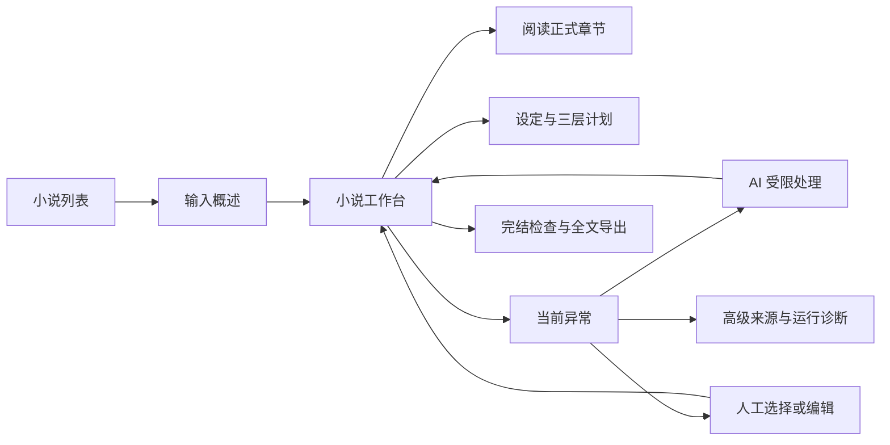

# XNovel 完整视觉重设计方案

版本：2.0 提案稿 · 日期：2026-10-17

业务依据：[PRD 1.5](docs/PRD.md)；实施与状态：[REFACTOR_TASKS 1.5](docs/development/REFACTOR_TASKS.md)。本文替代旧版视觉规范，定义目标界面，不代表页面已经实现或通过浏览器验证。PRD 决定业务行为，本文决定信息呈现、布局、视觉和交互；界面不得绕过业务门禁。

## 1 设计定位与现状依据

设计方向：**安静、清晰、以作品为中心的中文小说创作工作台。** 管理区精确紧凑，阅读区舒展；深灰与浅灰构成背景，单一靛蓝强调当前操作，正文与异常证据占据主要空间。用户应很快看懂“写到哪里、能读什么、是否需要我处理”。

保留 Filament 单体后台、现有 Heroicons、语义颜色和深浅主题，不引入第二套前端框架、组件库、字体服务或图片资产。视觉辨识度来自中文排版、连续章节目录和清楚的生成状态，不依赖营销大标题、封面墙、渐变、玻璃效果或动画装饰。

### 1.1 本次已核实的现状

以下来自静态源码检查；未登录浏览器检查部署页面，不能据此断言实际屏幕已经发生溢出、对比度不合格或性能问题。

| 入口 | 已确认事实 | 改造方向 |
| --- | --- | --- |
| `app/Providers/Filament/XPanelProvider.php` | 已注册专用主题、深浅模式、可折叠侧栏、全宽内容和靛蓝主色 | 复用主题入口，集中调整 token |
| `resources/css/filament/x/theme.css` | 已有 surface、边框、文字和动效基础变量 | 补齐两主题语义色、交互态、阅读和响应式规范 |
| `NovelForm.php` | 标题、题材、字数必填，概述可空；模型和 Budget Limits 展开 | 概述为主输入，技术配置折叠，统一中文与费用规则 |
| `NovelResource.php` | 注册 12 个小说局部导航页面，包含大纲、规划、分卷和故事线 | 合并用户入口，按三层规划组织 |
| `NovelOverview.php` | 准备度、状态、流水线、收束债务分多个区块展示 | 首屏突出当前任务、可读正文和需要处理的问题 |
| `planning-overview.blade.php` | 按分卷/故事线组织，空态引导人工维护，混有英文术语 | 显示全书方向、近期目标、本章计划及自动准备进展 |
| `read-only-chapter-content.blade.php` | 正式正文通过固定高度只读 textarea 展示 | 改为可选中、可搜索的正文阅读区，编辑单独进入 |
| 旧 `DESIGN.md` | 默认场景流水线、Volume/Arc 树和技术 Tab | 对齐三层规划、整章优先、独立审校和统一 Issue |

本次锁文件版本为 Laravel `v13.37.0`、Filament `v5.10.2`、Livewire `v4.4.7`，与 PRD 初次审计不同；历史证据保留时间语义，实施时再次核实安装与运行版本。本文不是框架 API 已验证可用的证明。

### 1.2 设计约束

- 一段概述即可启动，默认不要求逐页确认设定、计划和章节。
- 第一层使用中文业务语言；Run、Artifact、State Version 放入诊断层。
- 正式正文、草稿、自动处理中、等待人工、真正故障始终可区分。
- 费用增长不代替完成进度；默认模式不显示“预算耗尽”。
- 每个操作区仅一个首要动作；能自动继续时不制造人工“下一步”。
- 审校、统一正式提交、锁定事实、来源版本、暂停与恢复继续受业务门禁保护。

## 2 信息架构与导航

### 2.1 全局导航

保留六个一级职责，显示中文；不随数据库表数量增长。

| 显示名称 | 既有职责 | 默认内容 |
| --- | --- | --- |
| 总览 | Dashboard | 继续阅读/创作、需要处理、近期活动 |
| 小说 | Novels | 作品列表、创建入口 |
| 生成任务 | Generation | 跨小说整书任务；具体尝试放详情 |
| 异常与审校 | Review | 统一问题中心、待人工提交，分开筛选 |
| 记忆 | Memory | 高级查询和来源检查，普通生成无需进入 |
| 设置 | Settings | 模型、策略、费用、运行健康、诊断 |

红色计数只统计当前阻塞问题；待人工决策用警告色。自动恢复和历史失败不累加为待处理数量。同一 Issue 在多个入口引用，不复制问题或维护多套修复状态。

### 2.2 小说上下文与入口收敛

小说页持续显示作品名称、运行状态和当前章节。局部导航固定为：**工作台 / 正文 / 设定与计划 / 异常 / 更多**。“更多”收纳正式状态、记忆、生成记录、完结检查和小说设置；人物、世界、伏笔在设定内分类。

全局入口显示全部小说，局部入口自动带小说筛选；返回保留筛选与阅读位置。旧大纲、规划、分卷、故事线功能先迁入“设定与计划”再退役；分卷仅为可选目录分组，不出现默认必填空树。旧 Review 的正文问题与 Generation 的技术问题共用异常视图。



页面迁移不等于提前删除旧代码。XNR-031/032 核实注册、路由、测试及动态引用后清理；旧入口若保留跳转，必须落到新版同一数据源，不维持第二条写入链。

## 3 视觉基础与设计 token

### 3.1 主题与颜色

首次默认深色；可选择深色、浅色或跟随系统，显式选择持久保存。两主题信息结构相同，正文沿用当前页面 surface，不在深色工作台中嵌入刺眼白板。偏好只影响显示，不改变任务策略。

下表为目标值，实施时映射到现有 `--xn-*` 变量。Filament 主色、按钮、链接与自定义组件同步，不在 Resource 散落色值。背景和文字 token 成对使用。

| Token 角色 | 浅色 | 深色 | 用途 |
| --- | --- | --- | --- |
| canvas | `#F6F7F9` | `#0B0C0F` | 页面背景 |
| sidebar | `#F1F2F5` | `#0E0F13` | 侧栏 |
| surface-1 | `#FFFFFF` | `#111318` | 正文、主内容 |
| surface-2 | `#F8F9FB` | `#171920` | 工具栏、hover |
| surface-3 | `#EEF0F4` | `#1D2028` | 选中、代码区 |
| border | `#E1E3E8` | `#282B34` | 装饰分隔 |
| control-border | `#747B88` | `#858A96` | 需要边界辨认的控件 |
| text | `#17191F` | `#F2F3F5` | 主信息 |
| text-muted | `#4F5561` | `#B7BBC5` | 帮助、placeholder |
| primary | `#4F46E5` | `#A5B4FC` | 链接、当前项、主按钮底色 |
| primary-hover | `#4338CA` | `#C7D2FE` | 主按钮悬停 |
| primary-active | `#3730A3` | `#818CF8` | 主按钮按下 |
| on-primary | `#FFFFFF` | `#141820` | 主按钮文字 |
| primary-subtle | `#EEF2FF` | `#252744` | 当前导航浅底 |
| success-text / surface | `#166534 / #F0FDF4` | `#86EFAC / #122B20` | 正式保存、已解决 |
| info-text / surface | `#1E40AF / #EFF6FF` | `#93C5FD / #15263D` | 运行中 |
| warning-text / surface | `#92400E / #FFFBEB` | `#FCD34D / #322714` | 待选择、费用预警 |
| danger-text / surface | `#991B1B / #FEF2F2` | `#FCA5A5 / #351C22` | 阻塞、危险操作 |
| focus | `#4F46E5` | `#A5B4FC` | 2px 外环，offset 2px |

圆角：输入/按钮 6px，面板 8px，浮层 10px，状态标签 4px。间距采用 4/8/12/16/24/32/48px。静态面板无阴影，菜单/抽屉/对话框允许一层轻阴影。失败不整页染红，正式正文不整章染绿；Diff 增删同时显示文字/符号。

Neutral 使用 `text-muted` 配 `surface-3`。本次按相对亮度公式核算上述普通文字、主按钮三种状态与语义标签组合：浅色最低约 6.29:1，深色最低约 5.96:1；控件边界与列出的背景最低分别约 3.73:1、4.71:1。这只证明目标色值组合，不包含实际组件透明度、遮罩、焦点相邻色等渲染影响；完整页面仍由 XNR-035 验收。

### 3.2 字体与中文阅读

UI 字体顺序：`"PingFang SC", "Microsoft YaHei", "Noto Sans CJK SC", system-ui, sans-serif`。正文字体顺序：`"Noto Serif CJK SC", "Source Han Serif SC", "Songti SC", serif`，可切换 UI 无衬线。优先设备已有字体，不承诺已安装，不新增远程字体请求；缺字使用回退。

| 内容 | 字号 / 行高 / 字重 | 规则 |
| --- | --- | --- |
| 页面标题 | 24px / 1.35 / 600 | 手机 22px；长标题可换行 |
| 区块标题 | 16px / 1.5 / 600 | 与内容相隔 12px |
| 管理区正文 | 14px / 1.6 / 400 | 不为密度降低字号 |
| 字段与按钮 | 14px / 1.4 / 500 | 触控区域独立于字高 |
| 辅助信息 | 13px / 1.5 / 400 | 错误原因不能缩成脚注 |
| 技术元数据 | 12px / 1.5 / 400 | 仅 ID/hash 等；可复制 |
| 小说正文 | 18px / 1.9 / 400 | 可选 16/18/20/22px；行高 1.7/1.9/2.1 |
| 章节标题 | 24px / 1.5 / 600 | 与正文同一阅读列 |

正文最大宽默认 40em，约 40 个全角汉字，可选 32/40/48em；小屏占可用宽度减左右各 16px。段距 0.8em，常规叙述首行缩进 2em，标题和特殊文本不缩进；只改呈现，不修改存储和导出原文。保留换行，长 URL 可断行，不撑开页面。

中文标点不做夸张字距；数值用等宽数字、金额右对齐。代码用系统等宽回退。费用显示币种与实际/估计属性，微小金额可显示 `< USD 0.0001`，详情保留精度，不显示为“免费”。

### 3.3 图标与动效

沿用 Heroicons outline，导航 20px、操作 16px、空态最多 32px。图标按钮有可访问名称；不用 emoji 表示状态，不新增封面生成请求。

过渡 120–180ms，仅用于颜色、展开和浮层。无滚动视差、轮播、数字跳动或装饰循环。减少动态效果模式禁用非必要动画；等待仍以文字、更新时间和静态标识说明。

## 4 布局与响应式

### 4.1 页面骨架

桌面全局侧栏 240px，可折叠为 64px；顶栏最小 56px；内容 padding 24px、区块间距 24px。常规内容最大 1440px，创建页最大 760px，阅读页独立限制行宽。标题栏为上下文、标题/状态、动作；页面顶层首要按钮最多一个。

工作台约 2:1 两栏，主栏最小 560px，辅助栏 300–360px。空间不足改为单列。阅读与诊断采用专用布局，不强制使用统计卡片。

| 视口 CSS 宽度 | 导航 | 内容与浮层 |
| --- | --- | --- |
| ≥1440px | 完整侧栏 | 工作台两栏；阅读可显示目录；诊断可同屏侧栏 |
| 1024–1439px | 默认折叠，可展开 | 依内容宽度降为单列；诊断默认抽屉 |
| 768–1023px | 抽屉导航 | 单列；目录按需展开；工具栏可换行 |
| 320–767px | 顶栏菜单按钮 | 16px 边距；操作重排；抽屉全屏；列表摘要行 |

普通页面在 320px 宽度无全页横向滚动。必须二维展示的诊断表可局部滚动并提供详情；窄屏 Diff 改单栏。200% 字体缩放不裁掉内容；400% 浏览器缩放按实际 CSS 宽度重排。

桌面按钮最小高 36px，紧凑工具栏可 32px；小屏/粗指针触控目标至少 44×44px。粘性顶栏/底部操作必须预留空间，不挡焦点、错误和正文末行。避免短屏对话框内多层嵌套滚动。

### 4.2 四个关键页面线框

以下为布局示意，文字与数据是示例，不是运行截图；颜色采用第 3 节 token。

```text
创建小说（居中，≤760px）
  小说 / 创建
  描述你想写的故事
  背景、人物、冲突或结局，都可以直接写在这里。
  ┌──────────────────────────────────────┐
  │ 多行故事概述                          │
  │                                      │
  └──────────────────────────────────────┘
  目标篇幅：继承的可见值   模式：自动完成整本
  费用仅统计与预警 · 未启用金额硬上限
  ▸ 更多创作选项   ▸ 费用预警与可选硬上限
  [开始生成]  [保存草稿]

小说工作台（桌面）
  小说 / 雾城来信                  [阅读最新章] [暂停]
  雾城来信  正在生成 · 第 6 章
  工作台 | 正文 | 设定与计划 | 异常（0） | 更多
  ┌────────────────────────┬───────────────────┐
  │ 当前：第 6 章正在审校    │ 已正式完成 5 章    │
  │ 最近活动：21 秒前       │ 正文字数 15,420    │
  │ 下一步：合格后自动保存  │ 目标篇幅 可查看    │
  │ 规划 ✓ 写作 ✓ 审校 ●   │ 已记录费用 / 未知数│
  ├────────────────────────┼───────────────────┤
  │ 最新正式章节摘要与入口  │ 近期剧情目标      │
  │ 最近活动时间线          │ 全书方向入口      │
  └────────────────────────┴───────────────────┘

正文阅读（桌面）
  返回工作台   雾城来信                 [阅读设置] [导出]
  ┌─────────────┬─────────────────────────────────┐
  │ 章节搜索     │ 第 5 章 码头的回声              │
  │ 第 1 章      │ 正式正文 · 已审校 · 字数/保存时间 │
  │ …            │                                 │
  │ 第 5 章 当前 │      可选中、可复制的中文正文      │
  │ 第 6 章 草稿 │      最大约 40 个汉字/行          │
  └─────────────┴─────────────────────────────────┘
  上一章                    下一章 / 返回工作台

异常详情（桌面；手机按纵向顺序）
  异常 / 第 6 章人物知识冲突       待处理
  哪里出错 → 保留了什么 → 为什么自动处理停止
  ┌────────────────────────┬───────────────────┐
  │ 原文段落与证据           │ AI 处理            │
  │ 对应事实 / 用户要求      │ 建议、范围、费用说明│
  │ 已尝试步骤与结果         │ [按建议修复]       │
  │                         │ 人工处理            │
  │                         │ [修改段落并复验]   │
  │                         │ [其他可行方案]     │
  └────────────────────────┴───────────────────┘
  ▸ 技术详情：错误码、来源版本、执行记录、脱敏信息
```

## 5 全页面设计规格

### P01 总览与小说列表

总览首屏为“继续上次作品”，显示阅读位置与任务一句话状态；随后为需要处理的问题，最后是近期活动。无作品时只显示说明和“创建小说”，不展示空指标墙。运行健康异常时有提示，完整监控进入设置。

作品列表用摘要行，列为名称/题材、状态、正式章数/字数、最近活动、动作。默认最近活动排序，可筛选生成中、已暂停、待处理、已完结。处理数量基于当前 Issue，不把每次 Run 失败当成作品失败。主动作“打开工作台”，完结后可“阅读”；标题右侧“创建小说”。

无需封面也完整显示作品；长标题两行截断且可展开。筛选无结果与尚无作品分开。已有删除功能放更多菜单并说明范围，不与阅读并排。

### P02 创建与编辑小说

首屏仅要求“故事概述”，有 label、提示、字数限制反馈。示例“雨季中的旧港口，一位失忆的邮差收到寄自未来的信……”仅为 placeholder，不自动提交。按钮旁回显有效篇幅、模式和费用策略，来自统一配置，不由 UI 定义另一套默认值。

高级区分为“创作选项”“运行方式”“费用预警与可选硬上限”；有值则在摘要可见，不强迫展开。模式使用有解释的单选项：自动完成整本、先生成开篇（默认正式 3 章，可调整）、逐章审核。硬上限默认关闭，开启后才显示金额/币种/范围/后果；已开启的全局限制在摘要中持续可见，小说级不能静默覆盖。

反馈区分“正在保存”“已创建，等待开始”“预检需要处理”。失败保留输入，字段错误就地展示，顶部摘要可跳转。按钮防连点之外后端仍幂等。保存草稿不启动生成；只有服务端已保存内容才标“已保存”。

编辑已有小说时区分未来生效设置和当前任务冻结设置；改变在途来源先展示影响及恢复步骤，不静默重写正式章节。取消编辑不产生任务或费用。

### P03 小说工作台

首屏顺序：作品/状态、当前工作、需要处理的异常、最新可读章节。无异常不留空告警容器。主栏为当前章、正文入口、活动；辅助栏为正式章数/字数、目标、费用、近期方向。

全书显示“准备 → 创作 → 收束 → 完结检查 → 导出”，本章显示“规划 → 写作 → 提取与校验 → 审校 → 正式保存 → 摘要”。这是显示分组，不合并后端阶段；拆分进度折在写作详情，修复回到对应环节。

每阶段显示最后有效进展、耗时、下一步；排队与模型执行分开。字数可对照目标，但不得换算为整本完成百分比。总量确定的导出可显示准确计数。时间线首屏最多 5 条，更多进入记录。

| 情况 | 核心文案 | 动作与行为 |
| --- | --- | --- |
| 无正式章、准备中 | 正在建立设定，完成后自动开始第 1 章 | 可暂停，不要求采用设定 |
| 正常创作、有正文 | 第 N 章正在写作/审校，下一步具体描述 | 阅读最新章；暂停为次要 |
| 暂停请求已接收 | 正在暂停，已发请求可能返回草稿 | 不假称已立即停止，不开放第二主任务 |
| 已暂停 | 已保留至具体阶段 | 继续生成 |
| 逐章审核 | 本章通过审校，等待你的提交 | 查看并提交，不显示错误 |
| 自动恢复 | 正在第 N 次处理，展示下次尝试时间 | 查看进展，不要求逐次批准 |
| 需要人工 | 一句话原因和推荐选择 | 处理异常，既有正文仍可读 |
| 开篇目标完成 | 已完成开篇目标，等待选择 | 继续整本；调整方向为次要 |
| 正文完成、导出中/失败 | 正文已完成，导出进行中/待恢复 | 重试导出，不重写正文 |
| 已完成 | 完结检查和导出均完成 | 阅读全书 / 下载 |

费用摘要显示实际/估计的已记录费用、待确认请求数和统计时间；未统一币种分别展示。硬上限关闭时不显示剩余额度进度环。费用预警不替换当前生成主状态。

### P04 正文目录、阅读、版本与导出

桌面目录宽 240px，正文在剩余空间居中；窄屏目录为抽屉。长目录分页/按范围加载，支持章号/标题搜索；一次只加载当前章，不把千章正文一次传给浏览器。阅读位置按小说/章节/版本保存。

默认正式版本；无正式稿时可明确进入“草稿预览”，持续标“尚未正式采用”。新草稿不自动替换正在阅读的正文。阅读设置含字号、行高、行宽、衬线/无衬线；专注模式收起导航但保留退出、版本与目录入口。

“版本与审校”按需打开版本列表、Diff、证据和结论；宽屏双栏、窄屏单栏。证据来源过期时说明无法准确定位当前段落，可查看历史原文，不误指当前文本。正常阅读不默认满屏标红或展示 JSON。

人工编辑明确开启，显示来源、范围和保存状态；“保存新稿并复验”创建新版本，不能命名为“直接修复正式正文”。版本冲突或请求失败保留修改。未保存离开提醒只用于编辑，不阻碍只读导航。

导出展示范围（全部正式章/当前已完成部分）、TXT、章数/字数和版本清单时间；实际计数进度、成功下载、失败原因与重试完整。关闭浏览器不丢后台任务，文件缺失重新导出，不发生成请求；未完结导出标“未完结”。

### P05 设定与三层计划

页签为“故事设定 / 全书蓝图 / 近期目标 / 当前章计划”；人物、世界、伏笔在设定中分类。默认只读，“你的要求”“系统补充”“已锁定”有来源标签，不要求手工填全。

蓝图为主线、人物发展、承诺、重要转折和结局的分区文本；近期目标按先后列目标、关联承诺、预计章节范围、兑现状态；当前计划展示本章作用、视角、必须发生/不能发生、事实约束和衔接。远期未细化写“到达前自动细化”，不显示为错误或待填表。

桌面为左侧层级选择、中间内容和按需证据抽屉；窄屏单列。可选分卷只在使用时显示，不默认展示 Arc/Beat/Scene CRUD。

“调整未来方向”先填写意图，再显示差异、受影响未正式章节和需要重建的当前计划；无关远期变更不得提示整书重写。改变硬要求或锁定事实须明确授权与原因，AI 不得自行解除。

### P06 异常中心与双处理路径

默认“待你处理”，可切“自动处理中”“全部未解决”“已解决”。条目显示小说/章、中文原因、严重性、阶段、最近尝试和推荐动作，同一问题多次尝试折叠。逐章审核待提交单独筛选，不计入故障数。

详情顺序：问题与后果 → 已保存内容 → 原文/事实/服务证据 → 已尝试结果 → 推荐方案 → 其他选择 → 技术详情。错误码可复制；原始响应/堆栈折叠脱敏。刷新/重登录仍可见，toast 不是唯一记录。

AI 与人工两条路径同时可发现。AI 建议说明修改范围、复用内容、是否收费、次数上限、复验和恢复阶段；仅允许白名单动作。已有自动恢复在进行时不提供重复启动按钮。AI 不可用说明原因，人工路径仍可达。

人工默认给最多三个相关选择，更多折叠；每项明确字段/段落/设置、后果、失效范围、恢复方式和是否调用模型，不能只有泛化“处理”“重试”。

| 问题 | AI 路径 | 人工路径与建议 |
| --- | --- | --- |
| 要求矛盾 | 整理冲突与可行选项，不擅选硬要求 | 展示冲突原句，选择保留哪项或编辑说明；新意图保存后继续 |
| 锁定事实冲突 | 依原事实修复正文 | 高亮段落，编辑新稿并复验；改变事实走专用授权，不能跳审 |
| 局部修复耗尽 | 仅在允许范围建议不同策略 | 展示段落、约束和尝试历史；编辑新稿或改受影响计划，说明下游重验 |
| 429/临时故障 | 有限退避并显示下一尝试时间 | 等待或选择已配置模型；切换说明新尝试与冻结合同影响 |
| 凭据/连接不可用 | 解释检测结果，不能改秘密或充值 | 定位连接配置，检查权限/账户状态，恢复后重新检测 |
| 主动开启的硬上限触发 | 解释费用，不自行提高限额 | 提高/关闭对应上限或保持暂停，展示仍生效的其他限制 |
| 价格缺失、未开上限 | 费用未知但继续，不变成阻塞修复 | 补价格；说明默认生成无需等待 |
| Worker/数据库故障 | 展示可验证诊断，不假装改文可解决 | 定位运行健康与运维步骤，说明待恢复服务与验证方法 |
| 来源变化 | 比较版本，过期响应不直接采用 | 保留编辑，展示差异，基于最新来源创建新稿 |
| 导出失败 | 仅重试导出 | 给出存储空间/权限等实际证据，修复后重导，不重写 |

发起动作只显示“已受理/处理中”，复验成功才显示“已解决”，随后说明继续哪一步。处理失败保留输入和证据。模型文本按不可信内容渲染，禁止执行 HTML/脚本或从前端提交任意系统命令。

### P07 生成任务与活动

一行一个整书任务，显示作品、模式、当前阶段、正式章数、最近活动和暂停/处理入口；Run 尝试放详情。整书暂停与具体 Run 租约异常不能统称超时。

详情按时间线给阶段、耗时、模型、费用与来源链。成功交接不显示失败；排队、供应商等待、修复、人工等待分别命名。全局紧急停止放二级危险菜单，说明影响所有活跃任务与在途请求，不与单小说暂停混淆。

### P08 正式状态、记忆、审校与高级诊断

专业工具保留，但不是创作必经步骤；默认列表和结构化详情，不新增节点画布或图数据库。

| 工具 | 默认信息 | 深入操作与边界 |
| --- | --- | --- |
| 正式状态 | 版本、来源章；人物/关系/地点/物品/时间线/事实分类 | 差异与来源；只读；修正和最近章回滚走受控动作并填原因 |
| 记忆 | 小说过滤、内容、有效性、来源章/事件 | 入选/排除原因、相似度、重要性、token、Embedding 状态；排除失效/草稿 |
| 审校 | 决定、发现、证据、是否阻塞、下一步 | 规则/模型结论分开；合同有分数才显示，硬冲突不能被总分抵消 |
| 上下文 | 来源、容量、保留/裁剪区块 | 输入身份可查；原始 JSON 折叠，不隐藏硬约束被裁剪的问题 |
| Run/Artifact | 状态、来源版本、请求和费用关联 | 历史不可变；脱敏原文按需加载 |
| 完结检查 | 主线、人物发展、承诺、伏笔的完成清单 | 关键未闭合项定位证据，不提供一键忽略全部问题 |

证据抽屉含对象、小说、章/版本、摘录与完整上下文入口；宽 480–640px。复杂 Diff/JSON/编辑切全页，避免抽屉套抽屉；返回恢复选择和位置。

### P09 设置、模型连接、价格与健康

设置分“模型与连接 / 生成策略 / 费用 / 运行健康 / 高级诊断”。连接、价格管理归入对应区域，不占新一级导航；调试工具不出现在作品首屏。

每区展示生效值、来源、作用范围、未保存差异、生效时机；具体 Run 展示冻结值。保存反馈说明影响未来请求还是需要新尝试，不能把保存成功视为在途调用已改参数。

费用分四部分：统计始终开启；预警不暂停；金额硬上限默认关闭；次数/时间/无进展保护独立。主动开启上限说明“可能在小说完成前暂停”，确认只属于该动作，不成为默认生成步骤。

连接页不回显完整秘密；测试给模型、耗时和结果，可能收费则按钮旁明确说明并记录 Usage，不因称为测试而绕开用户启用的限制。

健康逐项显示 PostgreSQL、Redis、Worker、Scheduler、Provider、补偿积压的状态与观测时间；未检测、检测中、正常、异常、过期分别展示。无观测不得显示正常，失败保留最后成功记录及时间。

### P10 登录、账户与系统页面

登录沿用主题、XNovel 文字标识、单列表单；不新增注册营销或团队流程。账户菜单沿用管理员入口和安全校验，错误就地呈现，不增角色。

会话过期引导重登，未确认保存的编辑不能假称已保存；403 说明权限；404 返回小说列表；500 给重载及脱敏错误标识。网络失败保留可读数据并标可能过期，不能伪装“暂无小说”。维护/全局停止用常驻条说明范围。

## 6 共用组件与交互合同

### 6.1 组件目录

以下为职责名称，不要求创建同名 PHP/Blade 类。优先组合 Filament 现有能力，必要且重复的部分才封装。

| 组件职责 | 必备内容与状态 | 使用位置 |
| --- | --- | --- |
| 页面/作品标题栏 | 上下文、标题、状态、主次动作、长标题重排 | 全站 |
| 状态标签 | 中文名、图标/文字、可访问说明 | 作品、任务、审校、问题 |
| 当前任务面板 | 阶段、活动、下一步、恢复位置、过期观测 | 总览、工作台、任务 |
| 阶段序列 | 完成/当前/待执行/受阻、必要分支 | 工作台、任务详情 |
| 问题摘要/详情 | 原因、保留内容、双路径、处理进展 | 工作台、异常、章节 |
| 费用摘要/限额开关 | 实际/估计/未知、币种、范围、开启状态 | 创建、工作台、设置 |
| 正文/目录 | 版本、排版、章节定位、按需加载 | 阅读、异常证据 |
| 来源/Diff | 版本、位置、增删、过期提示 | 审校、修复、状态、计划 |
| 表单/反馈 | label、帮助、错误、保存态、提交/取消 | 创建、设置、编辑 |
| 空/加载/失败 | 原因、保留数据、下一步 | 全站 |
| 风险确认 | 对象、范围、后果、原因、具体动作名 | 回滚、改硬要求、全局停止 |

### 6.2 状态词典

这是显示语义，不是新增数据库枚举；映射 XNR-002/004 真实合同，UI 不另建工作流状态机。

| 显示状态 | 色彩 | 必须说明 |
| --- | --- | --- |
| 未开始 / 排队中 | neutral | 原因或队列情况 |
| 正在生成 / 正在审校 | info | 当前章/阶段、最后活动 |
| 自动处理中 | info | 已尝试次数、下一步 |
| 暂停中 / 已暂停 | neutral | 在途情况、保存位置 |
| 等待提交 / 等待选择 | warning | 具体动作，不称故障 |
| 需要处理 | warning | 决策原因与方案 |
| 执行失败 / 硬冲突 | danger | 原因、证据、恢复 |
| 草稿 / 候选 | neutral | 尚未正式采用 |
| 正式保存 / 通过 / 已解决 | success | 当前来源确已验证成功 |
| 观测过期 / 状态待确认 | neutral | 最后确认时间，不猜仍在运行 |

### 6.3 操作、表格与浮层

Primary 实心、Secondary 中性边框/底色、低频动作用文字；Danger 以语义色与明确后果提示。禁用原因就地可读，不只靠悬停。加载保持按钮尺寸与动作可识别，不清空表单。

默认列表行高至少 48px，双行摘要 72px，诊断密集表可 40px；对象左对齐、数字右对齐。筛选、排序、分页有名称，可清除筛选。整行点击只查看，状态变更使用显式 Action；复制 ID 与查看分开。

只读详情用抽屉，短确认用模态，编辑/复杂差异用全页。打开后焦点进入标题或字段，关闭回触发者；Escape 关闭只读层，未保存编辑先保护输入。手机最多两个可见底部动作，其余进入有名称菜单。

### 6.4 通用反馈

| 状态 | 展示规则 |
| --- | --- |
| 初次为空 | 说明缺什么、为什么、唯一推荐动作 |
| 筛选无结果 | 保留筛选并可清除，不引导重复建书 |
| 首次加载 | 布局一致的静态骨架与说明，避免跳动 |
| 局部刷新 | 保留正文、输入、焦点、选区和滚动位置 |
| 加载失败 | 已知数据、观测时间、原因、重试，不伪装空数据 |
| 动作受理 | 已受理，后续以持久 Task/Issue 为准 |
| 校验失败 | 错误摘要与字段提示，保留输入，可定位首错 |
| 版本冲突 | 禁止覆盖，保留编辑，显示最新版本与选择 |
| 无可执行动作 | 说明依赖和解除条件，不显示假按钮 |
| 操作成功 | 短反馈并更新持久状态，刷新可核实 |

状态刷新不抢焦点、不重置选区或让正文跳动。候选频率为活跃任务约 5 秒、空闲约 30 秒、后台标签停止非必要刷新，实施时结合现有机制实测并集中配置。刷新失败不暂停后台任务；连续失败展示观测失效，不无限空转。

## 7 进度、费用和异常文案

用户层用正式正文、草稿、本章计划、已记录费用、待确认费用、自动处理中、需要你选择。少用 Bible、Admission、Canonical、Artifact、Deferred；高级诊断保留准确技术名。

| 场景 | 推荐文案 | 不允许表达 |
| --- | --- | --- |
| 默认费用 | 以完成小说为目标，费用仅统计与预警；未启用金额硬上限 | 先充值预算才能生成 |
| 达到预警 | 已达费用预警，生成继续，可查看明细 | 必须追加额度 |
| 未知费用 | 有 1 次请求费用待确认，已记录费用不含该项 | 本次免费 / 总费用 0 |
| 硬上限触发 | 你启用的上限已触发，内容已保留；可调整或保持暂停 | 自动提高上限 |
| 无活动证据 | 最近确认于具体时间，目前尚未确认任务活动 | 无依据地一直显示正在生成 |
| 修复完成 | 新稿复验通过，继续第 N 章的具体阶段 | 发起修复即显示已解决 |
| 供应商余额不足 | 模型服务账户余额不足，处理后重新检测 | 将供应商余额称为应用预警 |

时间以配置时区显示，相对时间可查看绝对值，诊断明确时区。所有设计夹具的小说、费用、进度标示例，不混入真实统计。

## 8 可访问性与浏览器要求

目标：普通文字至少 4.5:1、大字至少 3:1；关键非文本控件边界与焦点按至少 3:1 检查，装饰 hairline 不作唯一控件边界。正文、placeholder、错误、禁用原因、链接、按钮 hover/active 和两主题逐对测量，token 不等于最终渲染已合格。[W3C 对比度说明](https://www.w3.org/WAI/WCAG22/Understanding/contrast-minimum.html)

320 CSS px 重排，必要二维表使用局部滚动与详情替代，不产生可避免的全页横滚。[W3C 重排说明](https://www.w3.org/WAI/WCAG22/Understanding/reflow.html)

键盘可完成创建、阅读、切章、暂停/继续、异常选择、人工处理和下载。提供跳到主内容；标题/区域/表格有语义；字段 label 与错误关联。图标和 tooltip 不替代名称。动态状态简短播报，不每次轮询朗读整页。

浏览器验收使用实际安装的 Chromium 桌面和 WebKit/Safari，记录版本；Firefox 可用时补充。模拟视口不冒充真机测试。未完成必需路径明确记缺口，PHP 测试不替代浏览器证据。

## 9 实施映射与边界

复用 Filament theme 与现有 Page/Resource/Action。项目已有 `viteTheme` 注册，官方提供自定义主题方式；具体 API/选择器实施时按安装版本核实，不改 vendor，不把 `public/css/filament` 构建文件当源码。[Filament 5 样式文档](https://filamentphp.com/docs/5.x/styling/overview)

| 设计范围 | 现有入口 | 责任任务 |
| --- | --- | --- |
| token、排版、布局、共用反馈、显示偏好 | `resources/css/filament/x/theme.css`、`XPanelProvider.php`、`resources/views/filament/components/` | XNR-034 |
| 总览、列表、工作台、阅读/差异/导出、账户/系统页一致性 | `Dashboard.php`、`NovelsTable.php`、`NovelOverview.php`、小说 Pages、正文/Diff Blade | XNR-024 |
| 创建/编辑、模式与费用摘要 | `NovelForm.php`、`CreateNovel.php`、`EditNovel.php` | XNR-010 |
| 三层规划与资产页 | `ManageNovelOutline.php`、`ViewNovelPlanning.php`、设定/人物/世界/伏笔 Pages | XNR-013；本章计划绑定 XNR-014 |
| 问题中心与双处理路径 | `Generation.php`、`Review.php`、修复 Action/UI | XNR-009、XNR-019 |
| 状态/记忆/完结工具 | `ViewNovelStoryState.php`、`Memory.php`、`ViewNovelEndingAudit.php` | XNR-020、XNR-022、XNR-023 |
| 费用与模型配置 | `Settings.php`、连接/价格 Resources | XNR-006 定合同，XNR-025 完成页面 |
| 生成任务、健康、诊断 | `Generation.php`、`Settings.php`、`AiDebugTest.php`、`SystemHealthService.php` | XNR-025，与 XNR-009 共用问题入口 |
| 全页主题/状态/响应式/交互验收 | `tests/Feature/Filament/`、浏览器与构建 | XNR-035；XNR-026 整合 |
| 真实作品与清理后页面 | 新小说与最终代码 | XNR-028、XNR-033 |

数据来自统一 Task/Run/Issue/Usage/Canonical 查询；浏览器只保存主题、目录、阅读偏好等显示选择，不承担任务真相。文字/颜色集中映射，不复制多套判断。状态刷新不查询全部正文/记忆；读取当前章、有限活动和按需详情，实测查询次数与长篇响应。

新增/修改代码按 tasks 增加中文注释；如需数据库存储偏好，先判断现有存储是否足够，结构变更增加中文表/字段备注，不为每种 UI 状态建表。

## 10 交付与验收矩阵

### 10.1 分阶段交付

1. XNR-034 在 R01 实施视觉基础与共用组件，提供隔离环境的组件及四个关键页静态状态预览；示例标注，无真实模型请求，预览不算业务完成。
2. XNR-009/010/013/014/019/020/022/023/024/025 接入真实合同并覆盖正常/错误状态，不能只交正常截图。
3. XNR-035 在 R05 汇总全页验收，修复样式/布局/交互缺口；业务缺陷返回责任任务，不用 UI 掩盖。
4. XNR-026 全链整合通过后进入 R06；XNR-028 用新小说验证状态与结果一致；XNR-033 在清理后的代码重验核心路径和受影响页面。

### 10.2 页面与状态矩阵

| 页面/组件 | 至少验收状态 | 必留证据 |
| --- | --- | --- |
| 创建/编辑 | 默认、展开、全局上限、字段错误、请求失败、重复提交 | 表单/反馈截图、幂等结果 |
| 总览/列表 | 无作品、多作品、长标题、筛选无结果、加载失败 | 首屏与移动重排 |
| 工作台/任务 | 准备、运行、排队、修复、暂停中/已暂停、待审核/人工、观测过期、导出失败/完成 | 截图与持久记录对照 |
| 阅读/Diff/导出 | 正式、仅草稿、混合版本、长章、千章目录、过期证据、导出各状态 | 正文、差异、导出文件 |
| 设定/计划 | 准备、已有窗口且远期未细化、有/无分卷、锁定要求、修订冲突 | 三层结构、影响预览 |
| 异常/审校 | AI 处理中/失败/成功/不可用、人工编辑、版本冲突、硬事实/服务故障 | AI 与人工各一条恢复记录 |
| 设置/诊断 | 继承/覆盖/冻结、未知费用、预警、上限开/关、健康未测/过期/失败 | 配置影响、脱敏、真实状态 |
| 账户/系统页 | 登录错误、会话过期、无权限、不存在、技术失败 | 反馈与返回路径 |

所有 P01–P10 在 1440×900 与 390×844、深/浅主题留基线截图；关键四页补 1024×768、768×1024、320×800。附加 200% 字体缩放、400% 页面缩放与减少动态效果检查。截图不替代操作验证，证据存实际任务报告引用位置；本次不伪造运行截图。

### 10.3 必过标准

- A35：统一视觉、两主题、导航与层级覆盖所有页面，旧技术层级不阻碍普通生成。
- A36：仅概述即可启动，目标/模式/费用可见，默认无金额必填或额外逐章确认。
- A37：进展、暂停/恢复真实；当前问题与历史失败分离；双处理路径清晰且有来源。
- A38：中文阅读、目录、版本、人工新稿和导出完整；长篇不一次加载全部正文。
- A39：响应式、键盘、对比度、焦点、缩放、减少动态效果及空/加载/失败/禁用状态通过。
- A40：诊断与创作分层，费用/配置来源和生效时机准确，未观测健康不冒充正常，秘密不泄露。

报告记录代码、页面/状态、主题、视口、浏览器版本、截图路径、操作步骤、预期/实际、问题与复验。未测项明确列出，不能宣布通过。不新增镜像 CSS 数值的测试；业务动作由自动测试验证，视觉由浏览器验收，构建证明资产可生成，三者不能互相替代。


## 11 R01 实施状态

XNR-034 已实现共用主题/组件与隔离四页静态预览，实际浏览器截图与测量见 [视觉基础报告](docs/development/reports/XNR-034-visual-foundation.md)。任务尚未标记完成：原生浏览器控制超时后，真实页面/字体缩放、减少动态效果和部分焦点测量仍需补验。预览不是新业务页面，XNR-035 的全页与双引擎验收仍未开始。现有运行小说数据未被用于截图。


## 12 R02 异常中心接入状态

P06 已接入统一 Issue 列表、证据与处理进展、只读 AI 建议、人工说明、来源 CAS 失败保留输入、脱敏下载及小说/章节入口。隔离浏览器完成双路径操作、两主题和 8 组宽度检查，见 [R02 报告](docs/development/reports/R02-implementation.md)。正文/计划/证据领域编辑器等待 XNR-019 等任务接入，不展示假执行按钮。XNR-034 未完成的真实缩放与减少动态效果仍须补验，XNR-009 与全页 XNR-035 不据当前截图宣布全量通过。


## 13 R03 概述入口接入状态

P02 已接入单段概述、字数提示、折叠创作选项、三种模式、当前目标/费用摘要、可选硬上限、保存草稿及底部提交区。编辑需确认影响；工作台从持久 Task/Run 读取状态并展示原文和设定候选来源，不显示虚构生成进度。明确矛盾使用集中选择表单；异常中心复用现有预览/执行布局，新增受限设定字段修复入口。

隔离 Chromium 已操作概述创建、候选展示、修改概述、继续及异常重试；深浅主题的 320/390/768/1440 视口均无横向溢出，390×844 提交按钮可见，键盘焦点可辨。截图及测量见 [R03 报告](docs/development/reports/R03-implementation.md)。最后新增的 AI 字段修复动作由 Livewire/领域测试验证，尚未补独立浏览器执行证据。真实 200%/400% 缩放、OS 减少动态效果和全页双引擎验收未完成；XNR-034/009 依赖与 XNR-035 全量验收不据此关闭。
