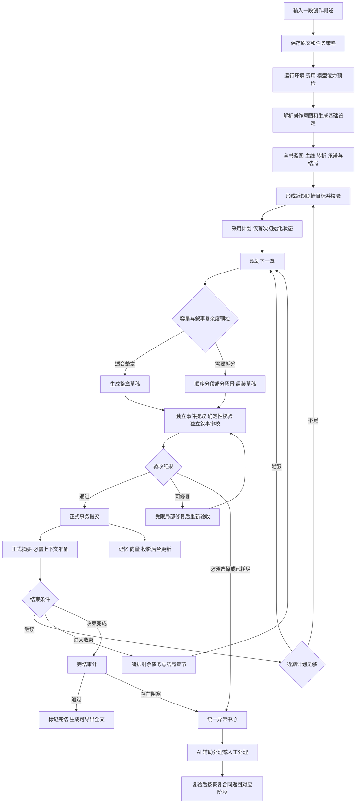
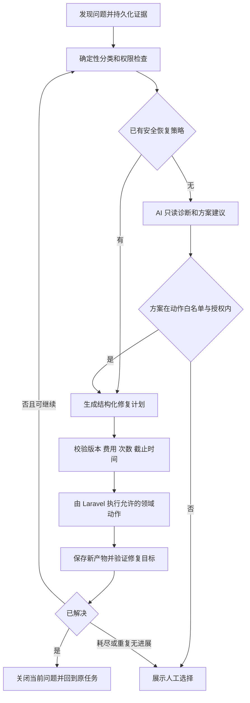
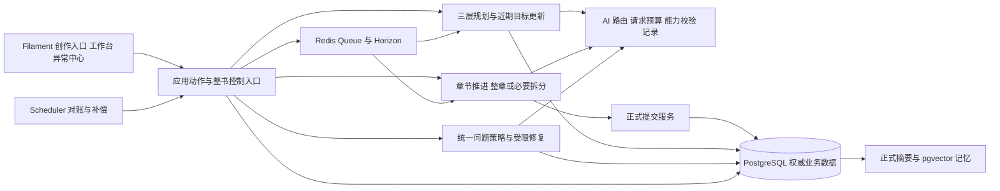

# XNovel 小说自动生成系统改造 PRD

版本：1.5 提案稿

日期：2026-10-17

代码基线：`3efe867`，本次检查开始时工作区无已跟踪文件变更。

适用范围：XNovel 全项目优化，包括产品流程、领域模型、生成架构、Prompt 与校验合同、配置、后台界面、异常处理、测试和运维。

实施状态：本文定义目标方案；R00–R04 已按任务批次实施，实际范围与未闭环验收见 REFACTOR_TASKS.md 及各批报告。R04 已接通概述到独立审校和局部修复，正式提交、摘要、续章、完结与真实作品验收尚待 R05/R06；不能据此宣称已实现完整小说生成。

用户已明确的改造边界：现有小说数据和日志仅用于提取问题与经验，不要求保留、迁移或续跑现有小说。完整优化后，新建小说，从一段概述开始执行全流程验收。本版据此取消旧小说兼容迁移方案。

本版费用策略：默认以完成小说为目标，费用用于统计、预警和优化；金额硬上限默认关闭，仅由用户主动开启。未设置金额或达到预警值不阻断正常生成，有限重试与无进展检测继续保留。

本版界面方案：[完整视觉重设计方案](../DESIGN.md) 2.0 定义全站导航、两主题 token、中文阅读、逐页布局与交互、异常双路径、响应式和浏览器验收；不更换 Filament 技术栈。页面按批次落地，当前视觉证据与待验收项目见 DESIGN.md 的实施状态章节。

既定架构：采用“全书蓝图 → 近期剧情目标 → 当前章节计划”三层规划；容量允许时优先整章写作，必要时顺序拆分；整书任务、执行 Run、异常 Issue 分离；先消除可预防的失败，再做有限修复。以上是待实施方案，质量、费用和速度是否改善必须通过新建小说评测验证。

## 1 产品目标与改造结论

用户输入一段文字，说明小说背景、类型、主要人物、剧情方向或希望获得的阅读体验，点击“开始生成”，系统按用户确定的创作目标与篇幅，自动完成设定、大纲、章节写作、审校、必要修复、正式入库、记忆更新、收束和全文导出。

正常流程不要求用户理解 Bible、Beat、Handoff、Admission、Artifact、State Patch 等内部术语，也不要求用户逐个创建人物、激活分卷、采用大纲、提交章节。用户可以查看和调整创作方向，但这些操作不应成为每本书的必经步骤。

异常情况下，系统必须说明“哪里出了问题、已经保留什么、正在尝试什么、何时需要用户、可选操作分别有什么后果”。可恢复的问题在有限次数与时间内自动处理，仅在用户开启金额硬上限时额外检查金额；必须由人决定的问题集中展示，并提供 AI 辅助处理与人工处理两条路径。

改造的核心是：**以一次创作任务贯穿全书；全书方向稳定、近期计划详细；由确定性程序管理状态与恢复；AI 只负责创作、判断和受约束的修复。** 保留正式提交与数据一致性的业务保障，全面审查并重构不合理实现，不以旧数据、旧合同或原有类的结构限制最终方案。

### 1.1 对现状的判断

已确认：项目具备相当完整的生成、审校、恢复与正式提交基础，但入口和默认运行方式仍要求用户理解内部流程；运行记录混合了真正失败、修复中的中间失败和正常断点交接；当前数据存在重复校验失败和修复超时。

不能确认：旧 skill 或已删除的 PRD 是故障的根本原因。本次没有恢复或审查被删除文档的历史内容，也没有将单次异常追溯到某次开发指令。现有源码中的 Prompt、Schema、预算、校验规则、版本合同和运行配置仍然存在，删除开发文档不会同步改变这些行为。

当前也不能表述为“系统完全无法生成”：现存小说已有五章正式提交，第六章最新 Review 为 PASS。但这并不证明系统已具备可靠的无人值守生成能力。

### 1.2 保留与不做

保留 Laravel、Filament、PostgreSQL、pgvector、Redis、Horizon、Queue，继续采用单用户单体架构。保留 Draft 与 Canonical 隔离、Story Event、状态版本、不可变产物、Review Gate、事务提交、幂等、暂停恢复、长期记忆和结局控制这些业务能力；对应表结构、类、接口和实现可以为新方案重构。

不引入多租户、团队审批、微服务、外部工作流引擎或多个自主 Agent 互相对话。第一阶段不做网站发布、外部平台自动投稿、任意历史分支合并；导出与发布是不同操作，生成结束不自动对外发布。

### 1.3 全项目优化和数据边界

本轮目标不是在旧流程上继续追加补丁，而是形成一套从概述到完结的统一实现。所有与主流程有关的模块都纳入审查；可以重写生成和恢复逻辑、合并重复服务、调整领域模型与数据库结构、重建初始化方案、重做交互入口，并删除仅用于旧合同的代码。复用以满足新需求和降低维护成本为依据，不以保留原文件数量为目标。

明确区分两类“历史”：

- 改造前的小说、Run、Artifact、Review、状态、记忆和队列任务：只作诊断样本，不需要导入新系统或提供兼容恢复入口。
- 改造后新建小说产生的版本、尝试、审校、费用和正式故事历史：仍必须完整追踪、幂等恢复、不可静默覆盖。这是产品可靠性要求，不能因为从头测试而省略。

现有数据不承担保留要求，但在清理前要提取有用的脱敏失败样本、配置条件、错误分类及回归用例。用户账号、Provider 凭据、模型路由、价格和部署配置属于运行配置，不等同于小说业务数据；应明确保留或重新初始化，不因清理小说而误删。

实施期间逐批进行单元、集成和故障注入测试；全项目功能与新合同整合完成后，再在干净的业务环境中新建小说，运行真实模型端到端验收。不得用旧小说续写成功或旧 Artifact 被复用代替新版从零生成能力。

## 2 现状证据与问题清单

### 2.1 核查范围

初次审计时 `composer.lock` 版本：Laravel `v13.30.1`、Filament `v5.7.8`、Horizon `v5.48.3`、Livewire `v4.4.3`。这是历史锁定依赖记录，不代表当前生产部署版本。视觉方案修订时锁文件已变为 Laravel `v13.37.0`、Filament `v5.10.2`、Livewire `v4.4.7`；实施前仍须重新核实实际安装及运行版本。

核查了创建入口、大纲流水线、章节阶段图、推进器、AI 修复入口、失败分类、预算、配置解析、正式提交、提交后任务、相关测试源码，并对当前配置连接的数据库执行只读查询。数据库样本观察时间约为北京时间 2026-10-17 15:46 至 15:50；查询不是同一事务快照。没有执行真实模型调用、浏览器端到端生成或生产修复。

首次检查时 `.agents` 不存在，`docs` 仅有系统元数据文件，根目录 `AGENTS.md`、`DESIGN.md` 当时仍存在。随后 `AGENTS.md` 也已删除；这是当前文档状态，不要求恢复。删除文档不会移除代码中已有的 Prompt、Schema 和校验规则。

### 2.2 当前数据库样本

| 项目 | 观察结果 | 可以得出的结论 |
| --- | --- | --- |
| 现存业务范围 | 1 本小说、6 章、325 条 Run、15 条 Review | 样本较小，只能用于定位当前问题，不能推算普遍故障率 |
| Run 状态 | succeeded 262，failed 63 | 这是执行记录分布，不是章节成功率 |
| Deferred | `scene_stage_deferred` 28，`generation_stage_deferred` 4 | 32 条失败记录表达断点交接，不能全部计为终态故障 |
| 小说 #2 | `generating`，`auto_generate=false`，`auto_commit=false` | 当前没有启用自动续章、自动提交 |
| 章节 | 第 1 至 5 章 canonical；第 6 章 review | 存在真实正式产物；第 6 章尚未正式提交 |
| 最新审校 | Review #24 / Run #622：PASS，84.05 分 | 审校通过与提交完成是两个状态；不能将停在此处直接认定为失败 |
| 大纲批次 | #298 为 v5 失败；#321 为 v6 成功 | 历史问题不能不加区分地归入当前版本 |
| 费用配置 | 全局日、小说、章节上限均为空；该小说无预算覆盖 | 当前未配置这些费用硬上限；局部修复仍有独立限制 |

### 2.3 已确认问题与优化方向

| 编号 | 问题与证据 | 影响 | 改造方向 |
| --- | --- | --- | --- |
| P01 | `NovelForm` 要求标题、题材、总字数和单章字数，故事前提反而可空；`CreateNovel` 默认关闭自动续章和自动提交 | 与“一段概述开始生成一本书”的核心目标不一致 | 概述必填，其他信息自动推导；默认整书自动模式 |
| P02 | `CreateNovel::mutateFormDataBeforeCreate()` 丢弃 `budget_limits`，未存入 `settings.budget`；`EditNovel` 有对应保存逻辑 | 创建页输入的预算不能按该路径持久化，用户可能误以为已生效；这是静态代码缺陷，尚未做 UI 复现 | 统一创建与编辑的预算解析，提交后回显实际生效值并做回归测试 |
| P03 | 当前大纲按 Foundation、Structure、全部 Arc Beats、Skeleton、全部 Main Beat Detail、Finalize 顺序完成，之后在页面采用 | 首章前必须等待全书细化，任一远期节点失败都会阻塞完整初始候选 | 初始采用只要求全书方向与近期可执行计划；远期节点延后细化 |
| P04 | Run #298：某卷目标约 144 章，Beat 合计仅 67 至 94 章；该批次属于旧 v5；现行 v6 已按 Arc 分配目标 | 证实过篇幅分配不一致，不能据此认定 v6 仍存在同一缺陷 | 复用确定性分配原则，在三层规划中统一已完成、剩余和目标总量，不保留无必要的旧层级 |
| P05 | Run #512、#514、#516 及修复 Run #513、#515 连续因 Review 总容量不足失败；总需求分别 48921、48582、48070 Token，合同上限 48000 | 已知容量矛盾消耗了重新规划与修复机会 | 容量问题走确定性容量调整，不作为普通创作失败反复重写 |
| P06 | Run #457/#458 审计数组不完整，#579 Handoff 汇总与逐项结论不一致；#616/#617 事件证据不符合逐字要求 | 创作之后仍易被重复、冗余的结构合同阻塞 | 服务端生成可计算字段；稳定条目 ID 与正文片段 ID；区分格式错误与故事缺陷 |
| P07 | Run #480/#500/#533/#543/#572 等出现内容修复超时；`ContentSelfHealingService` 从修复 Run 创建时累计时间，包含排队 | 时间上限真实生效，但无法仅由错误文本区分排队拥堵、模型慢或循环修复 | 分开记录排队时间、执行时间、总截止时间；跨修复器统一次数/时限与费用记录 |
| P08 | `RunStatus` 只有 queued/running/succeeded/failed/cancelled；Deferred 保存在 failed 中；推荐器已对部分成功续跑做抑制 | 数据层语义与用户当前状态不同；后续成功未必能通过单条 failed 解释 | 新增明确交接状态及完整来源关联，按当前问题汇总历史尝试 |
| P09 | AI 修复入口只覆盖特定场景重建、事件重提取、审校证据恢复；其他问题通过恢复中心、计划编辑、局部重写、配置页面等处理 | 已有修复能力，但入口和适用条件分散，用户仍需判断修哪一层 | 建立统一异常卡与动作白名单，页面只显示当前合法选项 |
| P10 | 部分失败分类依赖错误字符串；存在“检查输入并人工处理”等兜底建议；内容修复样本的 category 有空值 | 同类错误可能展示不同建议，未知错误缺少明确下一步 | 错误分类、失败字段、证据、动作及影响范围形成统一结构 |
| P11 | 大纲 Batch、章节阶段图、生命周期推进、自动续章及提交后补偿分别存在 | 局部能力完整，但没有由简述入口统一持有的整书任务合同 | 在现有推进器外补充薄的整书控制入口，复用领域动作，避免另写一套生成逻辑 |
| P12 | Run #461/#465 出现 Prompt 冻结版本不一致；大纲代码同时识别 v2 至 v6 多代合同 | 部署、恢复和新配置之间存在兼容负担；具体旧故障根因仍需逐条追踪 | 新系统只保留统一合同；移除改造前的兼容分支，新建任务仍冻结实际执行版本 |
| P13 | `prepareBatch()` 在计算完整输入 hash 前，可能按相同合同与分卷数直接复用 queued/running/succeeded 批次 | 用户修改概述等输入时，存在仍返回原冻结批次的静态风险；未完成交互复现 | “继续旧任务”与“根据新输入重建”分开，复用必须比较完整语义输入 |
| P14 | 删除文档后，两个 DocumentationTest 仍直接读取旧 PRD/Architecture 文件；健康检查仍检查旧发布手册路径 | 文档依赖悬空；测试和健康提示可能受到影响。本次未运行测试，不报告实际失败数量 | 清理失效引用，测试验证产品合同，恢复必要运维说明 |
| P15 | `phpunit.xml` 默认连接为 SQLite 内存库；`ChapterPlanPostgresJsonbChecksumTest` 在非 PostgreSQL 下跳过 | 默认测试通过不能证明 JSONB、部分唯一索引和 PostgreSQL 并发行为；不能由此推断历史从未做过 PostgreSQL 验证 | 将隔离 PostgreSQL 验证设为正式发布必经检查，单独报告跳过项 |

上述问题支持“默认流程不够自动、故障语义不统一、部分合同和恢复策略增加停顿”的判断。它们不支持“所有校验都应删除”或“完全重写系统即可解决”的结论。

### 2.4 已有能力和复用依据

`AdvanceChapterPipelineAction` 已集中章节下一阶段决策；`GenerationStageGraph` 已定义阶段与下游失效关系；`CanonicalCommitService` 已校验同一正文对应的 PASS Review、Event Candidate、State Patch 与状态版本，并在事务中提交；`CanonicalPostCommitDispatcher` 已将必需摘要与独立记忆、投影任务分开。

`GenerationRunLease`、`AutomaticGenerationRecoveryService`、`BudgetService`、`ContentSelfHealingService` 已提供租约、恢复、费用预留和修复限制；2026-10-15 的确定性增强迁移已添加租约字段、Artifact 来源标识及活动主线唯一约束。这些是可以复用的基础，不应被误报为缺失功能；但现有实现仍需按新合同逐项评估，允许整合、替换或删除重复逻辑。

### 2.5 历史约束的冲突和处置

下表中的 AGENTS 条目仅用于说明旧设计中的冲突，不是当前有效文件要求。改造按用户最新要求与本 PRD 执行，具体工程合同在实施时落实到架构文档和代码；恢复或新建 `AGENTS.md` 不属于本次改造的前置条件。

| 冲突位置 | 现有要求与行为 | 推荐处置 | 影响 |
| --- | --- | --- | --- |
| AGENTS 第 4 与第 112 节 | 前文禁止 Workspace architecture，后文要求 Novel Workspace，当前也存在小说工作区 | 明确禁止的是多租户工作空间，保留单本小说工作台 | 消除概念歧义，无需拆 UI |
| AGENTS 第 42/152 节 | 早期约 18 核心表基线仍在，但当前已增加关系化大纲、模型路由与配置等模型 | 改成当前数据清单与新增表论证要求 | 不按过时数量目标删表 |
| AGENTS 第 70 节与 `AIProviderConnection` | 文档不允许完整 API Key 入库，代码使用数据库加密保存且隐藏字段 | 用户已选择 A：密钥仅存 .env，经 config 白名单解析；数据库只存 credential_ref 和连接元数据 | 2026-10-17 已确认；不自动迁移或解密现存凭据，新版初始化不写密钥 |
| AGENTS 第 170 节与低干预目标 | Needs Attention/Hard Conflict 要停止自动链；新目标要求 AI 处理异常 | 保留停止提交门禁；另开受限修复操作，只修 Draft，复验通过才恢复原链 | 自动修复不等于带冲突继续提交 |
| 现有大纲全量验收与滚动细化 | 当前 Finalize 要求所有 Main Beat Detail | 以统一新合同和局部准备度替换旧版规则，不保留旧小说恢复要求 | 必须同步修改 Validator、采用边界、快照和恢复逻辑，不能仅删校验 |
| AGENTS 第 52/54 节的规划层级与默认逐场景生成 | 旧规范要求 Novel/Volume/Arc/Chapter/Scene 层级及逐场景写作 | 按本次用户接受的建议，改为三层规划、容量允许时整章生成、必要时顺序拆分 | 实施前同步更新开发约束、Writer 和阶段合同；场景不再是每章必须独立执行的阶段，正式门禁不变 |
| AGENTS 的有数据迁移限制与本次新边界 | 旧规范针对已有正式小说要求谨慎迁移；用户现已明确不考虑这些小说的保留 | 旧小说只作样本，新系统使用干净业务数据；同步更新过时实施约束 | 不建设旧数据迁移、旧合同读取或双轨兼容工程；新系统内部可靠性仍保留 |
| 已删除 skill 的引用 | 历史 AGENTS 曾指向 `.agents/skills/filament-ui/SKILL.md`，两者现均已删除 | 移除仍存于代码或其他文档中的失效依赖；不要求恢复旧 AGENTS 或 skill | 缺失的历史文件不作为实施阻塞条件 |

上述处置中的“更新约束”指将新决策落实到本 PRD、架构说明和实现合同，不指修改已经删除的 `AGENTS.md`。旧文件中的强制层级、场景默认和旧数据兼容要求，不应作为新方案的实现依据。

## 3 用户体验和功能边界

### 3.1 默认使用路径

首次系统部署时，由操作者配置模型连接、任务路由和模型能力；费用统计默认启用，预警与金额硬上限分别配置，硬上限默认关闭。此后创建每本小说只需输入概述。

创建页显示一个主要输入框和“开始生成”按钮。高级选项折叠：目标篇幅、单章长度、题材、结局偏好、文风、必须保留内容、禁止内容、费用预警、可选费用硬上限及运行模式。未填写时采用可见默认值，不让用户逐个选择技术阶段。

建议默认总篇幅 10 万字、单章约 3000 字，用于较快获得一本可完结作品；保留百万字目标与长篇验证要求。该数值是新产品默认值提案。概述中明确写了篇幅时优先采用，表单显式覆盖再优先；发生直接矛盾时展示差异并请求一次选择。

开始按钮附近展示目标长度、运行模式和费用策略，默认明确显示“以完成小说为目标，费用仅统计与预警，未启用金额硬上限”。不要求填写预算才能启动；达到预警值不暂停、不要求追加额度确认。用户主动开启硬上限时，展示金额、币种、作用范围及“可能在完结前暂停”的后果。

### 3.2 三种运行模式

| 模式 | 启动后的行为 | 人工边界 |
| --- | --- | --- |
| 自动完成整本，默认 | 自动建立设定、采用合格计划、逐章生成、合格后提交、继续至结局 | 仅在权限/服务异常、已启用硬上限触发、用户要求冲突或自动修复耗尽时介入 |
| 先生成开篇 | 默认正式完成 3 章后暂停，目标可调整 | 用户选择继续整本或调整方向；暂停不是故障 |
| 逐章审核，专业模式 | 正常自动写到 Review PASS 后等待人工提交 | 页面明确“等待你的提交”，不显示失败 |

把模式存成一个版本化策略，作为运行行为的唯一权威来源。现有 `auto_generate`、`auto_commit` 可以由模式推导或直接替换，不要求兼容原有小说设置；不得同时保存互相矛盾的模式与布尔开关。

### 3.3 必须减少的干预

正常链不再要求手动采用初始大纲、逐个建立初始实体、初始化故事状态、开启每一卷、启动每一章或提交每一章。自动采用仍经过与人工采用相同的校验和事务。

必须保留的人为决定：开启、提高或关闭已生效的费用硬上限、选择互相矛盾的明确创作要求、修改锁定事实或已采用的结局硬约束、对正式历史进行修正、采用未经预授权的模型路线、接受明确的软质量例外。

## 4 整体业务流程

图中异常恢复的出口按保存的恢复阶段定位，不固定跳到下一章：大纲问题回到对应节点，正文问题回到必要的最早受影响阶段，完结问题回到收束。基础设施或已启用硬上限预检失败也进入同一异常中心；费用预警和默认模式下的金额未知是可见提醒，不自动变成主链阻塞；该策略不放行缺失正文、失效来源或数据库写入失败。

### 4.1 全流程职责与交接

| 阶段 | 输入与输出 | 通过标准 | 下一步与异常出口 |
| --- | --- | --- | --- |
| 创建任务 | 原始概述 → 不可变创作意图版本与整书任务 | 非空、长度允许、策略完整、重复提交幂等 | 预检；矛盾需求进入选择页 |
| 预检 | 当前配置与任务策略 → 可执行合同 | 必需路由、容量、DB/Queue 健康及用户已启用的硬上限满足要求 | 设定；配置错误定位到具体字段 |
| 基础设定 | 概述 → 主角、世界、冲突、叙事风格、结局约束 | 用户明示要求保留，生成假设有标记，引用一致 | 全书蓝图；局部补全或请求关键选择 |
| 全书蓝图 | 基础设定 → 主线、关键转折、承诺、结局、篇幅范围 | 因果可闭合、结局明确、篇幅可分配 | 近期目标；只修有问题的内容 |
| 近期目标 | 当前状态与蓝图 → 接下来若干章的目标、必要变化、衔接要求 | 当前写作窗口可执行、引用有效、容量可行 | 初次采用或版本切换 |
| 章节规划 | 当前正式状态与近期目标 → 当前章计划 | 本章作用明确、约束可满足、后续阶段容量可行 | 选择整章或必要拆分 |
| 正文写作 | 当前章计划与上下文 → 完整章节草稿 | 计划目标可审查、来源一致、正文可读 | 独立事件提取和审校 |
| 审校修复 | 当前草稿、状态、约束 → 结论及最小修复合同 | 硬规则通过，语义评审有正文依据 | 提交、局部修复或人工处理 |
| 正式提交 | 同版本正文、Review、事件、补丁 → 下一状态版本 | 原子、幂等、版本一致、未暂停 | 摘要和后台派生任务 |
| 持续推进 | 正式进度 → 下一章或收束决策 | 摘要可用、无当前阻塞；用户已启用的硬上限允许请求 | 单章循环或近期细化 |
| 完结导出 | 全书正式内容与债务 → 完结记录、TXT | 核心承诺和结局满足，无 critical 债务 | 停止自动生成，允许重复下载 |

## 5 功能需求

### F01 概述解析和创作意图

概述支持自然语言，不要求 JSON 或固定表单结构。推荐输入 50 至 10000 个字符，硬上限为 10000 个字符；少于 50 个字符可提示信息较少但允许继续，空白内容不允许提交。中文字数与字符长度使用明确的不同名称。

保留原文。解析结果包含题材、时代背景、主角、核心矛盾、主线方向、结局偏好、目标篇幅、文风、必须保留项与禁止项，每个字段标记“用户明确提供”或“AI 补充”。用户明示项不能因为模型偏好被悄悄改写。

缺少书名、配角姓名、地点名称等普通创作内容时，AI 自动补全并列在“系统补充的设定”中，不逐项询问。明确要求互相冲突，例如同时要求主角最终死亡且明确永生存活，必须用简明选择请求澄清；一次展示相关矛盾，避免分十次提问。

用户在启动后修改概述，会产生新版本，先展示对设定和未来章节的影响。已提交章节不自动改写。启动前保存的重复网络请求应返回同一任务；主动“新建一本”才生成新小说。

验收：仅填概述即可创建合法任务；自动解析失败时原文仍可访问；自动补充与用户要求可分辨；重复点击不启动两本书或重复收费。

### F02 模型和运行预检

启动前验证各必要阶段的 Provider、路由、模型能力及服务访问权限，并检查价格信息的可用性。未启用金额硬上限时，缺价格显示“费用未知”，保留用量并允许正常生成；启用硬上限后，相关请求必须具备可核实的估价依据。验证数据库、队列、Worker、Scheduler 的实际心跳或观测结果，不能由“配置文件存在”推断服务正常。

复用当前模型管理。连接测试通过不等于长文本生成通过；模型要具有对应任务类型的验证记录，包括结构化输出和上下文/输出能力。未知能力显式标记，不伪造模型规格。

Embedding 暂不可用可以在可验证的结构化回忆满足要求时进入降级模式；Writer、Planner、Reviewer 不可用则不能假装可以生成。基础设施离线不调用 AI 进行无意义诊断。

验收：缺哪个配置就直接定位哪个设置项；开始前给出可执行/待修复结果；修复后只重新做相关预检；不因预检按钮反复点击产生生成请求。

### F03 基础设定和自动初始化

将当前 Foundation 输出收敛为支持开篇和全书方向的最小设定：作品定位、主要人物、初始世界、核心冲突、明确硬约束、文风、读者承诺与结局约定。普通配角和临时道具无需都提前建档。

基础设定、全书蓝图和首个近期目标窗口通过后，以 `ApplyNovelBlueprintAction` 为改造起点，在同一事务中建立 Bible、有效规划引用、初始人物世界数据及初始状态。Volume 为可选组织形式，不要求为了初始化补齐独立 Volume/Arc/Beat 层级。初始设定中的“未来会发生什么”不得作为已经发生的 Story Event 入库。

自动模式下无强制“采用”按钮。用户可选“生成后先看设定”，该选项才导致预览暂停。自动采用记录来源、校验版本和授权模式；失败时整次初始化回滚，复用已有生成产物。

验收：无需逐页补人物与世界；重复初始化不重复创建；任何一步失败不留下半套规划数据；开篇状态与未来计划明确分开。

### F04 三层规划与滚动更新

规划只设三个必要层级，不要求先生成全书每卷、每个 Arc 和每个 Beat 的完整树。

| 层级 | 必要内容 | 生成和更新时机 |
| --- | --- | --- |
| 全书蓝图 | 主角目标、核心冲突、主要升级过程、关键转折、高潮、结局、人物发展、读者承诺及篇幅范围 | 开篇前建立；稳定保存硬约束和方向，重要变化走有来源的修订 |
| 近期剧情目标 | 接下来若干章要推进什么、必须发生的变化、待兑现承诺、进入/退出条件、篇幅范围和过渡 | 初次覆盖预计 3 至 5 章；根据正式进展滚动补充，窗口大小是可配置策略 |
| 当前章节计划 | 本章作用、具体剧情、人物变化、必须/禁止透露的信息、章末落点和必要场景描述 | 前一章正式提交、必需摘要可用后生成；开篇使用初始状态 |

Volume 是可选的目录和叙事分组；Arc、Beat、Milestone 可以描述重要剧情节点，但不作为每本书必填的独立规划层、逐层模型调用或逐层审批任务。长篇仍需跨窗口跟踪人物发展、主线、承诺和伏笔，不能因简化层级丢失长程目标。

近期目标窗口由系统自动维护。窗口不足时补充；正式剧情与预期不同但不违反硬要求时，按实际状态修订未来目标。只生成当前窗口所需细节，不预先给全部远期章节固定精细剧情。目标用稳定业务 key 追踪完成依据，不把模型预测当成已经发生的事实。

篇幅区间、已完成量、剩余量与分配合计由代码计算。模型提供叙事权重和关键变化；可选分卷也服从同一份篇幅计划。偏差优先在未执行目标间重分配，不改动正式历史。费用增长本身不触发缩短小说、删剧情或提前完结；用户已启用的金额硬上限不能自动提高或关闭。

准备度只需确认“全书蓝图有效、当前窗口可执行、当前章计划可执行”。远期未细化不算失败。格式与来源校验仍执行；硬阻塞限定为用户硬要求、明确事实和数据一致性，重要叙事缺陷进入有限修复，表达偏好作为建议。

验收：不创建独立 Arc/Beat 也能从概述生成完整作品；远期细节缺失不阻断首章；窗口不足自动补足；修改无关未来目标不使当前有效章节失效；长程承诺可追踪至完结。

### F05 章节规划和上下文

每章计划回答本章为什么存在、推进什么、哪些信息必须出现、哪些不能出现、人物与地点如何变化、章末落点及如何衔接下一章。必要时包含 POV、时间锚点和场景描述；计划中的场景不自动对应独立数据库记录、Job 或模型请求。

当前正式状态、锁定事实、已采用硬设定和结局约束优先于计划和记忆。AI 需要改变故事时必须在草稿中呈现可验证的事件，不能直接改状态。

把必需信息与补充信息分开组装。上下文容量不足时先去重、删低相关记忆、压缩可派生摘要；硬约束不能被删。仍不够时降低本章任务规模或选择已授权的更合适路由，建立新计划合同。

规划完成后进行全链容量预检：不仅检查 Planner，也预估 Writer、Extractor、Reviewer 与必要修复输出。上下文、推理和可见输出的计算以 Provider 对应计数规则为准，防止重复计入或遗漏；保存具体算式和估计误差余量。

验收：已知不可执行的计划不得进入 Writer；无关历史不淹没当前任务；实际构建的审校 Prompt 超出预估时，修复上下文/合同，不重写无问题的正文。

### F06 正文生成和组装

产品策略为“容量允许时优先整章，必要时顺序拆分”。具体选择由代码依据章节目标、上下文/输出容量和已验证的模型表现决定并记录原因，用户无需逐章选择。不能仅因模型标称上下文大就认定能够稳定输出完整章节；目标约 3000 字也不是任何模型都可承受的保证。

| 条件 | 执行方式 | 结果与恢复单位 |
| --- | --- | --- |
| 整章输入、输出、提取和审校容量均可行，模型能力验证通过 | 根据章节计划生成整章正文 | 不可变章节草稿；后续按段落定位问题 |
| 章节过长或单次输出容量不足 | 在自然叙事边界顺序分段 | 每段独立保存；只续写缺失部分，最终组装全章 |
| 多 POV 或剧情需要精确分场控制 | 按计划顺序生成场景 | 每场景独立保存；下一场景读取必要前文与临时状态 |
| 已有正文局部有缺陷 | 段落或场景修复 | 创建修订版全章 Artifact，保留未改内容和来源 |

每次写作请求冻结执行粒度、边界、章节计划和来源。拆分时共享章内临时状态、前文尾部及剩余目标；临时状态不得成为正式事实。已知容量不足在请求前拆分；实际输出截断时保留有效片段、识别断点，再决定续写或调整边界，不能把残章判成功或无限原样重试。跨段组装仍需全章审校，不能用每段通过代替整章通过。

Writer 负责正文，不承担完整审计数组或自我批准。确定性组装负责拼接、顺序与重复边界检查；需要语言修改时作为有版本的编辑步骤记录，不默认增加一个 AI 组装请求。任何正文实质变化都要重新提取和审校。

长度目标采用区间。轻微偏长但结构完整默认记录建议；严重不足、重要剧情缺失或违反显式长度硬要求才进入修复。字数使用统一计算口径。

整章生成也支持局部修复。依据段落 ID、hash 和前后文应用修复，保存新全章版本；定位失效时拒绝应用。修复影响后续因果时，重新检查并更新受影响范围，不只替换一句话后沿用旧审校，也不无条件重写全章。拆分模式按同一依赖原则处理后续片段。

验收：三种写作方式共享同一提交门禁；每次请求和产物可恢复；已成功片段不重复收费生成；无需 Scene 记录也能生成章节；整章优先是否适合作为对应模型的默认策略，按第 13.5 节对照评测确认。

### F07 事件提取与审校

先检查正文完整性和来源，再由独立于写作调用的提取步骤生成重要事件候选；代码验证格式、身份引用、来源版本和可确定的事实规则，再由独立叙事审校调用判断连续性、人物、推进、节奏和表达。写作、提取和审校可以使用同一已授权模型，但不共用一次写作响应作为独立通过证据，也不要求引入多个 Agent。无法确定的语义冲突应呈现证据与不确定性，不用关键词猜测直接当成硬事实。

事件提取只生成会影响未来的候选事件。状态补丁由受控逻辑根据已验证事件建立。Review 检查同一份当前正文与候选事件；两者不能各自使用不同版本的草稿。

正文按版本生成稳定的段落/片段 ID 与 hash。模型返回条目 ID、结论和片段引用；服务器提取原文证据。需要句内定位时再返回偏移或引文，服务器验证。重复文字必须保留位置，不能用“全文找到相同句子”替代正确事件证据。

原样审计数组、覆盖数、合计分、Handoff 汇总由代码从条目判断生成。模型无需同时输出可推导且可能矛盾的两份结论。保持语义复核：引用命中正文只证明引用真实，不证明“角色死亡”等结论真实。

采用 PASS、REWRITE、NEEDS_ATTENTION、BLOCK 四种业务结论，但把以下情况分开：

| 情况 | 正确行为 |
| --- | --- |
| Review JSON 缺字段、审计条目漏填、引文定位错误 | 修复审校产物，保留正文；不能直接把正文判坏 |
| 叙事确有局部缺陷且证据可靠 | 生成最小修复合同，执行后对新正文重做受影响提取和审校 |
| 计划覆盖存在有证据的语义争议 | 仅在规则无法判定且影响通过时，在次数限制及用户已启用的金额硬上限内进行一次针对性复核；不默认多评审投票 |
| 锁定事实或正式状态冲突 | 阻止提交，优先提出修 Draft 的方案；不自动修改锁定事实 |
| 主观文风建议、轻微篇幅或节奏偏差 | 默认记录建议并允许通过；只有用户明确设为硬要求时才按硬要求处理 |

问题分级统一为：硬事实、用户硬要求和来源一致性违规必须阻止提交；重要剧情遗漏、严重重复、人物行为缺乏依据等有证据的叙事缺陷进入有限修复；一般风格偏好作为建议。综合评分用于说明质量，不能覆盖硬阻塞，也不能把每项低于理想分数都变成重写理由。修复改变正文后重新提取，并对新版全章执行必要审校，旧 PASS 自动失去对新正文的批准效力。

验收：同一个条目不被多个模型重复维护互相矛盾的汇总；旧 Review 不能批准新正文；评分高但硬约束未通过仍不提交；审校器故障不得伪装成故事质量差。

### F08 自动修复

先预防再恢复：篇幅合计、ID、覆盖汇总由代码生成；请求前检查容量和来源；正文证据使用稳定片段标识；运行前确认有效配置、容量及用户已启用的金额硬上限。已能确定的容量或合同矛盾直接修对应输入，不交给 Planner 原样反复生成。修复次数不能代替这些前置保障。

统一使用“问题 → 原因分类 → 修复计划 → 受控执行 → 复验”的流程，复用已有内容自愈和局部修复器。按问题处理，不按“哪个页面有按钮”处理。

推荐顺序：确定性纠正可计算字段 → 复用响应补结构/证据 → 修改计划或上下文 → 局部修正文 → 重建当前章。重建整个大纲或整本书不是普通恢复选项。

所有修复共享问题级次数、截止时间及累计费用记录，新增 Run 不得重置累计值。默认不设隐藏的章级、问题级修复金额门禁；用户主动开启对应金额硬上限后才检查。有限次数、时间和无进展检测是防止无效循环的必要策略，不是限制正常章节持续生成的金额预算。重复出现相同错误签名且输入与方案没有变化时停止同一路径，给出新的可执行选项。

验收：AI 自愈成功后自动返回原模式继续；超限后保留可用内容和当前断点；修复器也失败时仍能展示原问题，不进入“修复修复器”的无穷递归。

### F09 正式提交和持续生成

唯一正式提交入口仍是 `CanonicalCommitService`。提交必须满足当前正文、PASS Review、事件候选、状态补丁、计划引用与状态版本一致，并验证未暂停、未急停和未重复提交。

一次短事务完成锁定小说与章节、幂等检查、固定正式 Artifact、写事件、更新 Facts/实体状态、创建下一状态版本、更新章节与小说指针。模型调用全部在事务之外。

提交后先准备下一章必需的正式摘要，再判断是否续章。记忆、Embedding、可重建投影独立补偿，不因这些派生任务失败把已经提交的章节显示为失败，更不能重复提交。

下一章只在本章正式提交并达到必需上下文条件后创建。不一次排队未来 100 章。自动模式完整贯穿规划采用、开篇、近期目标更新、可选换卷和收束；逐章审核模式明确等待人提交。

验收：重复 Queue 投递只有一次正式效果；事务任意一步失败全部回滚；提交成功但进程在入队前崩溃，可以根据数据库继续派发必需后续任务。

### F10 长期记忆和连续性

近期上下文使用正式章节摘要、事件和当前状态；远期召回使用 pgvector。只从正式章节建立长期记忆，绑定来源章节、事件和正文版本。草稿内容不得进入正式记忆。

召回必须先按小说、状态和实体过滤，再进行相似度、重要度、去重和预算分配。失效或回滚内容不参与未来上下文。页面允许查看哪些信息被使用及为何入选。

Embedding 故障时，允许在“所需硬事实和相关正式历史仍可通过结构化数据获取”的前提下继续，并显示降级；如果当前任务必须依赖缺失的远期证据，应暂停到该缺口补齐。不能以“向量服务属于辅助”无限期忽略长篇记忆缺失。

验收：早期重要事件能被召回；错小说、失效草稿和相似但错误事实不污染上下文；修复记忆不会改动正式故事含义。

### F11 收束与完结

以目标篇幅、主线进度、结局合同和未解决债务共同决定收束。进入收束后限制新增核心人物、主线和硬世界规则，优先兑现承诺、回收伏笔和完成角色弧线。

收束也是自动规划的一部分。篇幅允许且用户已启用的金额硬上限未阻断时，系统可执行有限的补充章节计划。若剩余篇幅不足，展示“调整未来收束安排”“有限延长篇幅”“人工修改结局要求”等选择；只有已启用金额硬上限不足时才提供提高或关闭该上限的选项。费用预警不得作为删减剧情或提前完结的理由。

只有核心债务已解决且结局审计通过才标记 completed。达到字数但故事未结束不算完成。软质量例外允许用户明确接受并留原因；数据损坏、来源不一致和锁定硬冲突不能通过“强制完成”绕过。

验收：能够自动得到有结局的完整短篇/中篇；百万字流程有长期验收；完结后不再自动新增正文；完结修复从具体未解决项出发。

### F12 阅读和全文导出

提供正式章节目录、连续阅读、草稿对照与全文 TXT 导出。正文导出默认只包含 Canonical 版本，包含书名、可选卷名、章节标题、正文，顺序稳定；不混入审校意见、错误堆栈或草稿。

长篇导出通过后台任务或分块读取完成，记录采用的正式章节清单和版本，避免导出过程中指针变化导致混合版本。失败只重试导出，不重跑创作。未完结也可导出当前已提交内容，并标记未完结。

验收：导出目录与正式章节一一对应，无重复、遗漏和未提交正文；重复导出不调用生成模型；用户能从作品页面直接下载。

## 6 异常处理产品规范

### 6.1 所有异常都有同一个可见入口

小说工作台顶部固定展示当前状态，不依赖瞬时 Toast。异常详情能从工作台、章节页和全局异常列表进入同一条记录，刷新、退出重进后仍存在。历史失败保留在展开的运行记录中，不能覆盖当前已恢复状态。

异常卡必须回答：

1. 哪本书、哪一章、哪个阶段出了问题，首次和最近发生时间是什么。
2. 原因已确定还是待诊断；用户可理解的说明与原始错误码是什么。
3. 已经完成并保留哪些内容，正式章节和故事状态是否受到影响。
4. 系统是否正在自动重试/AI 修复，已试几次、已花费多少、剩余尝试次数和下次尝试时间是什么；剩余金额仅在对应硬上限启用时展示。
5. 推荐操作是什么，另有哪些选择；每个选项影响哪些内容、是否收费、成功后回到哪一步。
6. AI 无法执行时具体缺什么，不允许只有一个无法解释的灰色按钮。

技术详情按需展开：整书任务/Run/Issue/Artifact/Review ID、模型路由、Prompt/Schema 版本、输入 hash、状态版本、Provider request ID、失败字段、来源证据、响应截断状态和调用费用。请求日志与完整内容只向已认证操作者开放，凭据不显示。

### 6.2 用户状态与执行状态分开

| 用户看到的状态 | 含义 | 系统行为 |
| --- | --- | --- |
| 等待开始 | 任务保存，尚未开始收费执行 | 可修改、开始或取消 |
| 正在生成 | 某个阶段执行或正常排队 | 展示当前阶段、最近活动时间 |
| 正在自动恢复 | 可恢复异常已进入有界重试/修复 | 展示原因、尝试进度、下一步，不弹出必须确认框 |
| 等待你的选择 | 必须由人决定、修复次数/时间耗尽或用户已启用的金额硬上限触发 | 暂停受影响主链，列出明确选项 |
| 已暂停 | 用户主动暂停或模式要求暂停 | 不派发新生成阶段，不自动解除 |
| 正在收束 | 根据结局计划写剩余章节 | 展示尚未完成的核心债务 |
| 已完成，有后台任务待处理 | 正式内容完成，仍有非关键派生任务 | 可阅读/导出，后台补偿独立展示 |
| 已完结 | 完结门禁通过，必需任务完成 | 不再自动续章 |

排队、退避、Deferred、等待用户审核、主动暂停不属于同一个失败状态。模型调用成功但 Review 为 REWRITE 也不是 Provider 故障。

### 6.3 分类和处置矩阵

以下为目标策略。每条异常均提供“AI 辅助处理”与“人工处理”入口，但 AI 能力须如实展示：能自动执行时执行，不能执行时仅生成解释或方案；不得为了让两个按钮都可点而赋予越权能力。

| 类别 | 自动处理与 AI 能力 | 人工处理的明确选择 | 禁止行为 |
| --- | --- | --- | --- |
| 网络超时、429、临时 5xx | 先确定性退避和限次重试；参考 Provider 的等待提示；无需先问 AI | 等待自动重试；恢复后立即重试；选择已验证路由并新建尝试 | 无限重试；每次失败都重写正文 |
| Provider 密钥、权限、路由缺失 | 预检直接定位字段；若无可用模型，AI 入口说明不可执行 | 打开对应连接设置；保存后验证；再恢复原断点 | AI 猜测密钥或自动改凭据 |
| Worker/Scheduler 离线 | 通过租约和持久化任务识别；基础设施恢复后重新调度 | 查看服务诊断；按部署说明恢复服务；点击重新检查 | AI 宣称已重启服务；反复收费测试网络 |
| JSON/Schema 无效 | 可确定修正仅限空白、编码等不改变语义的情况；其余按问题级上限局部修复结构 | 查看坏字段与合法示例；表单补全；更换受支持路由重试 | 靠正则猜业务含义；空数组伪装审校通过 |
| 缺审计条目或证据定位错误 | 修复当前评审/提取产物，引用稳定片段 ID，保持原文 | 选择正文片段并确认对应条目；重提取/重审 | 为了凑证据编写从未出现的引文 |
| 上下文或输出容量不足 | 计算差额；去重和压缩可丢信息；按冻结许可档位扩容或缩小下一计划 | 显示“当前需多少、可用多少”；选更大能力路由、降低章规模或分拆任务 | 无输入变化地重跑 Planner；裁掉硬事实 |
| 计划格式或业务约束不满足 | 返回字段级差异，定向修复计划，重新执行 Admission | 编辑具体目标/场景；接受合理拆分；重建当前计划 | 一律“重新生成整本大纲” |
| 内容质量不足 | 有证据的最小局部改写，复验所有受影响阶段 | 查看问题段落；手工改文；添加修复要求；接受允许的软例外 | 以 Review 格式错误为由改正文 |
| 与锁定事实或明确用户要求冲突 | 默认只提议修改 Draft 以遵守原约束；政策允许且方案无歧义时执行后复验 | 修正文；若原锁定错误，显式修改锁定并查看影响；保留暂停 | 自动解除锁定或修改正式历史 |
| 正式状态/来源版本冲突 | 重新读取权威版本，能安全重建上下文时创建新尝试，否则暂停 | 刷新差异；基于新状态重新规划；取消已过时尝试 | 仅修改 expected version 后强行提交 |
| 篇幅安排或收束债务冲突 | 在未来目标间重分配，按正式剧情完成结局 | 采用新收束安排；明确延长篇幅；调整非硬目标 | 因费用预警删主线或把 unresolved 改为 fulfilled |
| 费用达到预警值或增速异常 | 提醒并展示主要耗费与优化建议；默认继续生成 | 查看明细；调整预警；主动开启硬上限或暂停 | 将预警自动升级成暂停、要求充值应用预算或草率完结 |
| 用户已启用的费用硬上限不足 | 阻止受影响范围的新收费请求，保留已有产物与断点 | 查看占用；用户明确提高或关闭该上限；保持暂停 | AI 自行提高或关闭硬上限；通过新 Run 清空历史费用 |
| 缺少价格或请求费用未知 | 默认模式保留 Usage/请求信息并标为未知，继续正常生成；启用硬上限时保守预留，无法可靠估价则暂停对应请求 | 补价格或核对账单；查看未知项；明确调整已启用上限策略 | 未知金额记为零或免费；默认模式强制等待金额确认 |
| 供应商余额/配额不足 | 展示供应商原始错误和应用内费用策略的区别，保留断点 | 处理供应商账户；选择已授权可用路由；恢复或暂停 | 擅自充值账户；把外部余额不足当成小说已完成 |
| 修复次数或截止时间耗尽 | 停止该自动路径，汇总所有尝试及仍未解决项 | 选择新方案并明确额外尝试次数/时限；手工编辑；保存并暂停 | 点击重试重置全部累计费用与尝试次数 |
| 摘要失败 | 正文已提交仍显示成功，只恢复正式摘要；续章等待必需上下文 | 重做摘要；手工写摘要后验证；保留暂停 | 重复提交或重写已正式章节 |
| Embedding/投影失败 | 独立补偿；满足降级条件时继续 | 重建派生数据；查看积压；暂停等待 | 把派生任务失败当成 Canonical 回滚理由 |
| 未知异常 | 保存脱敏诊断、停止受影响主链；有可用模型时提供只读分析 | 下载诊断包；查看可用内容；重新检查环境；交开发修复 | 让 AI 执行 SQL、任意命令或删除数据 |

### 6.4 AI 处理的完整流程

修复计划采用受限数据结构，至少包含问题 ID、输入版本、建议动作类型、目标 Artifact/字段、影响范围、执行步骤、成功验证条件、预计额外成本、需要的授权。动作类型只来自服务端白名单，例如重提取当前草稿事件、修复某个 Review 证据、重规划当前章、局部改写场景。

不把模型返回的类名、URL、SQL 或 shell 命令当成可执行动作。未知类型直接拒绝。AI 的解释和置信度只是建议，执行权限、次数和是否提交由程序决定。

采用新产物前，重新检查异常是否仍未解决、源版本是否仍有效。并发的人工修正已经改变来源时，晚到 AI 响应保存为历史候选，不能覆盖当前结果。成功必须有复验依据，不能仅因为模型说“已修复”而关闭问题。

### 6.5 人工处理的完整流程

人工处理不是让用户阅读原始 JSON 后自己找问题。每张卡最多优先展示三个最相关选项，其中一个标记“推荐”，其他可在“更多操作”展开。每个选项必须有具体动词、结果、影响范围、预计费用或“费用未知”、可否恢复的说明。

人工操作流程：选择方案 → 查看差异和影响 → 输入必要信息 → 服务端复验最新版本 → 创建新产物或执行领域动作 → 检查问题是否解决 → 按原模式继续。会修改正式含义、提高或关闭已启用金额硬上限或取消已完成工作时才增加明确确认；常规安全局部修复不反复询问。

人工正文编辑用自然语言编辑器，计划编辑用字段表单，证据选择用正文高亮定位，配置问题直接链接相关字段。提交失败时保留输入并指出具体字段，不清空整个表单。

示例一，审校证据无法定位：

> 第 6 章已生成，审校中的一项结论引用不到对应原文。正文和已提交前五章均已保留。
>
> 推荐：让 AI 重新定位这项证据，成功后继续审校。只修改评审依据，不改正文，预计增加一次小规模请求。
>
> 人工选择：从高亮正文选择依据；认定该结论证据不足并重新评审；保持暂停。

示例二，审校容量不足：

> 当前审校合同需要 48070 Token，超过已配置的 48000 Token。系统不会重复请求相同规划。
>
> 推荐：先重新计算并压缩可选上下文，展示预计节省量；若无法满足，选择已验证容量足够的审校模型并重建审校合同。
>
> 其他选择：缩小后续章节目标；手动调整有能力依据的 Token 容量配置。不能仅把数字改大而忽略模型实际限制。

以上是目标交互文案示例，不代表当前页面已实现或这两个历史问题仍未解决。

### 6.6 问题生命周期

问题状态采用 `open → diagnosing/repairing → resolved`，或者进入 `awaiting_user`。人工暂停工作不删除问题；取消当前任务时标记其不再执行，并保留原因。问题仍影响正式生成时不能仅以“已读”关闭。

去重指纹包含小说、目标节点/章节、阶段、来源版本、错误类别及规则 ID。同一问题的重复尝试追加到原记录，不弹出十张卡；相同错误码但不同正文版本不能无条件合并。解决后关联实际解决 Run/人工操作和验证结果。

从旧 Deferred 样本中吸取的规则是：新版判断某次交接是否完成，必须沿来源链核实后续成功，不能仅根据“后来有同阶段成功”判断已恢复，因为后者可能属于不同版本或不同场景。不为旧数据库额外建设展示迁移。

## 7 目标应用架构

### 7.1 组件边界

整书控制入口是新增的薄应用层，概念名称为 `AdvanceNovelGenerationAction`，实施时可按仓库惯例调整命名。它只选择“预检、基础规划、采用、下一章、补近期计划、收束、完结”这些粗阶段，委托经过优化的领域动作，不复制章节内部流程。

章节推进、大纲执行、正式提交继续保持明确职责，可分别以 `AdvanceChapterPipelineAction`、`NovelOutlinePipeline`、`CanonicalCommitService` 为重构起点；具体类的拆合服从最终职责与可测试性。UI、CLI 和定时恢复共享同一应用入口。不要新建平行的通用工作流框架，再让旧链路与新链路长期同时运行。

异常策略整合 `GenerationFailurePolicy`、`ChapterRepairRecommendation`、`ContentSelfHealingService` 和现有恢复 Action。保留有价值的小修复器，统一调用合同、尝试限制和费用策略，不要求一次性合并成一个巨型服务。

### 7.2 职责分配

| 层 | 负责 | 不负责 |
| --- | --- | --- |
| Filament | 输入、阅读、进度、选项、差异预览 | 决定状态是否可提交、直接修改 Canonical |
| 整书控制入口 | 当前粗阶段、模式、暂停、下一步和整体终点 | 自己重新实现规划、场景和审校 |
| 章节/大纲推进器 | 依赖关系、有效来源、阶段调度 | 让模型自由决定跳过门禁 |
| 领域服务 | 计划校验、证据验证、状态转换、事务、恢复边界 | 读取页面状态作为业务真相 |
| AI 适配层 | Provider 差异、能力、超时、输出处理、Usage | 自动修改事实或提高/关闭用户启用的硬上限 |
| PostgreSQL | 任务意图、版本、产物、问题、正式内容与费用 | 依赖 Redis 唯一副本解释业务状态 |
| Redis/Horizon | 队列、锁、执行监控 | 独自决定章节是否完成 |
| Scheduler | 发现孤立断点、过期租约和待补偿工作 | 不顾用户暂停而继续收费 |

### 7.3 整书任务、执行 Run 与问题分离

一次点击“开始生成”创建整书任务，拟用新表 `novel_generation_tasks` 表达。它持续跟踪从概述到目标完成的意图；`generation_runs` 只记录具体执行尝试；`generation_issues` 记录跨尝试的问题。三者通过 `generation_task_id` 关联，不再让 Run 同时充当数日的整书容器与短时 Worker 执行记录。

| 对象 | 保存内容 | 生命周期和判断依据 |
| --- | --- | --- |
| 整书任务 | 冻结的创作意图、模式、目标、策略版本、费用观测与用户自选硬上限；当前进度、暂停/结束原因 | 建议状态为 queued、running、paused、needs_attention、completed、cancelled、failed；不持 Worker 租约，通过子 Run、问题和持久化推进意图判断进度 |
| 执行 Run | 一次规划、写作、提取、审校、修复或确定性阶段的实际输入、版本、结果与费用关联 | queued、running、succeeded、failed、cancelled，必要时 deferred；租约和单次执行超时只作用于 Run |
| 问题 Issue | 错误分类、失败证据、影响、处理建议、关联尝试和关闭依据 | 使用第 6 节问题生命周期；成功恢复不抹去历史失败 Run |

整书任务的冻结授权与实时进度分开存储。每个 Run 创建时解析并冻结实际 Provider、Model、Prompt、Schema、输入产物、状态版本和策略快照；任务保留允许的模型范围、费用统计/预警策略及用户明确开启的可选金额硬上限；未启用时没有金额边界。全局配置变化仅影响尚未创建的执行合同，仍须符合任务授权；恢复已有 Run 保持原合同。需要改变当前执行来源或参数时显式建立新尝试，保留替代关系。

同一小说最多一个未结束的主任务，暂停和待处理任务仍占据该身份；重建任务必须在事务中结束或替代旧任务。任务状态与小说状态分别表达：开篇模式完成约定章节后进入 paused，保留继续整本的入口；整书模式只有完结审计和所需导出完成才 completed。普通阶段错误优先进入恢复或 needs_attention，不将可处理问题直接判为整书永久失败。

任务暂停后不创建新的生成 Run，进行中的请求可保存候选但禁止提交。调度器只检查执行 Run 的租约，同时检查 running 任务是否缺少可执行 Run 或推进意图；发现断点时幂等补派，不为任务建立虚假的数日租约。用户级“正在恢复”“等待选择”由任务、当前问题与派发事实统一计算。

正常阶段成功后派发下一阶段，当前 Run 记 succeeded。仅实际未完成工作已持久化检查点、可安全续跑时记 deferred，不以 deferred 代替正常调度或掩盖错误。退避使用 queued 与 `next_attempt_at`；更新 Enum、数据库约束、超时查询和 UI 映射。历史 failed 不导入新系统。

### 7.4 持久化推进与崩溃恢复

每次推进按以下顺序处理：读取整书任务和当前权威指针 → 校验主任务身份、暂停/版本/容量及已启用的金额硬上限 → 在短事务内认领逻辑步骤并写关联该任务的 queued Run → 事务提交后派发 Job → Worker 按租约执行 → 保存响应及验证结果 → 事务内写产物、任务进度和推进意图 → 触发下一次推进。任务进度是可对账的展示数据，正式章节与状态指针仍是故事事实依据。

派发不是业务完成的证据。事务提交后进程可能在入队前崩溃，因此 Scheduler 根据数据库中待执行意图重新派发；采用现有 Run/租约机制实现，不先增加独立 Outbox 基础设施。单个派发接口要返回“已入队、已有同一任务、失败”而非无法区分的布尔值。

Laravel 支持事务提交后派发；队列超时须小于 `retry_after`，避免尚未结束的任务被重新投递。这些框架机制不能替代应用的幂等和数据库约束。[Laravel 13 队列文档](https://laravel.com/framework/docs/13.x/queues)

Worker 开始和收尾时检查租约 token 与来源版本。过期 Worker 的晚到响应可以作为隔离候选保留，但不得推进当前流程、覆盖新产物或重复提交。

### 7.5 幂等范围

| 操作 | 逻辑幂等身份 | 重复执行要求 |
| --- | --- | --- |
| 创建整书任务 | 客户端提交标识与用户/小说范围 | 返回已有任务 |
| 蓝图/近期目标 | 小说、规划层级、目标 key、输入版本、合同版本、完整输入 hash | 复用已验证产物，任务变化不能绕过小说内的重复效果约束 |
| 章节阶段 | 小说、章节、阶段、来源 Artifact 集、状态与计划版本 | 不产生第二个当前结果 |
| 内容修复 | 问题 ID、来源版本、动作、修复序号 | 重复按钮不创建两条修复链 |
| 正式提交 | 小说、章节、确定性提交标识 | 一个章节仅有一次正式效果 |
| 摘要和记忆 | 正式章节与 Canonical Artifact 版本、派生算法版本 | 不重复写记忆或错误覆盖新版本 |
| 导出 | 正式章节版本清单与格式版本 | 复用相同版本结果 |

“Exactly-once”只承诺业务正式效果。Provider 收到请求但网络响应丢失时，不能承诺供应商只收费一次。若 Provider 支持可验证的请求查询或幂等能力才使用；否则记录结果/费用未知；默认模式保留估计并按有限重试规则恢复，启用金额硬上限时保守计入占用，不将未知费用清零。

## 8 AI 合同和配置改造

### 8.1 最小输出合同

让模型只返回需要创造或判断的内容。ID、序号、总和、汇总状态、可派生的标准字段由代码生成。每个阶段维护 Prompt 版本、Schema 版本、输入字段及输出字段的单一合同，避免 Prompt、Validator、UI 各自定义一遍。

复用当前模型连接、路由解析、预算和记录机制，不强制保留 `outline_foundation`、`outline_structure`、`outline_arc_beats`、`outline_beat_detail` 四个旧阶段。新合同按基础设定/全书蓝图、近期目标、当前章计划、正文、事件提取、审校及必要修复配置实际任务路由；简单且共享输入的设定与蓝图允许合并一次请求。具体路由键在实施时统一确定，不另建平行路由器。预算分配、格式汇总、确定性组装、State Patch 和 Commit 不增加模型调用。

改变结构不是随意放宽校验。兼容 Schema 必须在发请求前按模型能力检查；模型输出仍经过格式、引用、版本和业务规则验证。正式历史不能被修复候选直接修改。

### 8.2 配置来源与冻结点

本次检查确认：`AiSettingsResolver` 以数据库模型路由作为全局源，并在允许范围内叠加小说级覆盖；`GenerationSettingsService` 读取 `system_settings` 的 generation 配置；`config/generation.php` 仍承担阶段失败策略和部分技术参数。不能仅查看 `.env` 判断有效模型与全部生成预算。

| 配置类别 | 目标存放位置 | 生效规则 |
| --- | --- | --- |
| 数据库、Redis、Worker、部署日志策略 | `.env` 与对应 `config/*.php` | 部署与进程重载后生效，界面展示实际观测值 |
| Provider 连接和凭据 | 复用 `AIProviderConnection` 保存连接与 credential_ref；密钥只由 .env/config 白名单提供，禁止回退数据库密文 | 凭据不进入 Prompt、Artifact 或诊断导出 |
| 全局阶段模型路由和能力 | `ai_model_routes`、`ai_model_prices` 等现有配置 | 新 Run 创建时解析，保存来源与能力快照 |
| 全局容量和费用参数 | `system_settings` 的 generation 配置 | 用 `GenerationSettingsService` 读取，不另开平行配置表 |
| 小说创作/运行策略 | `novels.settings` | 用户显式覆盖优先，完整策略冻结到整书任务；执行粒度和实际参数再冻结到各 Run |
| 技术重试与局部修复限制 | 现有 `config/generation.php`，可编辑项如需入库则单一路径迁移 | 新操作冻结策略版本，旧操作不被新阈值悄悄改变 |
| Prompt/Schema/流程算法 | 版本化代码与合同 | 产物记录实际版本，部署兼容规则明确 |

在目标方案中，一般优先级是小说显式策略覆盖全局策略，执行时以已冻结合同为准。管理员急停、模型实际能力及操作权限不能被冻结值绕过。仅对用户明确开启的金额硬上限执行门禁，多项同时生效时全部满足；预警阈值不参与阻断计算。硬上限的启用状态、金额、币种、范围和用户调整记录采用同一配置解析路径，不能把缓存的旧数值当成主动启用。用户对运行中硬上限的明确调整在后续请求检查时生效并留痕，历史 Run 快照不被覆盖。凭据撤销立即阻止后续请求，不能为复现历史继续使用失效权限。

Retry 保持同一来源和冻结合同；Resume 从已验证断点继续；Restart 根据新输入或新配置创建新尝试并记录旧来源。用户调整路由后点 Resume，不应误以为会替换旧 Run 的模型；界面必须说明何时需要 Restart。

### 8.3 容量与超时

容量预检显示完整输入估计、推理预留、可见输出及安全余量，采用适配该 Provider 的合计方式。记录 `reasoning_tokens`、输出截断类型、完成原因，区分 `visible_output_truncated`、推理预算耗尽和上下文不足。

本地 `.env` 中 Worker timeout 为 360 秒，Redis `retry_after` 为 420 秒；`FinalizeNovelOutlineJob` 的 timeout 为 330 秒。这个配置片段不能证明全部 Worker 实际生效，也不能证明所有 Job 均满足时限关系，实施时需全量核对和运行探测。

每个昂贵执行 Run/Job 原则上完成一次模型请求，并保存结果；需要再次调用的修复或复核创建关联的新 Run。确定性处理可与保存结果同处一个阶段，不把简单计算拆成大量 Job。禁止把多轮长请求藏在同一 Job 中，耗尽执行时间后反复 deferred。保留必要检查点，但正常阶段完成不记交接或失败。总截止时间、实际执行时间和队列等待时间分别记录，不能用提高全部超时掩盖无限循环。

### 8.4 以完成小说为目标的费用策略

默认持续生成至约定目标完成，费用只用于统计、预警和优化。金额硬上限是用户可选功能，不是自动生成的必填条件。产品须区分三类“预算”：篇幅安排控制作品规模，Token/上下文容量控制技术可执行性，金额硬上限只有用户主动开启后才限制支出；不能因取消默认金额门禁而删除篇幅、容量和可靠性校验。

| 策略 | 默认值与含义 | 达到阈值后的行为 |
| --- | --- | --- |
| 费用统计 | 始终启用，按小说、任务、章、阶段、问题和请求归集 | 展示已知、估计、未知费用及用量，不触发金额暂停 |
| 费用预警 | 可选阈值及异常增速提示，与硬上限独立 | 更新工作台提醒，正常生成继续；同类提示合并，不要求逐次确认 |
| 金额硬上限 | 每日、整书任务、单章、单问题修复均默认关闭 | 只有用户主动启用的范围参与阻断；多项启用时每项均须满足 |
| 重试与修复限制 | 有限次数、执行时限和无进展检测始终保留 | 停止无效路径，保留问题并切换合法恢复方案或请求人工处理 |

启用状态必须与数值分开表达：未填写金额不等于零元上限；预警值或历史数值不能隐式开启硬上限。启用时金额必须有效，零元若允许则明确表示阻止该范围的新收费请求。创建、编辑和运行中调整共用解析，页面回显实际启用范围；全局已启用的限制不能被小说级覆盖悄悄绕过。调整启用状态、金额、币种或范围留痕，用户可明确提高或关闭限制，但不能清除已发生费用。

仅在硬上限启用时，通过原子预留检查“已知费用＋尚未结清的占用＋本次估价”是否允许发起请求；核实结果后转为已记费用并释放对应预留，避免重复计算。金额未知的请求保留关联与保守占用，不因 finally、失败或超时直接归零。默认模式可以记录在途估价与未知费用，但这些数值不构成金额阻断门禁。没有价格时显示未知，补价格后的追算需记录价格版本与依据，不能伪装供应商已核销账单。

所有实际收费路径共享上述策略，包括规划、写作、提取、审校、修复、摘要、Embedding 和真实评测；不能只给正文请求加限制。缺 Run 的请求也要有可追踪身份，启用硬上限时仍需原子占用，不能绕过并发校验。Usage 持久化或数据库完整性故障仍按技术异常处理，区别于仅金额未知。

建议初始策略：临时技术错误总尝试最多 3 次；同一结构/证据问题最多 2 次 AI 修复；同章自动正文重写最多 2 次。新 Run 不重置问题级累计次数、执行时限或费用记录。默认不保留隐藏的单次修复金额上限；用户需要时可主动开启。上述数字为待验证默认值，限制无效循环，不限制正常章节数。

成本优化优先减少重复调用、复用有效产物、精简低价值上下文、局部修复及使用经过质量验证的已授权路线。不得只因费用预警自动减少目标字数、跳过 Review、删除必要故事状态、切换未经授权的模型或提前完结。若用户主动启用的上限不足，明确展示未完成内容、已花费用和恢复选项，不承诺有限金额必然能完成任意小说。

## 9 界面与操作要求

### 9.1 主要页面

| 页面 | 默认信息 | 主要动作 |
| --- | --- | --- |
| 创建小说 | 概述、默认篇幅、模式、费用仅统计的默认说明；预警与可选硬上限折叠 | 开始生成、保存草稿 |
| 小说工作台 | 当前阶段、已完成章节与字数、当前问题、实际费用、近期活动 | 暂停、继续、查看正文、处理异常 |
| 作品阅读 | 目录、正式正文、最新草稿状态 | 阅读、导出、查看版本差异 |
| 设定与计划 | 用户原始要求、系统补充、全书方向、近期计划 | 修订未来方向、锁定关键要求 |
| 异常中心 | 当前未解决问题优先，自动处理中与历史已解决分开 | AI 处理、人工处理、查看证据 |
| 高级诊断 | Run/Artifact/Review/Usage/State 来源链 | 定位故障、下载脱敏诊断包 |
| 系统设置 | 连接、路由、能力、费用预警与可选硬上限、运行环境状态 | 测试配置、保存并显示影响范围 |

复用现有 Filament 资源与页面，将专业操作折叠到高级区域。完整视觉重设计以 [DESIGN.md](../DESIGN.md) 2.0 为依据，包括信息架构、布局、配色、排版、组件、交互与异常状态，不只是修改主色。旧版分卷/故事线/场景优先的展示按本 PRD 调整，不在本轮重建前端技术栈。

### 9.2 进度的真实性

进度展示“正在做什么、已经完成多少、最近一次有效进展、下一步是什么”。生成阶段有明确已知节点时可展示计数；全书计划动态变化时不得展示无依据的精确百分比或承诺剩余时间。

规划页按全书蓝图、近期目标、当前章计划展示，分卷目录按需出现。正文页默认显示完整章节；高级详情展示本次整章/分段/分场景策略、选择原因、片段进度与成本，不能要求用户先手动管理 Scene。异常直接定位到有问题的段落或目标，手工修改后仍生成新版本并重新验收。

首章可读时间、排队时间和 AI 执行时间分开。无心跳时先展示“尚未确认任务活动”，再依据租约和 Worker 证据判定异常；不要永久显示转圈。

暂停后已发出的请求可完成并保存候选，但禁止新收费阶段和 Canonical Commit。恢复时显示即将继续的具体阶段；不自动采用暂停期间已过时的结果。

### 9.3 通知原则

普通自动恢复只更新状态卡和时间线，不不断弹窗。需要人工选择时工作台明显提示并显示未处理数量。问题已恢复则关闭当前告警，历史记录保留。

首版不增加邮件、短信或聊天机器人通知。外部通知后续按真实需要单独授权。

### 9.4 完整视觉重设计范围

视觉方向为安静、清晰的中文小说创作工作台：管理区紧凑、阅读区舒展；默认深色，完整浅色及跟随系统选项；单一靛蓝强调操作，颜色配合文字表达状态。目标值、字体回退、尺寸和线框统一维护于 DESIGN.md，不在多个文档重复维护色值。

一级导航保持六个职责，中文名称为总览、小说、生成任务、异常与审校、记忆、设置。小说局部导航收敛为工作台、正文、设定与计划、异常、更多。普通流程无需进入高级诊断；状态、记忆、来源与完结工具仍可到达，不因减少入口而删除核心能力。

全页面范围为 DESIGN.md 的 P01–P10：总览/列表、创建/编辑、工作台、阅读/版本/导出、设定与三层计划、异常中心、生成任务、专业检查工具、设置/健康、登录/账户/系统错误页。每页必须覆盖空、加载、失败、禁用和实际业务状态；模型原文和异常证据按不可信内容安全渲染。

重点要求：概述创建首屏可完成；正式正文使用独立阅读排版，草稿标签持续可见；规划不要求补全旧层级；异常有具体 AI 方案与人工建议；默认费用预警不阻断；进度、暂停、恢复和健康依据实际记录，不用动画或假百分比替代证据。

### 9.5 视觉交付和验收门槛

R01 完成视觉基础、共用组件及关键页面状态预览；各功能任务落地对应页面；R05 在全链集成前完成全部页面的视觉与交互验收，再进入 R06 新建小说真实测试。视觉预览使用明确标注的隔离夹具，不能冒充真实生成结果。

以 DESIGN.md §10 的页面/状态/视口矩阵验收深浅主题、中文阅读、移动重排、键盘、焦点、对比度和缩放。记录实际浏览器版本、截图、操作、错误及复验结果；自动测试、前端构建与浏览器验证分别提供证据。新增 A35–A40 纳入正式验收，R07 清理后重验核心页面与受影响状态。

## 10 数据模型与版本改造

### 10.1 面向新系统的数据设计

以下是拟新增/调整的数据语义，字段名为设计建议，尚未存在或尚未完成对应行为的字段不得被实现者当成现成能力。

现有表和类是理解业务的起点，不是必须逐列兼容的接口。允许整理初始建表迁移、删除已废弃字段和历史补丁迁移、重设约束与关系；最终须能在空 PostgreSQL 数据库完整初始化。拆表和抽象仍需有当前业务依据，不以全面优化为由引入额外基础设施。

| 对象 | 现状与目标变化 | 约束 |
| --- | --- | --- |
| `novels` | 保存 premise 原文和当前指针；settings 使用有版本的运行模式、创作策略；关联当前整书任务 | 原概述版本存在不可变 Artifact；不导入旧小说 |
| 拟新增 `novel_generation_tasks` | 整书目标、冻结策略和授权、当前进度、暂停/结束原因、替代关系 | 同一小说至多一个未结束主任务；无 Worker 租约；费用与进度可从关联记录对账 |
| `generation_runs` | 只表达具体执行尝试；通过 `generation_task_id` 关联任务，规范 parent/retry 来源、pipeline version、下次尝试时间及租约 | 同类引用只保留一份权威表示；来源须属于同一小说；不维护旧 JSON 结构读取分支 |
| `generation_artifacts` | 复用创作意图、修复建议、上下文及正文；保留现有 input_hash、source_artifact_id、validation_status | 新 ArtifactType 需更新 Enum 与 DB CHECK；多来源清单保存在不可变合同中 |
| `novel_outlines` 及必要规划节点 | 重构为全书蓝图和近期目标的版本化存储；不再强制完整 Volume/Arc/Beat 关系树 | 已生成版本不可变；目标稳定 key；独立列/表只用于实际查询和约束需要 |
| `chapter_plans` | 保留 Admission Snapshot；精简为本章必要约束及来源身份 | 当前章合同绑定实际使用节点内容 hash，而非无关远期变更 |
| 章节正文与可选片段 | 章节草稿统一为 Artifact；仅拆分执行时需要片段序号、边界、前驱来源和结果关联 | 不强制每章创建 Scene 记录；复用可满足职责的现有存储，不默认新增片段表 |
| `reviews` | 维持评审记录，统一 findings 的 rule ID、severity、scope、evidence、repairability | 不覆盖历史 Review；只有相同来源的新评审才可替代旧评审 |
| `story_events`/`story_state_versions`/`facts` | 保留正式故事真相 | 本轮不重建状态存储框架 |
| `usage_records` | 复用请求成本；补齐实际/估计/未知及关联信息，具体列在设计批次确认 | 不将未知成本写成零；失败请求有 Usage 时必须入账 |
| 拟新增 `generation_issues` | 统一问题、当前处理状态、来源、解决依据和人工选择 | 当前设计明确需要新增的业务对象；修复尝试使用 Run，不重复另建 repair_tasks 等表；其他新增表须有实际职责依据 |

新增整书任务表的理由：长期创作目标、授权和暂停状态与短时执行租约具有不同生命周期；分离后无需在所有超时、失败率和认领查询中排除特殊根 Run。新增问题表的理由：需要独立查询当前问题并关联多次尝试。两张表解决当前真实职责，不为减少表数重新混用状态，也不因此引入通用工作流框架。

### 10.2 问题记录的最小字段

建议包含 `id`、`novel_id`、可空 `chapter_id`、`generation_task_id`、首次/最近 Run、来源版本标识、`fingerprint`、`category`、`error_code`、`severity`、`status`、用户说明、结构化证据、失败字段、允许动作、首次/最近发生时间、尝试计数、解决 Run 和解决说明。

高频筛选项独立列，详细证据与可选动作使用 JSONB。计数从关联 Run 对账，缓存值不是唯一真相。对活跃问题指纹建立唯一约束，外键检查小说归属，跨小说引用必须拒绝。

人工决定记录操作者、原因、操作前后版本和授权范围；可复用现有操作 Artifact/Run，不引入企业审计平台。只有实际复验通过才写 resolved。

### 10.3 规划版本和滚动细化的具体规则

1. 不读取或续跑改造前 v2 至 v6 大纲；新版从统一的滚动规划合同生成。旧版本样本提炼为回归测试，不保留运行时兼容分支。
2. 新合同首次产生有效全书蓝图与首个近期目标窗口；远期只需方向和重要转折，不要求完整层级和逐章细节。
3. 蓝图和近期目标分别版本化引用。滚动补充先产生新 Artifact，再采用新窗口版本；不为补几章复制整棵规划树，不原地修改已采用版本。未变目标保持稳定 key 和内容身份。
4. 切换在章节边界执行：无正在执行的受影响章节合同，上一章正式提交与必需摘要完成，当前状态版本匹配。短事务内更新当前蓝图/近期窗口引用；首次采用使用初始状态。
5. 当前章节冻结的来源保持原版本；远期变化通过节点内容身份判定无关，不因全书 checksum 变化失效全部当前产物。
6. 修改已被当前章节使用的节点，必须暂停相应流程并建立新 Chapter Plan/Admission，明确失效下游；已正式章节永不自动改写。
7. 当前目标验证必要变化、衔接、篇幅与 Canonical State；当前章节计划验证所引用目标可执行。未来转折不要求详细里程碑。蓝图中的硬约束变化需要明确授权，不能借滚动更新自动改变。
8. 新节点采用失败只回滚规划切换，不丢弃已经生成的候选，不回滚正式故事状态。

以 `NormalizedNovelOutlineValidator`、`ApplyNovelBlueprintAction`、`ApplyNovelOutlineRevisionAction`、`OutlineProgressResolver`、`PlanAdmissionService` 和相关 checksum/来源校验为审查入口，按新职责重构或合并，不要求保留这些类和旧阶段形态。不能只修改 UI 显示“稍后细化”。

### 10.4 事务边界

| 边界 | 同一事务内完成 | 事务外执行 |
| --- | --- | --- |
| 创建任务 | Novel/整书任务/原始输入版本关联、唯一主任务检查 | 模型调用与实际入队 |
| 采用初始蓝图 | Bible、实体、运行态规划、初始状态及指针 | Foundation 与计划生成 |
| 采用规划修订 | 版本检查、受影响节点验证、Current 指针更新 | 新版本生成与差异预览 |
| 保存阶段结果 | 租约验证、Artifact、Run 结果、推进意图 | Provider 请求 |
| 执行人工修复 | 当前问题和来源校验、权限、版本写入 | 长时间 AI 处理 |
| 正式提交 | 当前 CanonicalCommitService 全有或全无的业务写入 | 摘要、Embedding、导出 |

同一小说只有一个有权推进正式链的未结束整书任务；修复 Run 归属该任务，不另立主链。不同模式和修复不能同时争夺主链；任务暂停和结束必须与阶段认领、正式提交进行同一套锁定/版本检查。数据库约束与短事务保证业务唯一性，Redis 锁只减少重复调度。

## 11 旧实现退出和干净环境初始化

### 11.1 先吸取经验再清理

不做旧小说迁移，不承诺旧章节继续生成，不为历史 Outline、Admission、Prompt 或 Queue Payload 建立兼容读取和恢复能力。旧数据无需成为新版 Schema 的设计负担。

清理前将有价值的失败转换为最小、脱敏、可重放的样本：输入规模、请求合同、错误字段、实际响应特征、发生阶段、修复次数、等待时间和最终结果。样本注明来源及是否已恢复，用固定夹具验证新版不会重犯；不要求整个旧库长期在线，也不将旧正文直接作为新验收小说的输入产物。

优先固化容量超限反复规划、篇幅分配不一致、审校结构与正文质量混淆、证据定位失败、Deferred 误报、局部修复超时、Prompt 版本不一致和创建预算丢失等案例。

### 11.2 退出旧执行链

1. 暂停旧系统的新任务入口及自动恢复调度，确认旧 Worker 不再执行或重新派发任务。
2. 提取诊断样本和必要的运行配置，区分小说数据、凭据和部署基础设施。
3. 清理或隔离本项目旧队列、唯一锁、缓存与失败任务；不得对共享 Redis 执行无范围的全库清空。
4. 删除仅服务改造前合同的恢复 Action、旧 Prompt/Schema 分支、过时 UI 和命令；复查所有调用者与测试，不保留无业务用途的 fallback。
5. 以新合同完成模型、数据库初始化、配置、Job、页面、诊断和测试的同步改造。开发批次可以独立推进，最终交付只存在一套有效主流程。

### 11.3 从空业务环境初始化

验收采用新建的隔离 PostgreSQL 业务库与项目独立 Redis 队列/缓存范围，或者明确识别后重置的本项目验收环境。初始化过程必须可重复执行；开发中运行测试不误连接其他项目或服务的数据。

新的建表与初始化入口创建统一 Schema、约束、必要系统配置和操作者账号。Provider 凭据与部署配置按实际来源受控配置，不能写进 Seeder 或测试夹具。模型路由与能力完成校验后开放真实生成入口；价格缺失按费用策略提示，只有已启用硬上限的请求才要求可执行的金额校验。

初始业务库应没有小说、章节、故事事件、状态版本、产物或向量记忆；必要系统配置不计作小说业务数据。不得把旧失败链、已写正文或已有大纲复制进来作为预置成功条件。

### 11.4 发布和故障处理

完成全模块优化和集成验证后，再启动全新小说的真实验收。验收发现问题时保留本轮证据和故障现场，用于修复与回归；修复后若需要宣称“从零通过”，必须再新建小说，不能只恢复到成功步骤就认定全链通过。

改造期间的代码回退由版本控制完成，验收数据可以重置后重新测试，不建设旧小说兼容回退链。新版正式投入使用后，新产生的小说数据才进入正常备份、受控回滚和恢复制度。即使测试数据可丢弃，也必须测试暂停、续跑、重复任务、崩溃恢复和事务一致性，不能靠每次清库代替恢复能力。

### 11.5 实施完成后的无用代码清理

新方案实施并通过验收后，必须进行一次全项目代码清理，删除已经失去用途的实现，作为最终交付的一部分。各批次可在替代能力验证后提前删除对应旧实现；最终清理仍需覆盖全项目，不能仅关闭入口、注释代码或长期保留一套旧流程备用。

清理范围包括：被替代的 Service/Action/Job、旧规划与恢复分支、废弃 Prompt/Schema、重复校验与配置解析、无入口的页面/组件/路由/命令、无消费者的事件与监听器、旧调度和容器绑定、失效配置与功能开关、只服务废弃行为的测试/夹具/脚本，以及确认不再使用的依赖和前端资源。废弃模型、字段、表和迁移按第 10 节统一初始化方案处理，不能因未被正文生成直接引用就删除运行配置或必要基础设施。

删除前形成简明清单，逐项注明路径或符号、原职责、替代位置或无用途依据、调用与注册检查结果、验证方式。检查必须覆盖静态引用，以及 Laravel 容器绑定、自动发现、Filament 注册、路由、事件、Scheduler、队列载荷和配置中的动态引用；“全文搜索没有找到调用”不能单独证明可删除。无法确认用途的项先查清依赖，不以猜测删除，也不能未经说明将其标为清理完成。

删除旧测试时，仍有价值的业务风险必须由新合同下的测试覆盖。不能为了精简删除正式提交、状态版本、幂等、暂停恢复、记忆或结局保障。回退使用版本控制，不把旧实现复制到仓库的 backup/legacy 目录，也不保留大段注释代码。

清理后必须重新验证依赖安装与应用启动、空库初始化、路由和调度注册、Worker 执行及受影响自动测试；在最终清理后的代码上再次新建小说，从概述跑到完结和导出，并覆盖受影响的异常恢复路径。此前的长篇评测可保留为阶段证据；清理若改变生成合同或运行行为，应重做对应评测，不能将清理前的结果直接当成最终代码通过。

完成标准：已确认无用的代码实际删除；运行入口没有失效引用；依赖声明与锁文件一致；新系统只有一套有效主流程；删除清单、保留理由和清理后的验证结果可追踪。本要求不表示现在就删除尚未被新方案替代的代码。

## 12 全项目优化范围和分批实施计划

### 12.1 全模块完成清单

“完整优化”要求覆盖下列模块，不能只修复第 2 节的已知故障，也不能只完成新的创建页面。每项都要完成现状审查、目标实现、关联旧逻辑清理和验收；审查后无需改动的模块须说明其满足新合同的依据，不为改动而改动。

| 范围 | 必须交付的结果 |
| --- | --- |
| 产品入口和运行模式 | 一段概述发起整书任务，普通用户无需管理阶段与内部字段 |
| 领域模型和数据库 | 统一实体关系、状态、来源指针、唯一约束与初始化方案，无旧数据兼容字段负担 |
| 大纲和计划 | 三层规划、滚动近期目标、确定性篇幅分配、版本采用及可选分卷使用同一套规则 |
| 正文与上下文 | 容量允许时整章生成、必要时顺序拆分；可靠衔接、适度上下文、统一容量和字数口径 |
| 提取、审校和改写 | 最小输出合同、有效证据、硬软门禁、局部修复与重验，删除重复判断 |
| 正式提交与状态 | 唯一提交入口、事务原子性、幂等与状态版本校验 |
| 记忆和结局 | 正式来源记忆、可解释召回、受控降级、自动收束和完结审计 |
| 调度和恢复 | 单一主链所有者、可追踪 Job、租约、超时、断点和提交后补偿 |
| 模型与配置 | 一套生效优先级、能力预检、冻结合同、容量预检、费用统计/预警、用户自选硬上限与对账 |
| 异常处理 | 全阶段统一问题中心、有限自动修复、AI 辅助和清晰人工选项 |
| 管理后台和导出 | 统一工作台状态、可读正文、合理高级入口、完整正式作品导出 |
| 工程质量和运维 | 清理过时代码/测试/指令，建立 PostgreSQL 验证、故障用例、部署初始化和诊断说明 |

### 12.2 分批实施

每批必须能独立审查、验证和关闭；表中均为待实施，不表示本次已完成。

| 批次 | 依赖 | 工作范围和主要代码位置 | 数据影响 | 完成条件与回退 |
| --- | --- | --- | --- | --- |
| R00 经验提取与统一设计 | 无 | 固化脱敏失败样本；盘点全部模块；确定新领域模型和合同；整理 PRD、架构说明及失效文档引用 | 只读提取样本，不做小说迁移 | 问题对应回归用例，模块范围明确；文档和代码基线可追踪；不依赖已删除的 AGENTS 或 skill |
| R01 数据与执行基础 | R00 | 新 Schema/初始化；独立整书任务与执行 Run；模式、状态、执行租约、幂等、容量与费用策略、费用记录；完成统一视觉 token、布局与共用组件基础 | 新系统从空业务库初始化；任务不参与 Run 超时扫描 | 初始化、唯一主任务、暂停竞争和孤立 Run 恢复测试通过；视觉基础与关键页面预览通过；必要时重置验收库并恢复本批代码 |
| R02 统一异常处理 | R01 | 问题表、错误 DTO、动作白名单、异常卡、AI/人工共用恢复入口 | issues 关联新版 Run 和来源 | 各类问题可以安全恢复或明确升级人工；不依赖旧恢复入口 |
| R03 单段概述和整书入口 | R01、R02 | CreateNovel、Foundation、整书控制入口、模式、自动采用与初始化、工作台 | 原始输入 Artifact、整书任务关联、策略版本 | 固定响应测试从概述进入章节链，重复启动幂等，无强制额外创作表单 |
| R04 统一生成合同 | R03 | 三层规划、Admission、整章与条件拆分 Writer、独立 Extractor/Reviewer、证据与局部修复、容量预检、删除旧分支 | 单一规划/正文/Prompt/Schema 合同；去除强制 Arc/Beat/Scene 依赖 | 无完整层级仍可生成；各写作策略、分级审校、局部修复及来源故障测试通过 |
| R05 全链闭环与项目收敛 | R04 | 正式提交、摘要、记忆、可选换卷、收束、完结、全文导出；统一后台、配置、测试与运维说明；按 DESIGN.md 完成全部页面与主题/响应式/交互验收 | 新版正式状态与派生数据一致 | 第 12.1 节各模块审查完成，关键自动测试通过，不再存在活跃旧主流程；视觉验收通过后再进入真实整书测试 |
| R06 全新小说端到端验收 | R05 | 干净环境新建小说，真实模型跑完整链；整章与拆分对照；连续运行与长篇验证 | 全新小说、全新产物和完整费用记录 | 第 13 节门槛达标；按实测确定模型默认策略；失败保留证据修复并重新建书复测 |
| R07 无用代码清理与最终复验 | R06 | 按第 11.5 节核实并删除无用实现、注册、配置、测试及依赖；同步有效文档 | 不迁移旧小说；如调整 Schema 则重验空库初始化，保护新版验收证据 | 删除清单闭环，注册与受影响测试通过；最终代码重新新建小说完成全链；回退使用版本控制 |

分批是控制开发依赖和验证成本，不是把交付缩减成局部补丁。R01 至 R05 期间持续做固定响应、数据库和故障注入测试；所有模块完成整合后，R06 才新建小说执行真实端到端验收。R04 应将滚动规划、正文合同、提取审校等拆成可验证的小改动；未获得真实长期数据前不宣称百万字系统已可无人值守。

### 12.3 各批交付要求

每个实施任务应有需求编号、代码范围、表/状态变化、幂等规则、中途崩溃恢复方法、验证结果和回退方法。交付 PR 说明最终变化，不把“增加了几个类/测试”当成功标准。

整体交付必须包含 R07 的清理记录和最终复验结果；仅完成新功能、仍遗留已确认无用代码，不算本 PRD 全部实施完成。

配置或 Prompt 变化必须记录新版本与适用任务范围。测试使用隔离 PostgreSQL 和 Redis，旧故障使用最小脱敏夹具重现，不以当前小说及其产物作为新链路的必要前置。删除旧合同专用测试时同步补上对应业务风险在新合同下的测试；不要保留只能验证已废弃行为的测试，也不要直接删掉仍有价值的可靠性覆盖。

## 13 验收标准和评测

### 13.1 产品验收场景

| 编号 | 场景 | 必须结果 |
| --- | --- | --- |
| A01 | 首次配置完成，仅输入一段概述 | 自动建立设定、大纲、人物世界、初始状态并开始第一章，无额外必填创作表单 |
| A02 | 默认自动模式 | Review PASS 后自动正式提交、摘要、续章，最终进入收束；不要求逐章点确认 |
| A03 | 逐章审核模式 | PASS 后明确等待用户提交，不显示错误，也不自动提交 |
| A04 | 同时重复点击开始或恢复 | 只有一个有效逻辑操作；不重复创建小说、正式章节或修复链 |
| A05 | 模型返回不完整审计数组 | 保留正文，修复评审结构；不直接要求重写正文 |
| A06 | Prompt 总 Token 预算超限 | 发送前阻断并显示具体算式，不能不断消耗 Planner 修复次数 |
| A07 | 整章草稿中某段或场景质量不合格 | 在次数限制及用户已启用的费用硬上限内修复受影响内容，保存新全章版本，重新提取/审校后继续 |
| A08 | 锁定事实冲突 | 阻止提交，AI 只能修候选以遵守锁定或给建议；修改锁定需用户决定 |
| A09 | 自动修复耗尽 | 展示原问题、全部尝试、至少一个可执行人工路径，输入和产物保留 |
| A10 | 真实或模拟 429/超时/5xx | 有界退避，成功后继续；状态区分等待与失败；次数统计不重置 |
| A11 | Worker 在任意模型调用前后退出 | 无半提交；可判定的结果不重复调用；未知结果与费用明确标记 |
| A12 | Canonical 事务中任意写入失败 | 章节、事件、状态、指针全部回滚；重试后只一次正式效果 |
| A13 | 提交成功、后续入队前崩溃 | 数据库对账发现断点，只派发缺失的摘要/后续任务 |
| A14 | Embedding 失败 | 正式章节仍成功；按条件降级或等待相关记忆，不回滚正文 |
| A15 | 人工改文与 AI 修复同时结束 | 只有来源仍有效的一方可被采用；旧响应保留而不覆盖新稿 |
| A16 | 用户暂停时模型仍在返回 | 可保存候选，不开新生成阶段，不提交；恢复时验证版本 |
| A17 | 远期计划细化失败 | 开篇有效窗口仍可使用；到达未就绪节点前自动处理并受门禁保护 |
| A18 | 新系统内修改配置后恢复已冻结任务 | 展示该任务冻结参数；若采用新配置则显式 Restart 并保留该次操作的来源链 |
| A19 | 达到字数但主线未结束 | 不假完结；按剧情目标继续收束；受篇幅或已启用金额硬上限约束时提供明确选择 |
| A20 | 完结和全文导出 | 正式章节顺序完整、无草稿、无重复漏章；导出失败不重跑生成 |
| A21 | 删除/禁用外部服务权限 | 不泄露密钥；不可用的 AI 操作说明原因，人工路径仍可用 |
| A22 | 空库初始化后新建小说从零生成 | 不导入旧小说、大纲、正文、记忆或 Run；仅使用运行配置和新概述，完成规划到完结导出 |
| A23 | 不使用分卷、独立 Arc/Beat/Scene 记录 | 三层规划足以完成开篇、滚动更新、写作和完结；无旧层级缺失错误 |
| A24 | 整章容量可行、输出不足、多 POV 三类计划 | 自动选择并记录整章、分段或分场景原因；全部使用全章审校和相同正式门禁 |
| A25 | 拆分中断或整章输出截断 | 保留有效片段和来源，缺失部分受控续写；不把残章提交，不无变化重试，不重复生成已验证内容 |
| A26 | 整书任务运行数日、某 Run 租约过期 | 只恢复具体 Run；任务不因无 Worker 心跳被判死；暂停与待处理时仍阻止第二个主任务 |
| A27 | Writer 自评通过，但独立提取或审校不通过 | 自评不能批准提交；硬冲突阻断，重要叙事缺陷有限修复，一般风格建议不默认阻断 |
| A28 | 多轮修复返回同一错误、相同输入和策略 | 不产生无进展的收费循环；尝试跨 Run 累计，展示明确人工选项 |
| A29 | 正常阶段结束并进入下一次模型请求 | 前一 Run 成功，新 Run 有独立合同和记录；不靠反复 deferred 维持正常流程 |
| A30 | 新方案实施验收后的代码清理 | 确认无用的代码、注册和依赖已删除；业务保障测试保留或替代；最终代码启动、初始化、受影响恢复测试及全新小说全链复验通过 |
| A31 | 默认未设金额，且费用达到预警值 | 可以启动并继续后续章节至约定目标；预警不触发暂停、额度确认或新增隐性上限 |
| A32 | 用户主动启用、调整或关闭金额硬上限 | 启用时原子校验并阻止超限新请求；仅用户可提高或关闭；多范围限制一致，历史费用不清零 |
| A33 | 价格缺失、响应丢失或 Embedding 等非正文收费 | 默认模式标记未知而不假记零；启用硬上限时保守占用或暂停估价；所有收费路径遵循同一策略 |
| A34 | 费用增长、预警或取消默认修复金额限制 | 不擅自缩短篇幅、删剧情、跳审或提前完结；重复错误仍受次数、时间和无进展检测限制 |
| A35 | 全站视觉与导航重设计 | DESIGN.md P01–P10 使用统一主题、排版与组件；两主题完整；局部导航收敛，普通生成不再依赖旧层级页面 |
| A36 | 概述创建的默认界面与模式选择 | 首屏仅填概述即可启动，有效目标/模式/费用可见；高级项折叠；全局已开启限制可见；重复提交/失败不重复建书或丢输入 |
| A37 | 运行中、暂停、自动恢复和人工异常界面 | 状态与持久记录一致，缺观测不假运行；当前/历史问题分离；AI 与人工路径说明范围、后果和恢复点，处理成功以复验为准 |
| A38 | 中文长篇阅读、版本差异和导出 | 目录可定位，正文可调整排版；草稿/正式与过期证据可区分；长篇按需加载；导出失败只补导出，文件内容与版本清单一致 |
| A39 | 深浅主题、不同视口与可访问交互 | DESIGN.md 规定的视口、键盘、对比度、焦点、缩放与减少动态效果检查通过；空/加载/失败/禁用状态完整，无关键操作不可达 |
| A40 | 配置、费用、健康和高级诊断界面 | 生效来源与冻结值清晰；预警和主动硬上限分离；未知费用不假零，健康无观测不报正常；诊断不泄密且不成为日常创作必经步骤 |

### 13.2 自动测试范围

优先复用现有 `CanonicalCommitServiceTest`、`ChapterPipelineOrchestrationTest`、`AdvanceChapterPipelineActionTest`、`AutomaticGenerationRecoveryTest`、`ContentSelfHealingServiceTest`、`RequestAiChapterRepairActionTest`、`NovelOutlineStageContractTest`、`PlanAdmissionServiceTest`、`GenerationTimeoutRuntimeTest`、`ReliabilityRunTest` 等测试基座。

新增测试针对上表真实风险，覆盖并发认领、来源过期、未知计费、问题去重与关闭、三层规划窗口边界、重复提交、人工操作与 AI 竞争、模型能力不匹配，以及当前预算创建路径。另覆盖整书任务与 Run 生命周期分离、无 Scene 的整章链、拆分中断、截断续写和局部改文后的证据失效。数据库相关行为使用 PostgreSQL；Fake Provider 用于确定性流程验证，真实 Provider 单独验收。

文档测试不再依赖正文中是否包含若干历史术语来判断架构正确；仍保留文档链接和实际合同一致性检查。修改测试必须在对应实施任务中说明，不能为“变绿”直接删除测试。

### 13.3 指标定义

| 指标 | 计算口径 | 提案发布门槛 |
| --- | --- | --- |
| 首次可读时间 | 全新小说点击开始到首章正式提交；拆分预检/排队/规划/写作 | 用新版独立样本建立中位数与 P95；如已有可比旧日志则报告差异，不为对照重建旧执行链，不预先宣称改善幅度 |
| 自动章节完成率 | 无人工业务操作即正式完成的逻辑章节数 / 已启动逻辑章节数；自动修复计成功 | 100 章可靠性样本至少 95%；终态失败与未完结任务单列 |
| 人工干预 | 必须人工选择、手工修文/计划或运维恢复的次数，分类统计；只浏览不算 | 每 100 章不超过 5 次必要干预；用户主动改创意单列 |
| 故障恢复率 | 已注入可恢复故障中，保持数据完整并最终自动继续的比例 | 固定故障测试集合全部通过 |
| 正式一致性 | 重复正式提交、半提交、跨版本错误引用、Draft 污染次数 | 必须为 0 |
| 费用可解释性 | 可追踪请求、已知/估计/未知费用、预留和修复费用 | 每次请求都有记录；未知费用不伪装为 0；费用预警不阻断；用户主动启用的硬上限不被绕过 |
| 异常可操作性 | 当前阻塞有具体原因、影响、AI 能力说明和人工选项 | 固定异常集合 100% 覆盖 |
| 完结能力 | 从概述到明确结局、核心债务结清、可导出 | 至少 3 本不同题材的完整短中篇真实验收 |
| 文学质量 | 独立人工抽评连续性、人物、节奏、推进、可读性 | 各项五分制平均至少 3.5；硬事实冲突为 0，不能只使用自身 Reviewer 评分 |

这些是建议验收目标，尚未测得。当前 6 章样本无法建立可靠成功率或长期成本分布；63 条 failed 也不能直接作分母计算产品失败率。

自动率同时报告原始全样本与剔除“用户主动取消/改创意”的受控样本，列明排除项。不能通过忽略高成本失败章节或把人工修复算自动成功美化指标。

### 13.4 真实模型与长篇验收

正式端到端验收开始条件：第 12.1 节全部模块已经优化或完成无需改动的审查，统一合同贯穿全链，关键自动测试通过，旧任务无法进入新队列，新业务环境初始化成功，模型能力和费用策略已核验；金额硬上限未设置不构成启动阻塞。

第一轮必须在全新小说上输入自然语言概述，默认自动模式运行，不手工预建人物、Bible、Volume/Arc、Outline 或 Chapter Plan，不复用改造前任何产物。完整观察三层规划、章节循环、自动修复、近期目标补充、收束、完结和导出；使用分卷的样本另检查换卷。出现人工操作时记录原因，不将其统计成无人干预通过。

故障专项测试另外新建测试小说，验证 AI 修复、人工处理、暂停、重复投递和中断恢复。不能因标准整书成功而跳过异常路径，也不能以异常恢复成功替代从概述到成书的正常链验收。

按 10 章内部检查 → 20 章连续运行 → 50 章 → 100 章可靠性验证推进，再进行百万字长篇验证；仅在用户主动开启硬上限时受该金额约束。不得把前三章顺利运行等同于长篇可靠。

使用至少玄幻/幻想、现实/都市、悬疑等不同约束形态的固定概述，加入角色知识边界、长程伏笔、跨卷衔接和结局债务。固定对照的模型配置、Prompt 版本、Token 容量和费用策略，记录变化；模型不确定性通过多个样本观察，不凭单章文笔判断架构优劣。

长篇检查重点：早期事实召回、人物目标变化、重复情节、主线推进、近期计划重分配、费用增长和完结质量。抽查开篇、每个跨卷点、远期伏笔回收及结局，同时保留所有硬规则检测结果。

用户授权执行对应真实验收任务后，默认以完成约定作品和验证目标为终点，费用持续统计与预警；不把填写金额或追加额度确认作为启动和继续的前置条件。用户主动开启硬上限时才执行金额限制。供应商余额不足、配额耗尽、限流或服务故障按真实异常恢复，不能承诺默认模式一定不会中断。本次仅修订文档，不立即启动模型生成。

每次验收输出报告：代码/合同版本、初始化记录、新小说 ID、输入概述、模型路由、费用模式、可选硬上限、已知/估计/未知费用、首章时间、正式章节与字数、全部异常及处理方式、人工干预次数、完结审计和导出结果。阶段性通过、完整作品通过、100 章通过和百万字验证分别报告，不能互相替代。

### 13.5 整章与拆分策略的对照评测

“整章优先”是减少执行环节的设计选择，不是已经验证的文学质量或费用结论。全链整合后，用新建小说产生的同一章计划和正式前置状态，分别生成整章与顺序分场景候选，必要时增加分段组。候选在隔离评测数据中运行，不提交到同一本生产小说的正式链，也不建立通用分支系统。

固定蓝图、近期目标、当前章计划、前置状态、硬约束、目标字数、模型及能力配置、评审规则；仅改变生成粒度及其必要的上下文组织。记录各组 Prompt 版本、完整请求、实际 token 和费用。每种题材、篇幅和复杂度选多个计划并重复采样；样本数及可接受差异在运行前写入评测方案，不看到结果后调整口径。

| 比较维度 | 统计范围 |
| --- | --- |
| 质量 | 匿名人工评阅完整章节的连续性、人物、推进、节奏、可读性；另记硬事实冲突、重复和衔接缺陷，不能只看模型自评分 |
| 可靠性 | 完整输出率、截断、格式问题、首次审校通过率、修复后完成率、人工介入；失败候选不能从统计中删除 |
| 费用 | 写作、提取、审校、重试和全部修复的合计；同时报告每个启动章节与每个合格章节费用 |
| 时间 | 首次草稿时间与达到可正式提交条件的总时间；分别列排队和模型时间，不只比较第一次 Writer 请求 |

先要求硬门禁和质量下限满足，再比较自动完成率、总成本与耗时；质量差异不可接受时不能仅因请求更少选整章。对应模型表现稳定且质量不下降时采用整章默认；长章、复杂多 POV 或实测分场景更可靠的范围，使用已验证的拆分策略。结果不足以支持判断时明确标为未验证，不承诺提升比例。策略阈值、适用模型、样本范围和理由版本化，并用于 F02/F06 的预检与选择。

对照实验只证明受测章节条件下的差异，不能代替第 13.4 节从概述到完结的整书和长篇验收。

## 14 运维和可观测性

系统健康页分别显示 Web、PostgreSQL、Redis、Horizon Worker、Scheduler、模型连接和待补偿任务。每项有“最后验证时间”和证据，离线时不能继续显示过时的绿色。

日志记录技术故障；整书任务、Run、Artifact、Issue、Review、Usage 保存业务事实。诊断包仅包含必要脱敏信息，默认不含完整私有小说、密钥、数据库地址和授权头。需要完整正文才能复现时，用户明确选择加入。

`AI_LOG_PROMPTS=true` 在本地文件中已开启，建议提供日志保留期限与磁盘量观察，按敏感内容处理。不能依赖可能被格式化截断的日志推断 Provider 收到的请求或完整响应；应关联 request ID、保存的调用结果与业务产物。

首次切换验证旧任务已经退出、新版 Worker 与合同一致、队列超时关系正确、恢复调度正常。新版以后部署时，必须明确正在执行的新系统任务是继续、暂停还是重建合同，不能混用执行版本。重启和配置缓存变化必须有观测结果，不能把“已执行命令”视为成功。

运维手册至少包含：暂停新任务、定位当前问题、恢复 Worker/Scheduler、恢复孤立 Run、重新派发提交后任务、备份与隔离恢复、版本不兼容的切换、预算异常对账。文档缺失是运维警告，不应伪装为小说正文质量异常。

## 15 风险与最终设计取舍

| 风险 | 控制方法 |
| --- | --- |
| 自动化减少确认后错误传播更快 | 不放松正式门禁；硬冲突暂停主链；自动修复只作用于受限候选 |
| 滚动规划造成前后不一致 | 全书主线和结局稳定、近期细化、边界切换、节点版本冻结、历史不变 |
| 整章输出截断或局部修改影响全章因果 | 能力预检、必要拆分、保存有效片段；修复生成新全章版本并重提取和审校；实测选择策略 |
| 取消强制多层规划后遗漏长程目标 | 蓝图保存主线和承诺，近期目标追踪兑现依据，完结审计仍检查全部核心债务 |
| 整书任务进度与执行 Run 不一致 | 唯一主任务约束、事务内推进、持久化意图和定时对账；正式内容以 Canonical 指针为准 |
| 合同精简误删必要规则 | 每个规则标记用户硬要求/数据一致性/质量建议，逐项迁移并配回归场景 |
| AI 修复不断花费但没有进展 | 问题级指纹、跨 Run 累计次数与费用记录、重复无变化停止、人工方案有明确影响 |
| 旧任务混入新执行链 | 退出旧 Worker/调度并隔离队列，只启用统一新合同；新系统内仍限制每本小说唯一主链所有者 |
| 模型升级使旧 Prompt 不再可用 | 运行前能力验证、冻结版本、兼容恢复；无法兼容时显式新建尝试 |
| 测试很多但真实模型仍失败 | 固定响应测试、真实接口合同测试、完整作品、100 章及长篇验收分层完成 |
| 目标一开始过大导致迟迟无法交付 | 先修明确缺陷和异常入口，再实现概述到完整短中篇，最后验证百万字 |

本 PRD 的改造边界按用户要求确定为：旧数据只作经验样本、全面优化项目、取消旧小说兼容迁移、优化完成后新建小说从头验收。产品方案采用整书自动模式、用户明示要求优先、普通缺项由 AI 补全、三层规划、容量允许时整章生成与必要拆分、独立提取和审校、任务/Run/Issue 分离、失败预防、有限修复、统一问题中心和正式数据强一致。费用默认用于统计、预警和优化，金额硬上限由用户主动开启；费用增长不替代小说完成目标。总字数默认值、修复上限和指标阈值可在首次真实评测后调整，但必须留下版本和理由。

这些取舍不构成对“任意概述都能在有限费用内得到高质量百万字小说”的保证。可交付的产品承诺应是：流程明确、能自动推进、失败可见、恢复有边界、产物不丢失，且质量和稳定性由可重复验收证明。

## 附录 A 当前实现证据索引

以下路径相对本文件所在目录；方法名和本次观察的数据库 ID 用于复核，后续代码变更后应重新确认。

| 证据 | 当前文件与定位 |
| --- | --- |
| 创建表单与默认模式、预算丢弃 | [NovelForm](../app/Filament/Resources/Novels/Schemas/NovelForm.php)，[CreateNovel](../app/Filament/Resources/Novels/Pages/CreateNovel.php) 的 `mutateFormDataBeforeCreate` |
| 编辑页预算保存 | [EditNovel](../app/Filament/Resources/Novels/Pages/EditNovel.php) 的 `mutateFormDataBeforeSave` |
| 大纲版本、全量依赖与复用条件 | [NovelOutlinePipeline](../app/Services/NovelOutlinePipeline.php) 的版本常量、`prepareBatch`、`dispatchNextStage`、`finalize` |
| 大纲页面采用与恢复入口 | [ManageNovelOutline](../app/Filament/Resources/Novels/Pages/ManageNovelOutline.php) |
| 初始采用与状态初始化 | [ApplyNovelBlueprintAction](../app/Actions/Novels/ApplyNovelBlueprintAction.php)，[StartNovelGenerationAction](../app/Actions/Novels/StartNovelGenerationAction.php) |
| 章节准备度 | [NovelGenerationReadiness](../app/Services/NovelGenerationReadiness.php) 的 `evaluate`、`nextChapter` |
| 章节流程和下游失效 | [AdvanceChapterPipelineAction](../app/Actions/Generation/AdvanceChapterPipelineAction.php)，[GenerationStageGraph](../app/Services/GenerationStageGraph.php) |
| 现有 AI 修复与人工建议 | [RequestAiChapterRepairAction](../app/Actions/Chapters/RequestAiChapterRepairAction.php) 的 `preview`、`handle`；[ChapterRepairRecommendation](../app/Services/ChapterRepairRecommendation.php) |
| 错误与时间预算 | [GenerationFailurePolicy](../app/Services/GenerationFailurePolicy.php)，[ContentSelfHealingService](../app/Services/ContentSelfHealingService.php)，[generation config](../config/generation.php) |
| 失败和交接状态 | [RunStatus](../app/Enums/RunStatus.php)，[ChapterRepairRecommendation](../app/Services/ChapterRepairRecommendation.php) 的 `deferredRunWasCompleted` |
| 自动恢复和定时调度 | [AutomaticGenerationRecoveryService](../app/Services/AutomaticGenerationRecoveryService.php)，[console routes](../routes/console.php) |
| 正式一致性与派生任务 | [CanonicalCommitService](../app/Services/CanonicalCommitService.php)，[CanonicalPostCommitDispatcher](../app/Services/CanonicalPostCommitDispatcher.php) |
| 有效配置来源 | [AiSettingsResolver](../app/AI/AiSettingsResolver.php)，[GenerationSettingsService](../app/Services/GenerationSettingsService.php)，[AIProviderConnection](../app/Models/AIProviderConnection.php) |
| 请求费用记录和预留 | [TrackingAiProvider](../app/AI/Providers/TrackingAiProvider.php)，[BudgetService](../app/AI/BudgetService.php) |
| 已有租约和来源增强 | [确定性增强迁移](../database/migrations/2026_10_15_130000_harden_generation_determinism.php) |
| 文档残留依赖 | [OutlineConfigurationDocumentationTest](../tests/Unit/OutlineConfigurationDocumentationTest.php)，[ChapterCapacityDocumentationTest](../tests/Unit/ChapterCapacityDocumentationTest.php)，[SystemHealthService](../app/Services/SystemHealthService.php) 的 `documentation` |
| 默认测试数据库与条件跳过 | [phpunit 配置](../phpunit.xml)，[ChapterPlanPostgresJsonbChecksumTest](../tests/Feature/ChapterPlanPostgresJsonbChecksumTest.php) |
| 开发约束与界面基线 | 首次检查时的 `AGENTS.md`（1.2 修订时已删除，仅作历史基线），[DESIGN](../DESIGN.md)，[依赖锁文件](../composer.lock) |

## 附录 B 证据复核口径

数据库计数基于当前连接的现存记录，不包括已经删除的数据。Run #298 与 #321 属于不同大纲合同；#619 之后存在证据修复 #621 和最新审校 #622，因此 #619 不能仅凭 status=failed 被展示为当前仍未解决的错误。具体是否由自动处理或人工操作触发，应通过操作来源进一步判断，不能只从时间先后推断。

本次未运行测试套件，没有声称现有 12 个功能模块全部通过验证；测试文件存在不等于真实生成可靠。本次产物是改造 PRD，验收计划与未来实施分开。对旧 skill/PRD 的因果归因、全部历史故障的逐请求根因和真实长期质量，仍需按本 PRD 的基线与评测任务验证。
