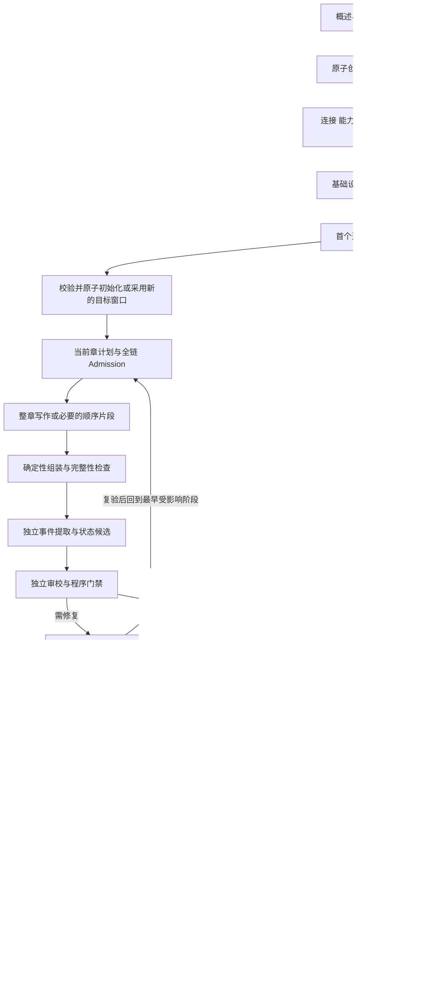

# 新版小说生成执行合同

版本：1.5 · R00 合同 / R01–R05 实施 · 2026-10-18。

依据：[PRD](../PRD.md)、[数据合同](data-model.md)、[DESIGN](../../DESIGN.md)、[基线及模块清单](../development/reports/XNR-001-baseline.md)。本文是 R01–R05 的目标合同。R01 数据/执行/费用基础已在隔离环境验证；R05 固定响应完整主链已接通，但完整视觉验收和真实模型尚未完成，见 [R01 报告](../development/reports/R01-implementation.md)。凭据按用户已确认的方案 A 实施，见数据合同 §10。

## 1 职责与实施边界

Laravel 决定流程与权限，模型只完成单次规划、写作、提取、判断或修复任务。复用现有 AiSettingsResolver、模型路由、ContextBuilder、CanonicalCommitService 和队列，不引入第二套路由器、工作流引擎、Agent 对话系统或额外服务。

整书控制入口只决定下一粗阶段；章节推进器负责当前章内部依赖；Issue 策略负责修复动作；CanonicalCommitService 是唯一正式写入边界。Filament 调用这些入口，不能直接更新正式指针或用页面状态决定提交。

旧小说不兼容续跑，旧日志仅供离线诊断。R00 只有文档/夹具；R01 开始隔离环境与实现；R06 才执行三本新小说等真实验收；R07 才删除确认无用的旧实现。

## 2 完整主链与终点



图中修复回到 G 是依赖重算入口，不意味着必然重新规划或重写；正文未变的证据修复可直接重跑提取/审校。已验证且输入身份相同的产物优先复用。

“完成”须同时满足：约定篇幅目标的已冻结验收口径、结局与核心承诺闭合、无阻断性 Issue、正式章节连续、最后一章必需摘要有效、完整 TXT 清单与文件可读。正文写完而导出失败时显示“正文完成，导出待恢复”，Task 尚不 completed。向量派生失败不把已完成正文回退；其待补齐状态仍在记忆/健康页面可见。

## 3 首次执行默认值与配置权威

以下是新版首轮实现默认值，尚未经真实模型性能评测。R06 可据实调整并记录版本，不能声称已经证明最优。

| 项目 | 默认合同 | 可变范围与生效点 |
| --- | --- | --- |
| 创作目标 | 总目标 100000 字、章目标 3000 字、full_book | 表单显式值优先于概述明确值，再采用默认；真正矛盾需一次选择 |
| 开篇模式 | 正式完成 3 章并完成必需摘要后 paused | 开篇章数可显式调整；继续整本保留原 Task 身份，策略留新版本 |
| 近期窗口 | 未来 5 章目标；剩余可用目标少于 2 章时补齐 | 只在章节边界采用，结尾按剩余目标缩短窗口，不要求补满虚构章 |
| 收束检查 | 每章边界重算债务；达到目标字数 80% 或进入蓝图最终转折时进入收束评估 | 评估综合主线/结局可达性；进入 completing 后限制新增核心人物、主线、硬规则与重要伏笔 |
| 章节长度 | 默认软目标区间为章目标的 80%–120% | 区间外触发内容完整性判断，不仅凭字数盲目重写；明确硬要求独立校验 |
| 整书长度 | 默认目标区间为总目标的 90%–110% | 主线/关键承诺未完成仍不可完结；用户明确硬篇幅优先；不会因费用提前结束 |
| 技术重试 | 同逻辑步骤最多 3 次实际请求，含首次；退避 10/30 秒 | 429 的合法 Retry-After 优先，可推迟至更晚；次数不因重投 Job 重置 |
| 结构/证据修复 | 同问题最多 2 次 AI 修复 | 原始失败不算修复次数；一次语义复核包含在此额度，不另开无限裁判链 |
| 正文重写 | 同章最多 2 次自动重写 | 段落/片段优先；换 Issue/Run 不清零章级计数 |
| 无进展保护 | 相同问题、相同来源与相同方案再次失败即停止该路径 | 请求次数上限只是最大值，不要求全部耗尽；换方案须说明变化 |
| 修复执行时间 | 问题累计实际执行 1800 秒 | 累计 Worker 实际执行段；排队、退避、人工暂停不计；异常退出按已记录开始/硬超时保守计入 |
| 金额策略 | 统计开启；预警未设置；每日/任务/章/问题硬上限均关闭 | 预警不阻断；显式开启、提高或关闭已生效硬上限留授权记录 |
| 初始请求时间 | connect 10 秒、单次 HTTP 总时限 300 秒 | 超时按连接/模型能力明确配置并冻结，不用隐式 SDK 重试叠加 |
| Queue 时间 | Job 330 秒、Horizon worker 360 秒、retry_after 420 秒、Run lease 450 秒 | 单请求阶段；批量派生拆成各自 Run；调整时校验整体关系 |
| 恢复扫描 | 每 60 秒扫描；queued 无派发事实 120 秒后可补派 | 超过 15 分钟无执行证据显示调度异常；不是整书失败或模型耗时 |
| 运行队列 | generation 主链；default 非关键派生/导出 | 不主动拆更多 Queue；同小说章节主链串行 |

本合同的“字数”是去除 Unicode 空白后正文的 Unicode 码点数，包含标点；标题/卷名/审校数据不计，UI 标注“正文字数”。比较目标、进度与导出均使用同一版本化计算器。该口径是设计选择，不能假称等同出版平台统计。

初始创作默认、模式、容量与费用策略存入 GenerationSettingsService 所管理的 generation 配置；技术重试、修复次数/累计执行时限和无进展规则继续以 config/generation.php 为单一来源，操作创建时冻结。总截止时间 deadline_at 默认 null，显式配置后与执行时限分别展示。部署超时归 config/queue.php、config/horizon.php 与连接配置。数据库模型路由和能力仍为全局权威，小说覆盖只在允许范围内生效。不得同时在多个文件维护同名阈值作为不同权威。

Task 冻结创作意图与授权范围；Run 冻结实际路由、输入、Prompt/Schema、参数和能力版本。新全局配置只作用于尚未创建的 Run；已有 Run 不能因部署改了 Prompt 就使用新 Prompt。冻结版本不可用时创建配置 Issue，显式建立替代合同，不偷偷套新版本执行。密钥不进入快照；禁用连接与撤销权限立即阻止新请求。用户后来主动设置的硬上限也在发送前实时复核，不被旧 Run 快照绕过。

## 4 Task、Run、Issue 状态转换

### 4.1 整书任务

| 起点 → 终点 | 条件与原子效果 | 恢复/显示 |
| --- | --- | --- |
| 新建 → queued | submission_key 唯一；创建 Novel、intake Run/intent、Task 并回填引用；保存 preflight 意图，同事务提交 | 重复提交返回已有对象；不重复建书 |
| queued → running | 主任务身份有效、基础配置可执行、认领主链下一步 | 标记当前阶段；没有 Worker 观测不能显示“模型正在生成” |
| queued/running → paused | 用户暂停；或开篇目标到达；或逐章审核到 PASS 等待提交 | control_version +1；不创建新 Run、不提交；保存已有响应 |
| running/queued → needs_attention | 阻断性 Issue 无合法自动恢复路径或次数耗尽 | 保留正确恢复点和所有成功产物 |
| needs_attention → running | 问题复验通过且仍有执行授权，无用户暂停意图 | 按原模式继续；修复按钮本身不是复验成功 |
| paused → running | 用户恢复，重新校验控制版本、来源与当前权限 | 复用有效产物；开篇切整本更新模式版本；不得 Scheduler 擅自恢复 |
| running → completed | §2 完成条件全部满足，导出清单有效 | 固定完成证据和结束时间 |
| 未结束 → cancelled | 用户取消并确认影响，停止推进 | 在途返回仍保存/计费；未解决 Issue 保留，界面说明已停止执行 |
| 未结束 → failed | 无法恢复的任务身份/数据损坏且已记录原因 | 普通超时、待修复或金额限制不用该终态；替代需新 Task |

同小说只有一个未结束主 Task，包括 paused 和 needs_attention。Novel 的创作生命周期与 Task 运行状态分开：暂停不表示小说作废；进入 completing 不表示已写完；恢复不能直接设置小说 completed。

逐章审核的“提交本章”是受控动作：校验当前 PASS 和所有 Commit 门禁，在同一控制事务内解除该次 waiting_manual_commit 停点并授权当前提交；随后继续原 manual_review 模式。普通 paused 状态不能直接执行 Commit。等待提交不计故障/人工修复。

### 4.2 执行尝试

queued → running 采用数据库 CAS 认领 token、lease 与输入版本。已被认领、已成功、已取消的重复 Job 返回现有结果，不发第二次请求。queued 等待 next_attempt_at 是退避，不是假 running。

running → succeeded 表示该步骤得到有效输出；Review 的 REWRITE/BLOCK 是一次成功执行的审校业务结果，随后生成 Issue。Schema/引用错误或 Provider 故障才记 failed，并持久化错误。运行中有合法未完成检查点才可 deferred，不能把“派发了下一阶段”标 deferred。

技术重试/修复创建新 Run 并关联 retry_of/issue；已结束 Run 不再 running。deferred 的后续 Run 引用检查点和此前产物，保留原尝试。过期租约由恢复器关闭当前执行权；晚到结果只能保存隔离候选/结算 Usage，不能改当前结果、Task 或正式指针。

每个 Run 至多一次 Provider 传输尝试；禁止 HTTP 客户端或 SDK 在一个 Run 内隐式重发。确定性阶段不计 AI 请求。重复投递与可恢复的业务新尝试是不同概念。

### 4.3 问题

open → diagnosing（需要受限诊断）→ repairing → resolved，或进入 awaiting_user。可直接由确定性策略 open → repairing，不默认支付一次诊断。diagnosing/repairing 均以关联 Run 证明活动；没有正在执行或排队的修复不能永远显示“AI 处理中”。

resolved 必须通过相同来源的复验或明确授权的软质量例外。无影响的历史问题不进入当前阻塞计数；来源已被替换时记录替代关系及验证结果。取消/暂停任务不等于问题解决；恢复时重新计算它是否仍影响当前来源。

## 5 阶段合同：输入、输出和后继

以下 stage key 为新版目标值，非现有 Enum 全部已支持。确定性阶段共用 `pipeline-v1` 与阶段校验 `*-v1`；AI Prompt 命名 `xnr-{stage}-v1`，输出 Schema `xnr-{stage}-v1`。每次 Run 保存准确内容哈希和可重放快照，不能只记“v1”却随部署改变内容。

表中阶段是合同边界，不要求逐行新建一个 Job 类。局部校验、Admission、组装、patch 和边界判断可在同次执行中确定性完成并记录子步骤；仅收费尝试、需要独立恢复的采用/提交/导出与派生工作建立独立 Run/Job。不得把一次 AI 调用的保存/校验拆成无必要的多层调度；也不得把多次 AI 调用藏在同一个 Run。

路由复用现有 AiStage 的 planner/writer/extractor/reviewer/rewrite/summary/embedding；将旧四个 outline_* 路由整合成新 foundation_blueprint、goal_window；新增 ending_audit 路由明确映射已有连接。diagnostic 使用 reviewer 授权路线但独立 Prompt/Schema；不再创建诊断供应商路由层。所有映射在 R01 设置页中显式展示，不能假定已有数据库已经配置新键。

| 阶段 / 路由 | 必须冻结的输入 | 输出及独立验证 | 成功后的主链 |
| --- | --- | --- | --- |
| intake / 无 | 原始概述、显式高级项、提交 key | intent；非空/长度、明确输入原样保存；不调用模型猜意图 | preflight |
| preflight / 无 | Task、当前连接/权限、所有必需路由和能力、策略 | operation_record；连接可用配置、支持的 Schema/容量；无金额不阻止启动 | foundation_blueprint |
| foundation_blueprint / 同名 | intent、目标、用户硬要求、输出容量 | 基础设定+人物/世界候选+蓝图；Schema、意图覆盖、实体引用、结局和篇幅可执行性 | adopt_foundation |
| adopt_foundation / 无 | 已验证基础包、Task/control_version、初始状态条件 | Bible/初始实体/初始 State Version/蓝图指针一次采用；不存在故事正文事件 | goal_window |
| goal_window / 同名 | 当前蓝图、状态、剩余承诺、已有有效目标与剩余篇幅 | 未来窗口候选；稳定目标 key、增量进展、约束及来源可执行 | adopt_window |
| adopt_window / 无 | 窗口候选、章节边界、旧/新规划差异 | 采用新索引与指针；保留候选历史，不能改变正在写的章合同 | chapter_plan |
| chapter_plan / planner | 已采用目标节点、当前状态、近期摘要、硬约束 | chapter_plan 候选；目标、章标题、因果推进、必要/禁止事实；不强制场景树 | admission |
| admission / 无 | 计划候选及全链实际路由/能力/Prompt、完整上下文预算 | 冻结计划、context、writer_strategy 与原因；检查 Writer、Extractor、Reviewer 都能执行 | chapter_write 或 fragment_write |
| chapter_write / writer | 冻结计划/context、状态、出口条件 | 完整候选正文；完结标记/截断、字数、重复/缺段验证；自评不是 PASS | assemble |
| fragment_write / writer | 冻结计划、片段身份、前驱片段 hash/尾文、临时状态 | chapter_fragment；顺序/前驱一致、片段完成与无重复验证；临时状态不正式化 | 下一片段，最后进入 assemble |
| assemble / 无 | 完整正文或按序片段清单、计划 | chapter_draft、段落索引；拼接/边界去重，不创造新剧情 | event_extract |
| event_extract / extractor | 当前正文 hash、计划、正式前置状态、实体全集 | event_candidate；证据逐字定位、实体/时间/类型/来源验证；汇总由代码算 | build_state_patch |
| build_state_patch / 无 | 有效事件候选、同一正文及正式前置状态 | state_patch；确定性状态变化、硬事实与引用验证，不写正式事实 | review |
| review / reviewer | 同源正文、计划、事件/patch、硬约束与独立规则 | review_result + Review；程序检查硬门禁并归纳决定，不要求冗余审计数组 | PASS→commit/等待提交；其他→Issue |
| local_rewrite / rewrite | Issue、当前正文/计划、精确范围、修复目标 | 新 rewrite_draft 或片段；范围差异、锁定约束与来源验证 | assemble 或 event_extract；旧 PASS 失效 |
| evidence_repair / extractor 或 reviewer | 失败证据项、对应正文范围、原候选与错误 | 新事件/审校产物；只修证据仍须复验；不得伪造引文 | 该阶段验证及必要下游 |
| diagnostic / reviewer | 脱敏错误、版本、允许动作、已有尝试 | repair_proposal；白名单、权限、影响范围与有进展依据 | 选定合法修复 Run；否则 awaiting_user |
| commit / 无 | 当前 PASS、正文/计划/事件/patch、预期状态、Task/control_version | Canonical、事件、新状态、指针与 pending_transition 原子写入 | summary；另建派生待办 |
| summary / summary | 正式正文/事件/状态、摘要合同 | 正式 summary；来源与关键状态不矛盾；摘要指针+续章意图 | chapter_boundary |
| memory / 无 | 正式正文/事件/摘要和派生版本 | 可重算记忆单元；来源存在、同小说、唯一派生键 | embedding；主链是否等待按必要上下文检查决定 |
| embedding / embedding | 有效记忆文本、模型/维度版本 | 向量；维度、来源、有限数值验证 | 完成派生；失败独立 Issue |
| chapter_boundary / 无 | 最新正式章/摘要、模式、篇幅、闭合债务、当前窗口 | 选择开篇暂停、补窗口、下一章或收束；可选目录分卷 | goal_window/chapter_plan/ending_audit |
| ending_audit / 同名 | 蓝图结局、当前状态、所有承诺/伏笔的确定性闭合清单 | ending_audit；程序先验证 critical debt，模型只判必要语义闭合 | 未闭合→收束目标；闭合→export |
| export / 无 | 连续 Canonical 章节快照、标题与可选卷名、格式版本 | TXT 文件+export_manifest；顺序/字数/hash/可读性校验 | 复核未变后 completed |

“preflight”不额外调用模型做健康探测：检查实际配置与已观测连接状态；首次真实调用的认证/服务错误照常进入 Issue。连接测试必须是用户主动动作，仍记录费用，不作为每章隐性开销。

## 6 共用执行、事务与恢复合同

§5 每个阶段均适用本节，而不是各 Job 自行定义例外。AI 阶段使用 §3 的单请求超时与技术重试；Schema/业务失败使用问题修复次数，不复发相同请求碰运气。确定性阶段不调用模型，默认 Job 时限 60 秒、数据库锁等待上限 5 秒；可恢复锁竞争最多 3 次短退避，语义冲突立即重新判断来源。

### 6.1 单次阶段执行

1. 短事务锁定 Novel → Task → Issue（需要时）；检查主任务、控制版本、当前来源、既有成功产物；建立唯一 queued Run 与待推进意图。恢复器与按钮走同一入口。
2. 提交事务后派发 Job。返回“已入队/已存在/派发失败”，不能把返回 true 当成功生成。数据库保存待派发事实，进程在入队前崩溃仍可补派。
3. Worker CAS 认领 queued Run；执行前复核 Task 未暂停、来源未过期、租约拥有者、连接仍授权。冻结输入不变；控制状态变了则取消本次执行，不发请求。
4. AI 请求前持久化 Usage/request_key，原子预留已启用上限；事务外发一次请求。模型耗时绝不放在持有 Novel 行锁的事务中。HTTP 总时限小于 Job、Worker 与可见性时间，lease 覆盖最长执行及收尾裕量。
5. 响应先关联持久化原始结果与 Usage，再校验。成功采用在短事务中检查租约 token、来源/控制版本，保存不可变 Artifact、Run 结论、当前结果及下一动作。响应可保存不等于可推进。
6. 事务外派发后继。所有后继从数据库状态重算，不能仅信 Job payload 的“下一阶段”。正常交接当前 Run 为 succeeded。

Laravel `afterCommit()` 只解决事务提交前被消费的问题，不保证提交后进程崩溃仍入队，因此保留数据库补派。官方机制见 [Laravel 13 Queue 事务派发](https://github.com/laravel/docs/blob/13.x/queues.md#jobs-and-database-transactions)；正式数据使用短事务与行锁，见 [Laravel 13 悲观锁](https://github.com/laravel/docs/blob/13.x/queries.md#pessimistic-locking)。R01 仍需在实际 PostgreSQL/Redis 上验证。

全局金额锁先于 Novel/Task/Issue 锁，统一顺序为 generation 配置行 → Novel → Task → Issue → Run/Usage；无费用事务不先拿全局锁，但持有 Novel 锁时不得倒序再请求全局金额锁。调用 Provider 与耗时文件操作全部在锁外。预留和发送间若发生暂停，最后发送前再查控制版本：已确认未发送则 not_sent 并释放；暂停线性化前已获发送权的请求视为在途，可以返回，但不能提交。

### 6.2 各类写入的事务边界

| 写入 | 必须同事务的事实 | 重复/崩溃后的结果 |
| --- | --- | --- |
| 初始化意图 | Novel、intake Run/Artifact、Task、所有引用 | 唯一 submission_key；失败无半本小说 |
| 采用基础包 | Bible/初始实体/初始状态、蓝图索引、当前指针、后继意图 | 同来源重复采用返回既有结果；不同来源先作版本检查 |
| 采用窗口/计划 | 候选校验结果、采用指针、计划冻结、后继意图 | 旧来源不覆盖新指针；候选不因采用失败丢失 |
| 保存阶段 | Artifact、Run、Issue 复验与后继意图 | 未落库视为未采用；已保存相同来源复用 |
| Canonical Commit | 身份/控制/状态校验、当前 PASS/来源、正文指针、事件、State Version、Novel 指针、必需摘要意图 | 任一写入失败全部回滚；重复提交返回同一正式效果 |
| 摘要采用 | 正式来源复核、summary 指针、续章意图 | 摘要失败不回滚 Canonical；阻止缺摘要的下一章 |
| 派生记忆 | 来源有效性、派生唯一键、记忆/向量及完成记录 | 回滚/换版后旧 Worker 不激活过期记忆 |
| 导出完成 | 文件已原子写入、manifest 来源仍当前、Task 完成状态 | 先写临时文件并原子改名，后事务采用；崩溃后校验 hash 复用或清理孤立文件 |

Canonical Commit 不调用 Provider。锁定小说后再次确认未 paused/cancelled、主任务一致、章节尚未正式、计划和正文当前、PASS/事件/patch 同源、expected state 匹配、全部硬门禁满足。由统一服务写入，页面、Job、Observer 不能复制提交逻辑。最新章受控回滚另记操作版本，保留历史事件/审校/Artifact，重新采用时建立新的提交身份。

主链只有一个 pending_transition，非关键 memory/embedding 派生使用各自 queued Run 与唯一 source 身份作为持久待办；恢复器根据正式章/派生版本查漏补建，不另建第二个全书推进器。

### 6.3 故障与暂停矩阵

| 中断点 | 已有事实与恢复动作 | 不允许 |
| --- | --- | --- |
| 创建事务未提交 | 整体回滚，客户端保留概述并用同 key 重试 | 半初始化小说进入可生成列表 |
| queued 已存、未入队 | 扫描到期补派同 Run | 新建同逻辑步骤或启动旧失败队列 |
| 多次投递/旧 Worker 存活 | CAS/租约只允许一名持有者；过期后新尝试有独立身份 | 把 Redis 锁当最终一致性 |
| Provider 未发送即失败 | 有证据则 Usage=not_sent，释放本次预留，按分类重试 | 无证据声称免费 |
| Provider 已收但响应丢失 | Usage=unknown，保留占用；支持且核实过查询接口才对账，否则有界新尝试 | 承诺供应商 exactly-once 收费或 finally 清零 |
| 响应有了但数据库失败 | 不推进；尽力保留隔离响应与 request_key，数据库恢复后对账；无法保留则明确结果未知 | 吞异常返回成功或不记费用继续 |
| Artifact 已存、未派后继 | 按已存成功结果/推进意图补派 | 重做已成功模型请求 |
| 用户暂停/取消遇在途响应 | 保存响应/费用，禁止采用推进和 Commit；恢复时同来源复验可采用 | 自动恢复越过用户暂停 |
| 人工换稿遇晚到 AI | 保存旧来源候选，明确已过期；当前指针不变 | 用最后写入获胜覆盖人工修改 |
| Commit 任一数据库写失败 | 全事务回滚，复核后重复提交仍一次效果 | 章节正式但状态/事件未写齐 |
| Commit 后进程退出 | Canonical 与摘要意图已在库；补摘要，再续章 | 为缺摘要重写已提交正文 |
| Embedding/导出中断 | 各自同来源补偿，费用照常；导出未完成不宣称任务完成 | 回滚正式小说或吞掉派生错误 |

暂停后不得新建 AI 修复 Run；用户可先预览本地方案，选择“修复并恢复”明确恢复 Task 后才执行收费修复。pause 与 commit 使用同一 Task/Novel 锁和 control_version：暂停先提交则 Commit 拒绝；Commit 先完成则暂停阻止后续阶段，UI 如实显示已经提交的章。

暂停发生时仍持有有效租约、输入仍正确的 Run 可以完成结果保存与验证并记 succeeded，但不更新 Task 的采用/推进指针，也不派后继；恢复时由控制入口复验并采用。租约已失效或来源已被替换的响应则只保存隔离 Artifact，不能借此标记当前尝试成功。两种情况均结算对应 Usage。

## 7 三层规划、容量和来源失效

蓝图只定义全书方向、硬约束、主角弧线、转折与结局；近期窗口细化接下来 5 章目标；当前章计划说明本章为什么存在、必须发生/禁止发生什么、出口状态和写作策略。Volume 是可选目录，Scene 只是一种片段策略，不是开始正文的必填数据库树。

窗口/蓝图采用只在章节边界：上一章 Canonical 与必需摘要完成，当前状态版本匹配，没有受影响的在途章合同。后台可生成远期候选，但不抢占正在写的章。节点采用比较稳定 key+内容 hash；仅补远期目标不让当前章计划失效；改动当前章实际依赖则明确暂停受影响链，建立替代计划并保留旧产物。

Admission 在 Writer 前估算完整序列化请求（system/messages/schema/硬状态/预计正文与输出余量），覆盖 Writer、Extractor、Reviewer。容量不足先裁剪可选召回，保留硬事实/当前状态/结局约束；再在已授权、能力经验证的路线内调整或按段落边界顺序分块。没有可行策略时进入 Issue，不能原样反复规划或凭空扩大模型窗口。

默认整章写作；长章、多 POV 或容量不允许时顺序分段/场景。后续片段读取前驱尾文与临时章内状态，必须保留前驱 checksum。整章被截断时只把已验证完整段落作为续写断点，不把截断响应当完整草稿；下一次独立 Run 补缺失部分，拒绝拼接重复与无进展续写。

长章提取/审校若需分块，必须使用 Admission 已确定的同一正文段落划分、全局硬约束和跨块连续性检查。每块独立 Run/费用；程序合并结果，全部覆盖才允许 PASS。不能只审某几段或平均分数掩盖一个块的硬冲突。没有经过测试的分块审校策略时宁可阻断当前不可执行合同，不声称 Writer 能写就整链能完成。

Context Builder 必须先按小说、有效状态、实体过滤记忆，再按相似度/重要度排序、去重并做 token 分配；近期章优先用 SQL 摘要与事件。Embedding 不可用但必要事实与相关历史仍可从结构化来源得到时允许降级；若本章必须依赖尚缺失的远期证据，Admission 创建依赖缺口 Issue 并等待补齐，不能无限期跳过长篇记忆。

收束窗口先针对 critical debt 生成有限补充章计划，每次仍受同一容量/修复/篇幅规则保护；超过已冻结篇幅上沿仍未闭合时，展示调整未来安排、有限延长篇幅、人工修改结局要求等选择，不无限加章。只有用户主动启用的金额上限触发时才请求金额策略选择。未完结的手动导出采用当前 Canonical 快照并标“未完结”，不因此把 Task 标为 completed。

| 变化 | 最早重算位置 | 可复用内容 |
| --- | --- | --- |
| 只修事件/审校证据 | 当前证据验证，必要时下游 patch/review | 同一正文与仍有效计划 |
| 正文实质编辑 | 段落索引、提取、patch、独立审校 | 未变且前驱有效的片段；旧 PASS 不可用 |
| 当前章计划/所依赖目标变更 | Admission，重算 Writer 是否有效 | 独立且相同来源的产物，不按阶段名盲目复用 |
| 前置正式状态/硬约束变更 | Context/Admission 及其全部下游 | 历史仅作证据；不能用旧状态提交 |
| 远期目标增补 | 新目标采用与下次章边界 | 未依赖新目标的当前章全过程 |
| 路由/Prompt/Schema 改变 | 新执行合同与新尝试 | 旧成功产物须按新规则明确验证后采用；不改旧 Run |

## 8 异常分类与两条处理路径

每条 Issue 展示：发生阶段/时间、错误码、中文原因、影响范围、已保留内容、当前尝试/上限、是否还在自动恢复、预计恢复点、费用或未知标记。堆栈/原始响应折叠并脱敏。优先展示最多三个具体动作，不让用户从原始 JSON 猜修复办法。

| 分类 | AI/自动路径 | 人工路径与限制 |
| --- | --- | --- |
| 网络/429/可恢复 5xx | 同合同有界退避，新 Run 与 Usage | 等待/重试；选择已授权连接；暂停；认证错误不盲目重发 |
| Schema/缺字段/引用证据 | 本地能确定的格式修正先做；必要时仅修缺项、重提取或定位证据 | 高亮选择真实原文；改候选字段；重新评审；不能编造原文 |
| 容量/不支持 Schema | 重算可选上下文、已验证分块或授权模型合同 | 查看精确 token 构成，调整有效配置/后续章长；不能只提高数字 |
| 重要叙事质量 | 有限局部重写并重新提取/审校 | 编辑草稿；明确接受允许的软例外并留原因 |
| 锁定事实/明确意图冲突 | 只修 Draft 使其遵守约束 | 用户明确修改锁定/结局并查看受影响合同；AI 无权解锁 |
| 状态或来源过期 | 隔离旧响应，按当前来源重建最早必要阶段 | 查看差异，采用当前版本/重建；不可强制旧 PASS 提交 |
| 预警/未知费用，未启用上限 | 继续目标，显示统计与优化建议 | 查看/补价/对账；不要求追加额度 |
| 用户已启用金额上限触发 | 不新发受限请求，保留正文与恢复点 | 明确提高/关闭该上限，等待每日窗口或保持暂停；AI 无权改限额 |
| 数据库/调度/凭据 | 保存能保留的事实，恢复基础设施后重验 | 定位配置字段/服务观测，给出实际错误；AI 不执行任意 SQL/shell |

AI proposal 白名单：retry_transient、repair_schema、repair_evidence、reextract_events、replan_current_chapter、rewrite_range、rebuild_context、reconcile_derived。每项必须提供 source、目标范围、动作参数、成功验证规则与预估费用；服务端解析成既有领域动作。模型提供 URL、类名、SQL、shell 或未授权模型时拒绝。技术操作建议可以展示，但不作为任意执行通道。

人工处理也保存 operation_record 或新内容 Artifact，经过同一来源/归属/硬门禁。修改正式历史、解锁硬事实、变更结局、采用未授权模型和更改已生效上限需要明确确认；安全的局部修复在已授权范围内自动执行。处理失败保留用户输入和具体字段错误；成功后显示复验依据与恢复到哪一步。

## 9 费用与请求身份

所有正文、规划、修复、摘要、Embedding、诊断、连接测试与评测都走同一 Usage/request_key 边界。缺 Run 的配置测试也要先建 Usage；不会因没有小说或章而免除全局限制。默认费用只用于统计优化，价格未知保留 null 与原因并继续，不伪记免费。

请求前原子检查主动启用的各范围；至少持久化 prepared 后才能发送，过渡 in_flight 后发生中断视为可能已发。响应结算同一请求行，不能同时算已记费用和全额预留。跨日按实际发送日和冻结时区归属；已经开启任务/章/问题上限仍包含之前在途与未知项。多币种不直接相加。

费用故障与费用预警分开：Usage 无法持久化是数据库可靠性错误，不能带病继续付费；预警超过是展示信息，不阻止后续章节。模型路线、全文目标、Review 与硬约束不因费用增加而自动删减。只承诺正式写入幂等，不承诺网络未知时供应商不会重复收费。

## 10 UI 与数据来源映射

本节落实 DESIGN P01–P10，不新增前端状态机；颜色/排版/尺寸统一引用 DESIGN，不在本文件复制 token。所有观测显示 observed_at，未取到新数据时标“状态未更新”，不靠动画假装正在生成。

| 用户显示 | 权威查询/判定 | 可用操作 |
| --- | --- | --- |
| 等待执行 | Task queued 或 queued Run 尚未认领/退避 | 查看排队原因、暂停；展示 next_attempt_at |
| 正在生成/提取/审校 | Task running + 同源 running Run + 未过期 lease | 查看本章与请求状态、暂停；长请求只有“处理中”，不伪造 token 百分比 |
| 自动恢复中 | 活跃 Issue diagnosing/repairing + 实际待执行/执行 Run | 查看修复范围/次数、暂停；不反复弹窗 |
| 需要你处理 | Task needs_attention + 阻断 Issue awaiting_user | AI 方案、人工具体选项、差异与恢复点 |
| 已暂停/等待提交/开篇完成 | Task paused + stop_reason | 恢复、提交本章或继续整本；保留已发请求数量 |
| 草稿/正式 | 当前 draft 指针与 canonical_artifact_id | 草稿标签持续显示；正式正文优先；版本差异 |
| 已完成/正文完成待导出 | Task completed + 有效 manifest；或 Canonical 闭合但 export 未成功 | 下载/重试导出；不能把无文件任务显示已完成 |
| 当前问题数 | 活跃来源且仍影响当前链的 Issue | 历史问题单独可查，不把旧失败 Run 全数当当前故障 |
| 费用已知/估计/未知/占用 | Usage 状态与 price/cap 快照 | 分项明细、补价/对账；未知项数量始终可见 |
| 完成进度 | Canonical 章数/统一字数/目标区间/当前阶段 | 显示具体数值；字数达到 100% 不等于结局/导出完成 |
| 配置/健康 | 有效连接/路由/能力与最近实际探测 | 显示配置来源与变更影响；无 Worker 观测显示未知 |

异常中心高亮原文按不可变 Artifact/段落索引定位。模型正文、错误和证据均按不可信文本渲染，不能让 HTML/脚本或原始授权头进入页面。下载仅提供获授权的受保护文件，不能用模型返回路径作下载地址。

## 11 任务交接、验证与退出条件

| 后续批次 | 必须落实的合同 | 关键证据 |
| --- | --- | --- |
| R01 | 两张新增表、约束/中文备注、Usage、CAS/补派、能力配置、视觉基础 | 隔离 PG/Redis；重复提交、暂停竞争、请求预留；A04/A22/A23/A26/A31–A35 |
| R02 | Issue、修复累计、白名单与人工版本验证 | 同错误无进展、旧响应晚到、不能绕过硬门禁；A05/A08–A10/A24/A34/A37 |
| R03 | 单概述、可见默认、模式、基础包原子采用 | 从输入到任务无手建旧树；A01/A02/A15/A36 |
| R04 | 三层规划、全链容量、整章/片段、独立提取审校 | 夹具与实际新合同测试；A07/A11/A16/A17/A21/A25/A27–A29/A38 |
| R05 | Commit、摘要、记忆、收束、导出、全部 UI 集成 | 回滚/重投/边界故障、无半提交、P01–P10；A03/A06/A12–A14/A18–A20/A35–A40 |
| R06 | 真实新书、粒度对照、长篇与百万字 | 全部 A01–A40 的适用真实证据，不能以 R00 静态审查替代 |
| R07 | 清理候选代码后空库和全链复验 | 新代码最终状态下从新书到导出，保留可靠性能力 |

以上为交接关注点，不替代任务总表的逐项验收映射。历史夹具见 [R00 样本说明](../../tests/Fixtures/refactor_r00_README.md)：6 个观察投影、11 个构造合同场景。它们提供风险输入，不等于新功能测试已通过。

R00 审查应核对：阶段输入输出闭合、每次收费有身份、暂停/晚到/重复/崩溃均有结果、没有 Draft 写正式状态、没有金额默认停点、没有强制旧规划树、无第二套路由/引擎。凭据方案 A 已获明确确认；R01 按任务依赖实施并记录实际验证。

## R01 执行基础落地说明

新链使用 GenerationRunCoordinator / GenerationJobDispatcher / ExecuteGenerationRunJob，持久 queued Run 和 Task.pending_transition 取代仅依赖 Redis 的推进。正常成功保持 succeeded，只有真实检查点交接才可 deferred；R01 不为普通成功制造 deferred。旧扫描器排除新版任务，旧入口在 R07 清理。

新 Job 当前仅接入执行身份 Preflight，明确标注 execution_foundation；并非完整的模型/配置预检已完成，更不表示从概述到全书正文已闭环。配置冻结和容量检验入口已交付，后续阶段必须复用；Canonical Commit 不在本批改写。

本机核实 Job 330s ≤ Horizon 360s < Run lease 390s < Redis retry_after 420s。代码保留运行时关系检查，不修改部署.env。技术尝试计数按相同逻辑键累计；暂停复用有效结果，重启需新输入身份并保留历史。问题修复累计和人工处理动作由 R02 接入。

所有收费调用通过发送前 Usage 账本，硬上限默认关闭；冻结生成配置不豁免实时急停、凭据撤销、任务控制或最新用户金额授权。未知响应、缺用量和缺价格均不记免费。详细事务和对账说明见 XNR-005/006 报告。


## 12 R02 实施边界

统一错误目录、Issue 生命周期、同源复验与失败对账已通过 `GenerationIssueCatalog/GenerationIssueService` 接入 pipeline-v1。UI、恢复扫描统一调用 `GenerationIssueActions::preview/execute`；不导入旧历史。`GenerationIssueDiagnostic` 复用 reviewer 路由与任务模型授权、冻结请求、费用账本，产物只读，不能以建议代替复验。

当前执行动作是 Preflight 临时故障重试、只读 AI 诊断、人工说明及任务暂停。关闭 Issue 的领域复验器当前只支持 Preflight 身份/来源检查；其余领域必须在接入时增加明确成功条件，不能用 Review Run 成功替代内容 PASS。目标白名单中的正文/证据/计划/派生修复仍等待相应领域批次接入，未实现动作不提供执行按钮。空模型授权不会自动扩权。问题累计次数/时限跨 Run 保存，问题/章节费用仍受用户显式上限约束；来源变化时隔离晚到候选。

异常中心及小说/章节/Generation/Review 入口引用同一 Issue。XNR-009 由于 XNR-034 的缩放/减少动态效果验收未结束，仍保留 IN_PROGRESS，不能以页面实现替代全部依赖通过。详见 [R02 实施记录](../development/reports/R02-implementation.md)。


## R03 已实现的整书入口

本节是实施事实，不把上文目标主链当成已经完成。证据见 [R03 报告](../development/reports/R03-implementation.md)。

- `NovelIntentContract` 保存不超过 10000 字的原始概述、逐句要求、显式选项、篇幅来源、模式与费用策略。默认 10 万字、每章 3000 字、整书自动；硬上限默认关闭。提交 UUID 与输入 hash 共同区分重试和主动新建。
- `CreateNovelGenerationTaskAction` 原子创建 Novel、Intake Run、Intent Artifact 和唯一主任务。草稿暂停；启动持久化 preflight，由统一队列认领。新入口不再写旧 auto_generate/auto_commit 布尔值。
- `NovelBookWorkflow` 是 UI、`novel:book` 命令、恢复扫描的粗阶段入口。预检核对实际配置、路由和能力，冻结 Foundation 请求；不发探测请求，不据配置存在宣称 Provider/Worker 在线。
- `NovelFoundationContract` 使用 `book-foundation-v1`，保存设定候选与字段来源。普通缺项自动补齐；明确矛盾写入一个选择集合。结构、原文引用、要求完整覆盖和明确篇幅分别校验；失败响应仍不可变保存为 rejected。
- 异常中心的 `repair_foundation` 仅接受新版设定校验错误，基于原文和失败候选修复。共用 Issue 累计次数、时限、无进展、费用与 CAS 门禁；新请求 hash 可变，但原问题身份、来源清单和当前意图必须一致。成功校验后才解决 Issue。AI 诊断仍是只读建议；人工可修改创作概述/显式选项或集中选择矛盾，不允许保存说明直接消除错误。
- `ReviseNovelIntentAction` 创建新 Intent，保留原文和用户选择历史，取消旧排队工作，在途旧来源结果隔离。旧 Issue 标为来源被替换，不能冒充旧候选复验成功。初始化之后的设定修订明确停在 `future_revision_not_ready`，后续影响重算等待 R04/R05。
- `ApplyNovelBlueprintAction::initializeBook` 在 Novel→Task→Outline 锁和同一事务内，采用设定、全书蓝图、首个目标窗口，写 Bible、初始人物地点、State 0、规划指针及不可变采用凭证。重复身份只返回已有结果。任一写入失败全部回滚，并产生独立初始化失败 Run/Issue；不生成未来 Story Event、Facts、Volume、Arc 或 Memory。
- `opening` 只在足量正式章及必需摘要齐备后暂停；继续转整书并记录策略历史。`manual_review` 只对当前正文、当前状态的 PASS 等待人工提交，自动 Commit Job 不提交。R04/R05 尚未接通时这些是边界合同及固定响应测试，不是已完成的章节生产流程。

### R04 交接合同

`novel_outlines.kind=blueprint/goal_window` 索引不可变 Artifact，必须同小说、draft、source checksum 一致。蓝图 Artifact 为 `outline_blueprint`，含 `foundation_artifact_id`、`mainline`、`ending`、非空 `turning_points`；目标窗口 Artifact 为 `goal_window`，含 `blueprint_id` 和非空 `goals`。这是 R03 初始化的最小交接格式，R04 必须增加真实规划语义及完整校验，不能把测试夹具带入生产。

设定阶段完成后，缺真实蓝图/目标窗口时持久暂停并显示“等待 R04”；固定交接夹具初始化后则暂停在章节规划。新任务禁止走旧四阶段大纲、旧 Apply 和旧 GenerateNextChapter。Bible 的 `style_profile.schema_version=book-v1` 保存自然语言文风；R04 Context 必须读取它及原始硬要求，不能再套用旧预设风格覆盖用户输入。

## R04 已实现的规划、写作与复验

本节取代上文 R03“缺蓝图暂停等待 R04”的临时停点；保留该段作为 R03 历史边界。R04 当前实现和证据见 [实施记录](../development/reports/R04-implementation.md)。正式提交、必需摘要、继续下一章与完结仍由 R05 接入。

```text
Foundation → Blueprint → Goal Window → 原子初始化
 → 当前章 Plan → 全链 Admission → Whole Writer / Sequential Fragments
 → 全章 Draft → Event Extraction → Deterministic Patch + State Rules
 → Independent Review → PASS 时等待 R05 Commit
                        ↘ 局部 Rewrite → 新稿 → 再提取 / 校验 / 审校
```

- `NovelStageContract` 只承载认知请求的 Schema、Prompt 版本与冻结请求。蓝图/窗口/章计划复用 Planner 路由，整章/片段用 Writer，提取用 Extractor，审校用 Reviewer，局部修复用 Rewrite。没有新增模型路由表或相互对话的 Agent。
- `NovelPlanningService` 生成蓝图与默认最多 5 章的近期窗口；转折篇幅、标准 key、目标内容 hash 由代码计算。缺少远期细节不影响开篇。目标少于 2 且剩余篇幅仍需更多章节时补窗口；保留未变目标身份。未来方向/目标保存为版本候选，章节边界采用。明确修改当前目标才取消旧排队阶段、失效当前计划/稿指针并重建；旧 Artifact 和费用留档。新状态下的未来目标产生新的来源版本，仍须经过章计划与独立校验，不视为已发生事实。
- `NovelChapterPipeline` 复用 Chapter/ChapterPlan，不创建 Scene、Arc 或 Beat。计划含标题、作用、人物变化、POV、时间、落点及必需/禁止信息；`admission_snapshot` 冻结完整语义计划、上下文、路由和实际预算计算。独立 Context Artifact 保存预检依据。
- `ContextBuilder::forBook` 读取 Bible 原文要求、锁定事实、当前状态、近期目标、人物/世界与正式摘要。可选记忆暂用同小说、正式来源、显著性和去重的 SQL 回退；不隐藏发送 Embedding。R05 继续适配正式长期记忆。Bible/锁定事实另有 `hard_context_hash`，人工改锁定事实也不能继续旧请求。
- 写作前联合预检 Writer/Extractor/Reviewer/Rewrite。实际序列化输入字节上界加协议余量与输出预留，超限先裁剪可选记忆；不删除正文、硬事实或当前状态。没有自动切到未经配置的模型。实际提取/审校请求再次冻结容量，超限保留正文，人工修正容量后使用“保留正文并重建容量准入”，新建 Admission/Plan 版本并复验，不重跑 Writer。
- 默认整章写作。输出容量不足时冻结分段原因、数量与顺序；前驱 ID/hash、尾文、临时状态进入下一片段合同。截断仅保留可确认的完整句边界，最多两次续写；损坏 JSON 无法分离正文时保留原响应并建问题，不猜正文。组装校验前驱、顺序与重复边界；不静默删字。改稿后统一从完整新稿重新提取，无关段落逐字保留。
- 独立提取绑定完整正文和段落内 Unicode 偏移；重复引文不能自动匹配第一处。主体与载荷实体必须属于本小说。代码构建候选 Patch 并复用 StateValidator；未知实体和证据错误保留正文。Reviewer 还须核对事件语义，不能把逐字命中当成事件成立。
- Reviewer 仅输出发现项、严重度、目标覆盖和证据；服务端计算 PASS/REWRITE/NEEDS_ATTENTION/BLOCK。硬规则不能被模型好评覆盖；轻微建议不强制重写，语义争议保持待处理。未评分保存 NULL。
- `BookChapterRepair` 接入同一 Issue 动作预览/CAS/次数/费用机制。结构或证据失败只修对应阶段；有定位证据的正文缺陷只允许指定段落 hash 的局部替换。章级改写上限、同方案无进展、问题累计时限及用户主动启用的金额上限继续生效；复验的提取/审校费用归回原问题。原问题须等新稿独立 PASS 才关闭。
- 人工“保存新稿并复验”锁 Novel→Task→Chapter，检查当前稿 ID/hash/control_version，保存独立全章 Artifact；与 AI 竞争时晚到旧响应隔离为历史。保存与后续复验登记分离，容量失败也不丢已保存文字。页面延迟读取显示版本，保存后即时取消旧 PASS 展示。

自动任务与人工模式目前均在独立 Review PASS 后暂停：分别显示 `commit_not_ready` / `awaiting_manual_commit`。不能将 R04 测试理解为一本小说已经完成，也不能使用旧 Commit Job 绕过 R05。

## R05 已实现的正式闭环（2026-10-18）

本节替代 R04 的 `commit_not_ready` 临时停点。实现与未完成的验收项分别见 [R05 报告](../development/reports/R05-implementation.md)、[集成记录](../development/reports/XNR-026-integration.md) 和 [视觉记录](../development/reports/XNR-035-ui-acceptance.md)。真实模型小说验收仍属 R06。

```text
独立 PASS → BookLifecycle
  自动模式 → CanonicalCommitService
  人工模式 → 暂停等待明确提交 → 同一 CanonicalCommitService
→ 正式章节 + Story Events / Facts + 新 State Version + 持久摘要待办
→ Summary 路由生成带原文证据的必需摘要
→ 章节边界（开篇暂停 / 下一章 / 完结审计）
→ 完结 PASS + 无关键债务 → Novel completed
→ 冻结正式章节清单 → 分块 TXT + 文件校验 → Task completed
```

### 正式事务与恢复

- 锁序 Novel→Task→Chapter。检查 current task、control_version、期望正式状态、当前计划/正文/Review/Event/Patch 来源和校验和；服务端重跑 Review 输出规则及 StateValidator。无 Scene 或 Arc/Beat 不构成新链缺项。
- 正式正文引用、事件/事实、状态版本、章节/小说指针、提交凭证与 `pending_transition.canonical_chapter_id` 同事务；重复提交只有一次正式效果。模型请求不在锁内。
- 正式提交事务先结束，再进行摘要准入。摘要配置/容量错误不能撤销已正式内容；对账从持久待办补派。摘要条目引用正式正文精确位置，缺摘要不规划下一章。成功摘要采用及章边界待办同事务，派生记忆 afterCommit；派发缺口可扫描补偿。
- 最新章撤回必须暂停并填写原因，追加完整恢复状态版本，失效对应事件、事实/记忆与后续计划/草稿指针，清除失效完结/导出依据。保留原 Artifact/State 和操作凭证；恢复按新状态重新规划同一章，不走旧 PASS。

### 记忆、费用与降级

- `BookMemoryService` 复用 MemoryUpdater，正式章摘要与有效正式 StoryEvent 才可建立记忆。召回先同小说/有效正式来源，结合目标实体、相似度、显著性和去重，限定条数后仍经上下文容量门禁。
- 当前向量检索使用近期正式记忆的已有向量作为锚点，避免在规划事务中隐式发送查询 Embedding；这是可解释的初始实现，并未声称真实长篇召回质量已达标。缺向量/向量查询失败时，只在当前状态和必需摘要完整的条件下用 SQL 回退，并记录原因与入选 ID。
- 独立向量使用 `book-derived-v1` Run，冻结实际连接、模型、维度、内容 hash、费用合同和控制身份；每次请求继续经过 RequestUsageLedger。来源变化/租约失效不能采用，过期在途费用标未知，相同输入最多三次实际尝试。派生失败为非阻断 Issue，主链不被回退。
- 已完成正文允许补齐派生向量；暂停/取消不发新请求。没有增加默认金额限制。

### 收束与导出

- 80% 目标字数进入 completing 的写作约束；达到目标后调用独立 Reviewer 进行完结证据审计，同时计算确定性 Closure Debt。主线、结局、读者承诺、人物发展和伏笔逐项覆盖，不能仅按字数完成。
- 审计只读取正式状态及近期 20 章、开篇 3 章和重要记忆来源的正式摘要证据，避免把长篇全部正文/摘要塞入一次请求。无证据必须保持未兑现，不能推断已经兑现；大输入继续经容量门禁。
- 未完成时默认最多三次单章收束窗口。耗尽后保留债务 Issue；用户可填写方向，明确授权额外 1–3 章，记录操作者/原因/状态/额度并逐章复验。累计次数不清零，不取消硬事实/审校门禁，不改变费用上限。
- `BookExportService` 保存正式连续章序、标题、Artifact/checksum、正式状态和完结标记；逐章读不可变正文、流式写私有文件。来源 hash 与文件 hash 都验证后才 Task completed。文件失败或采用前丢失生成可恢复导出 Issue，重试不调用模型。
- 阅读页可随时下载正式快照；未完结标明“未完结”，不改变当前生成待办。鉴权下载仅提供对应小说可见的正式清单，缺失文件从冻结正文重建。

### 运维与入口

主链继续由 ExecuteGenerationRunJob 执行（含确定性最终导出）；default 队列承担记忆/向量派生。默认导航按整书任务与章节阅读，旧 Run 细节放高级入口。健康读取真实探测/心跳及最近请求，未观测不假报在线；Worker 标识来自已加载的 Job 实现，不在旧进程内读取新文件假称重载。恢复与切换细节见 [运维手册](../development/OPERATIONS.md)。R07 尚未执行，旧实现仍待受控清理。
