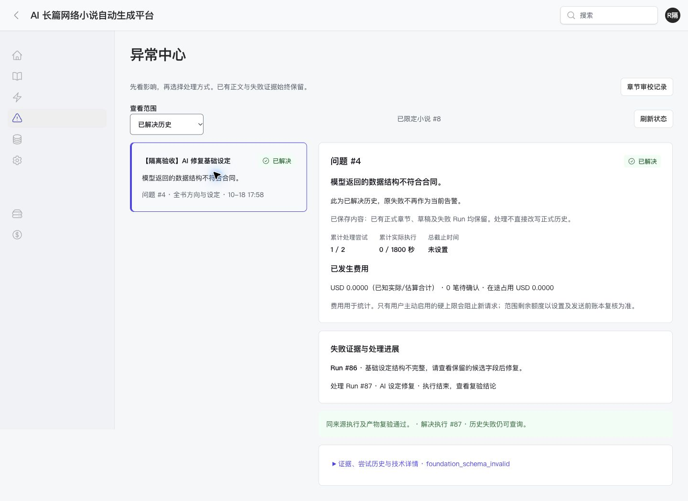

# R05 剩余验收续办记录

日期：2026-10-18。执行者：Codex。范围：补验 R05、修复发现的问题、核对依赖与 R06 入场条件。开始时已有大量未提交的 R05 改动，本记录只描述续办工作，不把原有实现视为本次新增。

**当前结论：R05 已完成，具备进入 R06 的前置条件；未执行 R06/R07。** 第 12 节关闭最后三类验收，XNR-034/035/026 及此前仅受视觉依赖阻塞的任务更新为 DONE。下列第 1–11 节保留各轮当时的结论，不代表当前状态。真实环境切换与凭据/Worker 核验仍属于尚未执行的 XNR-027。

## 1 已修复并复验的问题

| 问题 | 最终处理 | 验证 |
| --- | --- | --- |
| 阅读、人物等子页在小屏局部导航中没有当前项名称 | 为工作台、正文、设定、更多的关联子页明确 active 状态 | 最终深浅/规定断点基线；阅读移动端显示“正文” |
| 千章目录翻页或搜索后折叠，打断连续操作 | details 仅忽略自身属性，内部分页继续更新 | 1000 章夹具，每页 25 链接；第二页首章为 26；搜索 999 回到 1/1 页，输入焦点保留 |
| 摘要准入失败被归为初始化、且缺失章身份 | 记录 MemorySummary、summary-admission 和已正式提交的 chapter_id | BookCompletionTest 从真实提交后的缺路由场景检查问题身份 |
| 配置重检结案显示空的“解决执行 #” | 仅存在 resolved_by_run_id 时展示编号 | 异常页模板及页面回归 |
| 部分灰色文字、深色危险/警告按钮对比度不足 | 使用项目语义色，并提高输入边界/占位文字可辨性 | 18 页面、两主题、2302 个文本样本，抽样无低于 4.5:1（大字 3:1）的项；不覆盖所有悬浮、禁用、图标和透明遮罩状态 |
| 列表空值产生可聚焦但无名称的链接/按钮 | 正式章节空值为“尚无正式章”，人物标记空值为“无额外标记” | 基础 Tab 遍历发现并修复；两页复测无空名称焦点 |
| 草稿版本冲突后直接重试始终失败，缺少恢复入口 | 增加“保留输入并读取最新稿”；显式更新来源和控制版本，保留编辑文字，再由用户确认保存 | 两页面暂停造成真实冲突；输入保留；读取最新来源后生成新 Artifact，显示尚未正式采用；自动测试检查读取本身不创建新稿 |
| AI 设定修复真实结案后任务残留旧停止原因 | 只在任务运行中、停止原因与该问题一致且无其他阻塞时清除旧提示 | 扩展受限修复测试，不覆盖暂停/其他故障或后继 |
| 修复历史把 AI 修复一律标为“原断点重试” | 按实际动作显示设定修复、内容修复、只读分析、重新导出或重试 | AI 修复历史页面实际显示“AI 设定修复” |
| 404 等系统错误仅英文且无恢复路径 | 中文 403/404/419/500/503 页面，保留 HTTP 状态，5xx 提供关联日志编号；JSON/Livewire 保持原合同 | 6 项错误响应测试；实际 404 和隔离触发错误页移动端检查，无横向溢出 |

没有改数据库结构；不需要新增备注迁移。修改的关键逻辑均增加中文注释。未增加依赖。

## 2 实际恢复路径与持久结果

全部使用独立 `xnovel_refactor_test`、合成账号、隔离会话/Redis 前缀、Fake Provider、Queue::fake 与禁止意外 HTTP。浏览器登记动作后，仅针对该 Run 用真实执行器消费固定响应；不会自动消费其他任务。

1. **概述创建**：只填写概述完成提交，生成 task/novel #7，默认整书模式、100000 字、不要求金额。页面显示已保存/待预检，没有假装模型正在运行。空表单触发必填校验。重复提交和请求失败的完整浏览器组合仍未验。
2. **摘要恢复**：task #3 的正式章 #3 / Artifact #58 保留。先保存人工说明，AI 只读诊断 Run #75 成功后问题仍为 awaiting_user；相同来源和说明不能重复分析收费。选择重建容量准入后只补摘要；摘要 Artifact #131 建立后才规划第二章。见 [诊断](assets/R05/followup-summary-diagnose.json)、[恢复](assets/R05/followup-summary-recovered.json)。
3. **仅导出恢复**：task #5 文件丢失问题由界面登记，仅重建导出，Run #78 完成并结案；正式正文 #102、摘要 #110 不变，Usage 数仍为 9。见 [持久结果](assets/R05/followup-export-recovered.json)。
4. **有限补章**：task #4 从界面填写原因、授权额外 1 章，计数与上限均为 1，已有正式正文 #78 保留；原债务问题仍 repairing，不能把授权本身当成结案。见 [结果](assets/R05/followup-ending-extended.json)。本次没有生成这章或声称结局已通过。
5. **人工新稿**：task #6 / chapter #6，另一个页面暂停使旧编辑来源失效，保存明确拒绝且保留文字。显式读取最新来源再保存，Artifact #127 保留，新稿 #134 显示独立审校待办，未写正式状态。见 [冲突](assets/R05/followup-edit-conflict.txt)、[保存](assets/R05/followup-edit-saved.txt)。
6. **AI 实质修复**：task #8 基础设定缺 world，失败候选 #137 retained/rejected。通过页面预览并执行“请 AI 修复设定字段”，Run #87 生成 validated 候选 #138、问题 #4 resolved、attempt_count=1，费用账本新增一笔固定响应记录。见 [前态](assets/R05/followup-repair-before.json)、[后态](assets/R05/followup-repair-after.json)、[界面文字](assets/R05/followup-ai-repair-resolved.txt)。后态记录捕获了本次发现的旧 stop_reason 残留；随后代码修复及回归负责证明清理，不改写这份原始证据。

这些是隔离短夹具，不是 R06 的三本真实作品，也不证明模型质量和长篇稳定性。

## 3 视觉与交互证据

- 最终代码下 18 个页面 × 深浅主题 × 1440×900 / 390×844，加创建、工作台、阅读、异常四页的 1024×768 / 768×1024 / 320×800，共 **96 次布局观测**。无 document 横向溢出，主区 opacity=1。详见 [最终矩阵](assets/R05/followup-final-matrix.json)，对应 `final-页面-主题-宽度.png`。
- 首轮 `fullPage:false` 截图受工具视口缩略影响，可读性不足；最终基线已用 `fullPage:true` 重拍，并抽看创建小屏、工作台 320、阅读 768。布局观测不代表所有截图逐像素审查或全状态通过。保留的早期交互缩略图只作辅助，以 DOM 和持久结果为主要证据。
- [对比度结果](assets/R05/followup-contrast-after.json) 和 [计算方法](assets/R05/followup-contrast-method.js) 使用实际渲染颜色、祖先背景合成及字体尺寸。2302 个样本不是 2302 个不同组件；未覆盖所有视觉状态。
- [基础键盘遍历](assets/R05/followup-keyboard.json) 覆盖 18 页面；最终 novels/characters 复测记录另附在同一文件。未发现隐藏焦点或无样式焦点；本记录不代替全部弹窗、展开区和失败态键盘验收。
- 登录错误显示中文且保留账号输入。中文系统反馈记录见 [错误状态](assets/R05/followup-errors.json)；这些隔离路由只存在临时站点，不进入项目路由。



## 4 仍未关闭的必需项与解除条件

| 项目 | 当前事实 | 下一步 |
| --- | --- | --- |
| Safari 全站关键操作/小屏矩阵 | 本轮原生连接多次启动失败；上一轮只有正式阅读与专注证据 | 恢复可用 Safari 控制或提供同版本实测记录后补验；不能以 Chromium 代替 |
| 200% 纯字体放大 | 既有 200%/400% 是页面缩放，不等于字体独立放大 | 用浏览器实际字体缩放覆盖关键页面，核对裁切、按钮与焦点 |
| 系统减少动态效果 | 原始设置为关闭；此前自动审批拒绝临时切换。用户现已明确授权临时开启并恢复；控制连接仍失败，尚未修改 | 连接恢复后记录当时原值、临时开启、实测并恢复；授权不再是阻塞项 |
| 全状态/展开交互组合 | 本轮补齐长章/千章目录、冲突、AI 修复、摘要/导出/有限补章及系统反馈；尚未全覆盖 DESIGN §10.2 | 补创建重复/请求失败、空作品/加载失败、规划修订冲突/锁定与分卷组合、费用未知/上限/配置冻结、健康失效及派生失败的最终浏览器状态，并补弹窗/展开区键盘和焦点 |

上述条件不全通过时，XNR-034 → 009 → R03/R04 → R05 的完整交付依赖不能关闭；XNR-035、026 也不能 DONE。代码回归可单独通过，但没有越过依赖链的批准。

## 5 R06 配置事实

已只读核实 `x_ai_provider_connections`：OpenAI 连接启用，旧 `api_key` 非空，但 `credential_ref` 为空。未读取或输出密钥值。现行 `AIProviderConnection`/`AiSettingsService` 不解密使用旧列，只经 `credential_ref` 读取 `config('ai.credentials')`；OpenAI 对应部署变量 `XNOVEL_OPENAI_API_KEY`。因此“表里有旧 key”不等于新版请求已可用。

这属于 R06 的 XNR-027 环境准备，不影响 R05 的固定响应验证；没有据此修改 `.env` 或迁移凭据。R05 完成后，先按运维手册落实新链凭据引用、模型路由/能力、项目专用 Worker/Scheduler 与干净验收环境，再由 XNR-028 创建三本真实小说。费用默认只统计，未设置硬上限不构成入场阻塞。

## 6 最终验证与清理

最终同一命令重跑 XNR-026 所列 R01–R05 相关测试（包含新增系统页测试与本轮扩展断言）：**280 passed / 1 skipped / 2346 assertions，231039 ms**，共 281 项。专用 PostgreSQL 并发测试实际执行；跳过的是 SQLite 专用项。原始 [最终结果](assets/R05/followup-final-regression.json) 为 `result=passed`，本机 Artisan 包装退出码仍为 1，未隐瞒该差异。初次复核 274/1/2310 和系统页专项 6/26 与最终组有重叠，不相加。

[前端构建](assets/R05/followup-build.txt)、[Pint](assets/R05/followup-pint.json)、`git diff --check` 均通过。构建存在既有可选 fontaine 缺失警告，不影响成功构建，本次未新增依赖。旧 CanonicalCommitServiceTest 的 35 项基线失败未在本轮重新执行或修复；原 R04 基线复现证据仍见 XNR-026，不宣称全仓库全绿。

临时 Herd 链接及本轮临时站点目录已移除，浏览器视口已恢复。系统“减弱动态效果”未改变；测试套件只重建专用测试库。没有迁移运行库、修改 `.env`、读取/展示密钥值、重启实际 Worker、调用真实模型、创建 R06 真实作品或删除旧业务代码。继续验收需重新构建隔离夹具，不依赖已清理的临时站点。

## 7 再次续办：规划冲突修复与环境阻塞（2026-10-18）

本节是上述验收之后的增量结果。对应 DESIGN §5 P05、§6.4 版本冲突要求及 XNR-013/035；不改变 PRD、架构或验收标准。

代码检查发现两个实际问题：未来方向与章节目标编辑器共用 `taskVersion`，打开另一编辑器会改变旧输入的控制版本依据；冲突后再次点击“调整”会覆盖尚未保存的文字，缺少保留输入的恢复入口。已作以下修复：

- 方向使用独立且 Locked 的控制版本，目标保留独立版本；普通打开操作不更新已经打开的编辑器，也不覆盖未保存文字。
- 分别提供“保留输入并读取最新方向/目标”。读取只更新本编辑器的来源和版本；用户核对当前内容后才保存，保存仍经过既有事务、版本校验和不可变候选服务。
- 目标已移出当前窗口时拒绝重绑，保留输入与旧身份，明确建议复制文字、放弃该编辑、重新选择当前目标，避免错误套用到其他章。
- 放弃输入有明确确认提示。方向对照标注“当前已采用方向”，避免把后台刷新后的值误称为原始编辑版本。

影响文件：`ViewNovelPlanning.php`、`book-planning.blade.php` 及现有章节链测试。新增中文逻辑注释；没有数据库结构变更、没有新增业务抽象。读取不产生 Story Event 或候选，保存复用 `NovelPlanningService` 的事务/CAS；当前蓝图、当前窗口、正文和正式历史不会因读取而改变。

验证命令：

```bash
php artisan test --configuration=phpunit.pgsql.xml tests/Feature/Refactor/NovelGenerationPipelineTest.php --compact
vendor/bin/pint --dirty --format agent
npm run build
git diff --check
```

最终该测试文件 **25 passed / 381 assertions，69454 ms**，见 [原始结果](assets/R05/planning-conflict-regression.json)。包含新增的两项回归，检查交叉打开编辑器、冲突拒绝、保留输入、显式刷新后保存候选、目标离开窗口和正式数据不变。本机 Artisan 包装退出码仍为 1，Pest JSON 为 `passed`，与先前记录一致。格式化、[构建](assets/R05/planning-conflict-build.txt) 和 diff 检查通过；构建仍有既有可选 fontaine 警告。

首次测试被沙箱禁止连接本机 PostgreSQL，获准访问专用测试库后继续。新增窗口夹具先后违反 Artifact 版本唯一约束及当前窗口唯一约束，已按新版本/旧窗口转历史修正，没有放宽数据库约束；后者失败原始结果保留在 [夹具失败记录](assets/R05/planning-conflict-fixture-failure.json)。此前 280/1/2346 是上一轮整合结果，本轮只重跑受影响文件，不相加，也不声称最新代码已重跑整合组或全仓库。

**界面实测未能继续：** Safari 控制返回 `Sky Computer Use native pipe startup failed`；重新初始化和复查后仍为 `apps=[] / browsers=[]`。Chrome 与内置浏览器分别返回 `Browser is not available: chrome`、`Browser is not available: iab`。未通过其他工具绕过控制限制，也未重建无浏览器可用的临时站点。第 3 节矩阵是本次修改之前的证据；规划页新增按钮、冲突恢复、放弃确认的视觉与键盘行为须在连接恢复后重新实测。

上轮自动审批拒绝的是临时修改 macOS“减弱动态效果”，原因是缺少该系统偏好变更的明确授权；字体大小调整尚未执行，并非已被拒绝。记录本节修复时尚未收到授权；后续用户已确认，当前状态见第 8 节。环境恢复与设置授权是两个独立条件。

**依赖结论不变：R05 未全部完成，R06 不满足入场条件。** 本轮关闭了规划编辑的代码缺陷和对应自动回归缺口；XNR-034/035 的浏览器、纯字体放大、减少动态效果及剩余状态/交互证据仍缺，因此 XNR-026 及完整交付依赖保持 IN_PROGRESS。未执行 R06/R07，未修改运行库、`.env`、凭据或实际 Worker，未调用真实模型。

## 8 临时设置授权已收到（2026-10-18）

用户明确回复：“同意以上两项临时设置变更，验收后恢复原设置。”授权范围为临时开启 macOS“减弱动态效果”和将测试浏览器字体放大至 200%，验收后恢复；继续验收无需重复询问这两项。执行前仍须读取当时的原设置，并在结束或中断清理时恢复、核验。

收到授权后已检查连接，并重置控制会话再检查。两次均返回 `apps=[]`、`browsers=[]` 与 `Native apps: Error: Sky Computer Use native pipe startup failed`。因此本轮没有实际切换设置，也没有可以声称已恢复的变更；当前阻塞为控制连接不可用。未修改代码、`.env` 或业务数据，没有重跑与此次文档状态更新无关的测试。需恢复浏览器及桌面控制后继续第 4 节和规划新增交互的实际验收，R05/R06 状态不因授权本身而改变。

## 9 重启后的来源链诊断（2026-10-18）

用户提供的“电脑操控”截图显示：任意应用开启、Chrome 扩展已安装且控制开启；Chrome、Safari、System Settings 均在始终允许列表。用户随后确认已重启。重置本会话控制工具后，仍得到相同 native pipe 错误及空应用/浏览器列表，未执行任何 UI 写操作。

只读检查得到以下事实：

- 本机 `Codex Computer Use.app`、`SkyComputerUseService` 和 `SkyComputerUseClient` 文件存在。
- 重启后的桌面日志 `~/Library/Logs/com.openai.codex/2026/10/18/codex-desktop-3cadd83d-93e6-4b6f-b0f3-fd71a7e7c5cc-78946-t0-i1-122544-0.log` 第 99 行，在 12:25:48 UTC 记录 `Managed service available`；第 150 行记录 `computer-use` 插件已是当前版本、跳过安装。
- 同一日志第 259 行，在 12:26:34 UTC（本次控制检测期间）记录 `browser-use native pipe rejected socket peer reason=untrusted-process-ancestry`。重启前也有多次相同拒绝。
- 当前命令的父进程名称链为 `PhpStorm → npm exec codex-acp → node → codex → 当前命令`；Codex 可执行文件位于 JetBrains 的 `codex-acp/2.2.2` 缓存中。只查看进程号、父进程号和可执行名称，没有读取进程环境或密钥。

推断：当前 IDE 会话连接桌面服务时的进程来源信任校验，是主要排查方向。日志明确证明浏览器管道拒绝，但尚不能单凭它断言所有 Sky 原生启动失败都只有这一原因，也不能断言所有 IDE 会话均不支持此功能。

下一验证：在 ChatGPT 桌面应用中直接打开 XNovel 项目并新建会话，先检测桌面/浏览器连接；检测成功后按本报告和任务文档继续 R05 隔离验收。保留已有工作区变更和第 8 节授权，结束后恢复临时设置；不执行 R06/R07、不调用真实模型。若桌面原生会话仍失败，再收集该会话对应的新日志。未修改信任校验、启动配置、`.env` 或任何系统权限，未将本轮诊断记为验收通过。

## 10 桌面会话连接恢复后的实测（2026-10-18）

**连接已恢复，R05 仍为 IN_PROGRESS。** 本轮 Chrome 扩展、Chrome 原生、Safari 原生和系统设置均可读取与操作。原有 Chrome 标签页被另一会话占用，因此新建独立验收标签页；没有接管该标签页。当前版本实查为 Chrome 155.0.8059.80、Safari 27.0.1。此结果证明本桌面会话可用，不把此前 IDE 来源链推断提升为所有环境的确定结论。

### 隔离环境与实际操作

临时 Herd 站点 `xnovel-r05-desktop.test` 复用当前代码，显式绑定 `xnovel_refactor_test`、独立 session cookie/目录和 Redis 前缀、Queue::fake、FakeAiProvider、Http::preventStrayRequests。初始化前 Boost 只读查询确认该测试库作品数为 0；本轮未清库。复用现有 NovelPipelineFixtures 创建合成作品 #26 / task #25 / chapter #26，以及独立合成登录账号。以下全部是隔离短夹具，不是 R06 作品。

- Chrome 双页面规划冲突：同时打开未来方向与第 2 章目标编辑器；第二页面保存方向候选后，第一页保存被拒绝，原输入保留。分别执行“保留输入并读取最新方向/目标”后重新保存成功；当前蓝图仍显示版本 1、追查来信，修订明确为候选，等待章节边界采用。取消“放弃目标输入”确认框后文字仍保留、焦点回到放弃按钮。见 [冲突页面](assets/R05/desktop-planning-conflict.txt)、[恢复页面](assets/R05/desktop-planning-recovered.txt) 及同名 PNG。
- Safari 创建：空概述触发原生“填写此栏”并聚焦概述；展开创作选项可用；只填写合成概述、快速双击开始生成后进入作品 #27 / task #26，页面说明尚无执行记录，未假称模型已写作。随后完成暂停、继续、再次暂停。Boost 查询确认最终该作品一条当前任务、0 正式章、status=paused、phase=preflight、control_version=4。这只证明本轮快速双击路径，不覆盖网络重放等全部重复提交条件。见 [创建](assets/R05/desktop-safari-created.png)。
- Safari 人工提交：作品 #26 确认框显示后果，初始焦点在取消；Escape 可关闭，但 AX 最后报告焦点为页面容器，尚不能认定焦点回归触发按钮通过。Tab/空格尝试未证实提交；最终鼠标确认成功。持久结果为 task #25 running / memory_summary / control_version=6、1 个正式章，界面显示 55 字，并立即显示导出和暂停。见 [正式提交](assets/R05/desktop-safari-committed.png)。没有执行后继摘要请求。
- Safari 正式阅读及专注模式可用，Escape 能退出专注；本轮未重新实际下载导出文件。见 [专注](assets/R05/desktop-safari-focus.png)。

### 新发现并修复：操作后按钮保持旧状态

Safari 实测暂停后任务已暂停，但头部仍为“暂停”，刷新才出现“继续生成”。原因是 `bookActions()` 创建动作时把可见性立即计算成布尔值，而 Filament 缓存动作对象。`ViewNovel.php` 改为延迟计算暂停/继续、人工提交和导出可见性；成功后刷新共享任务对象与页面记录。控制版本仍由原有 Locked 字段及领域 CAS 校验，不更改提交、费用或授权规则。没有数据库结构变更。

修复前新增回归两例均因旧动作未隐藏失败；修复后 Safari 无需刷新即可在暂停/继续间切换。人工提交后也立即移除提交入口并显示导出/暂停。见 [修复前](assets/R05/desktop-safari-paused-stale-action.png)、[修复后](assets/R05/desktop-safari-controls-fixed.png)。

实际执行 `php artisan test tests/Feature/Refactor/NovelIntakePageTest.php tests/Feature/Refactor/BookCompletionTest.php --compact`：**33 passed / 416 assertions，7698 ms，退出码 0**；使用默认 SQLite 内存库，避免重建浏览器使用的 PostgreSQL 夹具。涵盖新增暂停/继续同响应按钮切换，以及扩展的人工提交同响应动作断言。见 [原始结果](assets/R05/desktop-controls-regression.json)。Pint 和 `git diff --check` 通过。没有重跑全部 R01–R05 PostgreSQL 整合组、全仓库或前端构建；本次未改前端资产。此前 280/1/2346 不代表本次最终代码上的重跑结果。

### 减少动态效果与尚未通过的显示验收

本轮读取 macOS“减弱动态效果”原值即为 **on**，与第 4/8 节的历史 off 不同；没有切换它，收尾仍为 on。Chrome 实际 `prefers-reduced-motion: reduce=true`，创建、工作台、阅读、规划、异常、设置六页所有已读取元素的 animation/transition duration 均为 `1e-05s`；六页无整页横向溢出。见 [系统原值/终值](assets/R05/desktop-motion-system.txt)、[测量](assets/R05/desktop-motion.json) 及 `desktop-motion-*.png`。这补齐六页当前状态的偏好生效证据，不代表全部动态交互、两主题或 Safari 减少动画矩阵完成。

200% 纯字体放大仍未完成：工具安全策略拒绝 `chrome://settings/fonts`，明确禁止替代路径绕过。用户最初回复“16,32”，但随后两次确认当前仍为原值 16；页面刷新后的实际根字号也为 16px。因此没有把 32 当成已执行，未修改字体，也不声称恢复过字体。后续需用户实际调整到 32 后再测并恢复 16。

响应式工具 `viewport.set({width:390,height:844})` 返回后，实测现有及新标签页宽度仍为 1709；没有把这些截图标为 390 小屏通过。已调用 reset 清除临时覆盖。Safari 本轮只有桌面操作，仍缺全站关键状态与小屏矩阵。原有纯字体、剩余 DESIGN §10.2 组合、弹窗键盘与焦点缺口继续保留；尤其本轮 Safari 确认框关闭焦点、键盘确认未通过完整验证。

**关闭条件尚未满足：XNR-034/035/026 与依赖链继续 IN_PROGRESS，不执行 R06/R07。** 本轮保留原有改动；没有改运行库、`.env`、凭据、实际 Worker 或发起真实模型请求。

收尾已移除本轮 `xnovel-r05-desktop` Herd 链接并核验不存在，删除本轮临时入口/会话目录；关闭本轮 Chrome/Safari 标签页，保留用户原有标签页。专用测试库中的本轮合成记录保留，未执行清库；没有真实队列消费这些记录。系统减少动态效果保持进入时的 on，Chrome 实际字号仍为 16px，视口覆盖已 reset。继续验收需重新建立临时隔离入口。

## 11 纯字体、Safari 矩阵与费用预警续验（2026-10-18）

本节接续第 10 节。用户实际将 Chrome 默认字号从 16 调至 32，页面缩放 100%；明确授权临时开启 Safari 网页开发者功能。临时 `xnovel-r05-font.test` 仍只连接 `xnovel_refactor_test`，独立会话、Queue::fake、Fake Provider、禁止意外 HTTP；未执行 R06/R07。

### 新修复与合同确认

- 健康页读取 UsageRecord 的 `updated_at`，但该模型禁用此列，导致有账本时观测失败。改为仅查看已发送状态的最近请求，使用真实 `settled_at` / `sent_at`，排除 prepared/not_sent，不以打开页面的时间伪造供应商在线时间。新增最近、过期、未确认及未发送回归。
- 32px 根字号下阅读页原生范围控件超出容器、顶部搜索挤出头像、设置页标题与状态标签挤压。增加控件宽度约束、标题换行和小屏内边距；正文从固定 px 改为相对 rem，默认 19 对应实际 38px，响应浏览器字体偏好。
- 费用预警此前只保存阈值，工作台没有判断或提示。用户确认按**当前整书任务累计**，小说显式阈值覆盖全局默认；已同步 PRD §8.4 与 DESIGN。汇总优先实际金额、否则估计金额，按币种分组，未知不当作免费，未发送记录不计入请求累计；预警不修改任务状态、控制版本或硬上限。

### 显示与操作证据

| 验收 | 本轮实际结果 | 证据 |
| --- | --- | --- |
| Chrome 200% 纯字体 | 最终 104 次观测全部 root=32px、scale=1、reduce=true，无 document 横向溢出；18 页深浅 1440/390，关键页补规定断点，另补主页面 320 | [测量](assets/R05/font32-final.json)，`font32-final-*.png` |
| Safari | 18 页深浅 1440/390，加关键四页深浅 1024/768/320，共 96 次 URL 与 RDM 尺寸核对；Safari 使用自身正常字体，不能当成 32px 字体证据 | [矩阵](assets/R05/safari-final-matrix.json)，`safari-final-*.txt/png` |
| Safari 弹窗键盘 | Option-Tab 遍历（Safari 原 Tab 全项设置关闭且未改）；取消后焦点回到键盘触发按钮；再次打开并键盘确认，正式章 1、task #27 running/memory_summary/control_version=3 | [焦点返回](assets/R05/safari-keyboard-focus-return.txt)、[提交](assets/R05/safari-keyboard-submitted.txt)、[持久结果](assets/R05/font-persisted.json) |
| 创建失败与重试 | 隔离入口对 Livewire 注入 503；关闭错误覆盖后概述仍保留，撤去故障再保存成功，novel #29/task #28 paused/intake、正式章 0 | [失败](assets/R05/font32-request-failure.png)、[输入保留](assets/R05/font32-request-recovered.txt)、[成功](assets/R05/font32-request-retry-saved.txt) |
| 展开与目录 | 320px、32px 字体下创建三组展开、空概述校验；阅读目录展开与搜索、专注模式可操作；正文计算字号 38px | `font32-create-expanded.png`、`font32-directory-search.txt` |
| 规划与设置 | 有/无分卷、锁定不会游泳要求、当前窗口与远期未细化；创建显示主动全局硬上限；配置弹窗说明未来生效 | `font32-planning-volumes-locked.txt/png`、`font32-global-cap.txt/png`、`font32-settings-dialog.txt/png` |
| 费用预警 | 合成已对账 USD 1 替代估计 USD 9，保留 1 笔未知；达到全局 USD 1，Chrome/Safari 都显示提醒，task #25 保持 running/control_version=6 | [Chrome](assets/R05/font32-warning.txt)、[Safari](assets/R05/safari-final-light-390-warning.txt) |
| 列表筛选 | 无匹配结果保留搜索文字和清除筛选入口；键盘进入筛选按钮 | `font32-filter-empty.txt/png` |

矩阵数量是观测数，不是独立页面数，不表示每张图逐像素审阅。早期 Safari 地址栏补全导致 URL 不匹配的截图不纳入最终矩阵；改用明确地址粘贴并逐次核对 URL。Chrome 列表中有横向滚动表格，不能把文档未溢出等同于每个表格单元同时可见。503 注入证明输入保留和重试，不证明生产环境每一种错误的文案。

受影响文件联合回归：`NovelIntakePageTest.php` + `BookCompletionTest.php` **42 passed / 460 assertions，7815 ms，退出码 0**，见 [结果](assets/R05/font-affected-regression.json)。包括实际费用优先、全局默认、小说覆盖、其他币种/其他任务隔离、未知金额、prepared/not_sent 排除，以及渲染不改变任务、不派发任务。前端构建成功见 [构建](assets/R05/font-build.txt)；Pint 已执行。

### 最终回归、剩余项与恢复

最终按 XNR-026 同一 R01–R05 整合命令执行：**293 passed / 1 skipped / 2467 assertions，276970 ms**，共 294 项，见 [原始结果](assets/R05/font-final-regression.json)。Pest `result=passed`，Artisan 包装退出码为 1；仍保留这一差异。唯一跳过为 SQLite 专用项，PostgreSQL 并发项执行。初次沙箱连接禁止后获准重跑；不把沙箱失败计为实现失败，也不声称全仓库测试通过。

回归后确认专用测试库 Novel=0、UsageRecord=0，仅新建合成账号 #92，补拍真实零作品总览及健康未观测。随后只加入两条合成观测：30 分钟前 settled 正确显示过期，当前 unknown 正确显示需要处理。见 `font32-dashboard-empty.*`、`font32-health-unobserved.*`、`font32-health-stale.*`、`font32-health-unknown.*`。另补 32px 登录错误、账户弹窗深浅 1440/390 与登录浅色 1440/390，未修改账号信息或密码。

**R05 仍为 IN_PROGRESS，未执行 R06。** 第 4 节的环境连接、纯字体、减少动态效果、Safari 小屏基线、创建失败/重复、规划分卷/锁定、预警与健康观测缺口已分别取得上述证据；不能继续把它们整体列为未测。仍未完成以下必需验收：

1. DESIGN §10.2 中工作台派生失败/完成、阅读过期审校证据、异常 AI 不可用/失败等状态的最终浏览器逐项对照；已有自动回归和部分恢复截图，尚不是完整状态证据表。
2. Diff、人工异常编辑、配置弹窗等展开区的完整键盘流程、焦点回归，以及表格横向滚动后的焦点可见性复验。基础 Tab 遍历及 Safari 提交弹窗通过不替代这些操作链。
3. 剩余状态的颜色/焦点样式核对；2302 个文本对比度样本不能推导所有禁用、悬浮、遮罩状态均通过。

这些缺项继续约束 XNR-034/035/026 和依赖链；本轮没有降低完成条件或把未测项写成通过。后续只需针对剩余状态/操作补验，不必重新证明已关闭的连接及字体设置问题。

恢复：Safari 网页开发者功能已核验为关闭（[记录](assets/R05/safari-settings-restored.txt)），关闭本轮 Safari 标签页；Chrome 视口 reset、本轮标签页关闭。macOS 减弱动态效果保持进入时的 on，本轮未改变。已提醒用户将 Chrome 字号从 32 恢复到 16，未替用户操作或声称已恢复。临时全局费用设置在整合测试前恢复；测试按既有隔离机制重建专用测试库。最后两条健康合成记录与账号留在专用库，无运行任务。临时 Herd 链接和 `/private/tmp/xnovel-r05-font` 已移除。运行库、`.env`、凭据和实际 Worker 未改，未发真实模型请求。


## 12 剩余三类验收闭环（2026-10-18）

本节接续第 11 节，不覆盖或改写历史未通过记录。临时 `xnovel-r05-final.test` 显式连接 `xnovel_refactor_test`，使用独立会话、Redis 前缀、Queue::fake、Fake Provider 和禁止意外 HTTP。四个合成短夹具只用于 R05，不是 R06 真实作品。Chrome 仍实际为根字号 32px、页面比例 1、减少动态效果开启。本轮未改 Safari 偏好；其上一节的跨引擎矩阵与键盘提交证据仍适用。

### 三类剩余项及持久结果

| 类别 | 实际操作与结果 | 证据 |
| --- | --- | --- |
| 工作台派生失败/完成 | 摘要失败显示等待修复；导出失败明确保留正文。键盘预览并确认仅重试导出，run #491 succeeded、task #61 completed、issue #22 resolved，界面显示正文与导出已完成 | `close-summary-failure.*`、`close-export-failure.*`、`close-book-completed.*`、[持久结果](assets/R05/close-export-completed.json) |
| 过期审校/人工新稿 | 同时打开两页；一页保存新稿，旧页保存被 CAS 拒绝且输入保留。显式读取最新稿后再保存成功；旧 PASS 只属于旧稿，新稿等待独立审校。最终页面显示草稿 #677、尚未正式采用；Diff 展示前后稿 | `close-stale-review.*`、`close-stale-recovered.txt`、`close-diff-latest.*`、`close-editor-save-focus.*` |
| AI 禁用/失败/恢复 | 同要求失败后不可重复消耗；已有排队修复时禁用并说明原因。键盘保存人工说明、预览及提交新要求；第一次固定失败保留历史，第二次固定有效响应 run #489 succeeded、issue #23 resolved、attempt_count=2 | `close-ai-failed-disabled.*`、`close-summary-disabled-expanded.*`、`close-ai-repaired.*`、[持久结果](assets/R05/close-ai-repaired.json) |
| 完整键盘链 | Diff/人工编辑展开、保存、冲突恢复、空正文失败、成功后的焦点返回；配置四个标签页及字段至提交/取消、Escape 返回触发按钮，96 次焦点观测；横向列表 20 次焦点观测随浏览器滚动进入可见区域 | [配置链](assets/R05/close-keyboard.json)、[表格链](assets/R05/close-table-focus.json)、`close-settings-tab-*.png`、`close-editor-focus-fixed.*` |
| 状态色与弹窗 | 五类状态 × 两主题 × 390/1440 共 20 组、959 个文本样本无低于对应字号阈值项；弹窗单独复测，浅色说明原 2.85:1 修复后 7.49:1，深色 4.90:1。核对真实 hover/focus-visible、禁用解释、遮罩与 Escape 返回 | [状态颜色](assets/R05/close-state-colors.json)、[弹窗原记录](assets/R05/close-modal-colors.json)、`close-modal-*-fixed.json/png` |

本轮共 49 次几何观测无文档横向溢出，见 [测量](assets/R05/close-measurements.json)。这不是 49 个不同页面，也不是所有单元格同时完全可见：横向表格/弹窗标签采用内部滚动；表格焦点观测证明焦点未完全隐没，部分宽单元格仍需横向滚动查看。禁用控件不按普通可操作文本的 WCAG 阈值冒充失败或通过，结合可读说明、状态与实际不可执行路径核对。颜色样本是本轮剩余状态的检查，不声称穷举浏览器全部组合；与前述完整基线共同构成 R05 证据。

### 发现的问题与修复复验

1. 异常说明采用 `wire:model.blur`，在实装 Livewire 4.4.7 下失焦不会发服务器请求，导致新要求无法及时解除旧签名禁用。按官方 4.x 文档改为 `blur.live`；实际旧要求保持禁用，新要求失焦立即可操作，无需刷新。
2. 人工编辑的 Schema 更新后焦点落到 BODY。保存与显式读取来源后发送反馈事件，DOM 更新后回到相应按钮；保存成功、冲突、验证失败均复验。空正文原显示 `validation.required`，现为明确中文提示，原稿不变。
3. 浅色配置弹窗描述对比度不足，将 `.fi-modal-description` 接入既有辅助文字色。构建后深浅弹窗重测均通过。
4. 收尾逐图检查发现小屏弹窗多层内边距叠加，32px 字体下开关标签被挤成单字列；仅无文档溢出不足以通过。因此继续收紧小屏弹窗/标签/分组内边距，并让开关与标签上下排列。最终重新构建，Chrome 深浅 320/390/1440 六组复验无文档溢出、颜色失败；方向键依次切换四标签，焦点自动滚入可见区域。实际检查输入与开关截图通过，见 [最终测量](assets/R05/close-modal-final.json)、`close-modal-final-light-*.png`、`close-modal-fields-320-fixed.png`。旧 `close-modal-viewport.png` 保留为修复前缺陷证据，不能作为最终通过截图。另补 Safari 当前正常字体桌面弹窗打开、标签方向键与 Escape，见 `close-safari-modal.*`、`close-safari-modal-return.txt`；本轮未重跑 Safari 小屏矩阵，不将 Chrome 结果冒充 Safari。未新增依赖或镜像 CSS 测试。

受影响现有测试补充空正文提示及保存/恢复焦点事件断言，窄测 **1 passed / 28 assertions**。Pint 已运行通过，Vite 8.2.2 构建成功（既有可选 fontaine 提示保留），`git diff --check` 通过。最终 PHP/行为代码按 XNR-026 同一命令重跑整合组：**293 passed / 1 skipped / 2472 assertions，259333 ms**，共 294 项；[原始结果](assets/R05/close-final-regression.json) 为 Pest `result=passed`。Artisan 包装退出码仍为 1，保留该差异，不将其隐去；唯一跳过为 SQLite 专用项，PostgreSQL 并发项实际执行。旧 CanonicalCommitServiceTest 的 35 项基线失败本轮未重跑或修复，不宣称全仓库全绿。整合回归后仅追加上述弹窗 CSS 布局修复，重新构建并做六组浏览器复验；未重复与纯 CSS 无关的整合测试。最终构建见 [记录](assets/R05/close-build.txt)。

恢复：本轮 Chrome 视口已 reset、创建的标签页已关闭；临时 Herd 链接已移除并确认不存在，临时入口/会话目录已删除。Safari 开发者功能沿用上一节已恢复的关闭状态，本轮未开启；macOS 减弱动态效果保持进入时的 on。Chrome 字体由用户手动设为 32，仍需用户恢复 16，不声称已自动恢复。隔离测试重建后为最后弹窗复验只新增一个合成账号，未保存配置或建立生成任务；再次移除临时入口、会话目录和 Herd 链接，关闭 Chrome/Safari 临时标签页。没有修改运行库、`.env`、凭据或实际 Worker，没有真实模型请求，也没有执行 R06/R07。


### 当前状态与 R06 入场判断

第 11 节列出的三类必需缺口已通过本节修复复验关闭。结合第 1–11 节及 XNR-026 最终隔离整合回归，XNR-034、XNR-009–026、XNR-035 更新为 DONE；其中前序任务此前因完整视觉交付及依赖未闭环而保持 IN_PROGRESS，并非本轮重新实施全部模块。

**具备启动 R06 的流程前置条件，但 R06 尚未执行。** XNR-027–030 保持 TODO。下一批应先执行 XNR-027：按已确认方案 A 准备新链凭据、实际路由、迁移及专属 Worker/Scheduler，核验旧任务退出和隔离边界，再开始 XNR-028 真实作品。R05 的 Fake Provider 与短夹具不能证明真实供应商可用、完整作品质量或百万字稳定性；这些不是本轮可以预先宣告通过的项目。
