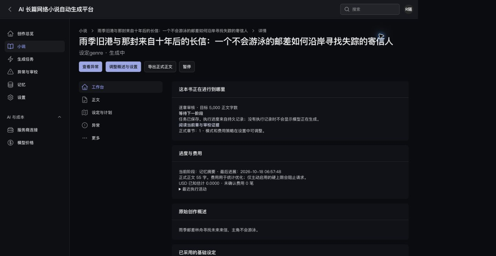

# XNR-035 全页面视觉与交互验收记录

日期：2026-10-18。执行者：Codex。状态：**DONE**。最后三类必需验收已修复复验关闭，当前结论见 [续办报告第 12 节](R05-followup-acceptance.md#12-剩余三类验收闭环2026-10-18)。以下矩阵与未测说明保留各轮历史事实，以最新续办记录为准。

> 本文原始矩阵保留为上一轮证据；2026-10-18 续办的修复、最终 96 次布局观测、恢复链及当前缺口以 [R05 续办记录](R05-followup-acceptance.md) 为准。

## 环境与证据边界

使用临时 Herd 站点 `xnovel-r05-review.test`，显式绑定 `xnovel_refactor_test`、合成账号、隔离会话/Redis 前缀、Fake Provider、Queue::fake、Http::preventStrayRequests。运行项目的 `.env`、账号、旧小说未修改。夹具为短文本合同验证，不是 R06 的三本真实作品。结束后已移除临时站点链接及临时目录。

实际浏览器：Chrome 155.0.8059.80；Safari 27.0.1（22625.1.29.11.28）。版本从本机 App 的 Info.plist 核实。Chrome 使用浏览器扩展控制，Safari 使用原生 UI；没有用第三方浏览器脚本冒充实测。

[DOM 宽度记录](assets/R05/browser-matrix.json) 包含 135 次观测（包括早期复验，不能当作 135 个不同页面）。已记录观测均无 document 横向溢出。截图保存在 [assets/R05](assets/R05/)；截图只证明当时可见区域，不代表屏幕外全部内容/状态通过。

## 页面覆盖

| DESIGN 页面 | 实际入口/状态 | 当前证据 | 仍缺什么 |
| --- | --- | --- | --- |
| P01 总览与列表 | `/x`、`/x/novels`，已有合成任务、长标题 | dashboard / novels 深浅 1440、390 | 全空/失败/长列表键盘路径 |
| P02 创建 | `/x/novels/create`，概述默认入口、折叠高级项 | create 深浅 1440、390、1024、768、320；创建行为沿用 R03 测试 | 最终版完整创建失败/重复提交浏览器复验 |
| P03 工作台 | `/x/novels/2`，待人工提交→正式提交→暂停→恢复 | workbench 各视口；manual-commit-result、resume-result | 未知费用/长异常文案全部组合；浅色导航收尾需刷新截图 |
| P04 阅读/目录/导出 | `/book-chapters/2`，草稿/正式、偏好/专注 | reader 各视口、reader-focus-dark；实际 TXT 下载 | 千章目录、长中文正文、200% 纯字体缩放和完整差异键盘链 |
| P05 设定与计划 | `/novels/2/planning`；人物/世界/伏笔列表 | planning、characters、world、foreshadowings 深浅 1440/390 | 所有修改/冲突状态及最新局部导航复验 |
| P06 异常与审校 | `/generation-issues`，本轮空列表/空详情 | issues 各视口；双路径业务与领域修复有 R02/R04 Livewire/浏览器证据 | 最终 R05 摘要/导出/收束异常的完整浏览器操作链 |
| P07 整书任务 | `/generation`，Task 列表 | generation 深浅 1440/390；Livewire 验证 | 全空/失败/禁用/过期观测的逐项键盘操作 |
| P08 状态/记忆/完结 | `/story-state`、`/memory`、`/ending-audit` | state / memory / ending 深浅 1440/390；完结短夹具 | 向量失败、有限补章、回滚影响弹窗及全部状态视觉 |
| P09 设置/连接/价格 | `/settings`、连接和价格列表 | settings / connections / prices 深浅 1440/390 | 多配置来源/长脱敏错误/权限撤销浏览器矩阵 |
| P10 登录/账号/系统反馈 | `/x/login`、管理员账号弹窗 | login-dark、account-light；账号弹窗未改凭据 | 登录浅色/失败、系统错误页、全键盘与焦点回归 |

1440×900 / 390×844 为主页面基线；关键四页为创建、工作台、阅读、异常，补 1024×768 / 768×1024 / 320×800。深色 18 个页面最终矩阵已重新记录。浅色矩阵早于最后一轮局部导航/文字颜色调整，不能作为这些最后修改的完整复验。

## 实际交互与修复

1. 待人工提交的合成小说显示明确确认弹窗；点击确认后显示 1 正式章、55 正文字数及记忆摘要阶段。暂停后变为“继续生成”，再继续恢复运行。Queue::fake 不消费后续模型任务，页面没有声称模型已实际开始写作。
2. 点击完结 TXT 下载链接，实际得到 `novel-1-25.txt`（215 字节）。核对含书名、具体章标题、两段正式正文，无审校 JSON 或草稿。HTTP/鉴权/冻结版本另由自动测试验证。
3. Chrome 专注阅读隐藏导航与技术信息，Escape 返回；管理员账号弹窗显示真实必填项与当前密码规则，取消后回到入口，没有修改账号信息。
4. Chrome 使用原生快捷键进行实际 200% 与 400% 页面缩放，浏览器工具栏分别显示对应比例，DOM 视口为 854 / 427，scrollWidth 相同；已恢复 100%。这不是“200% 纯字体缩放”的替代证据。
5. Safari 首次显示空白，重新加载后正式正文及控件正常出现；点击专注模式后只保留阅读内容与控制。仅这些操作有证据，不能宣称 Safari 全站兼容已通过。
6. 发现全局搜索中文辅助提示缺失、Filament 表面未使用项目 token、保存成功仍保留未保存提醒、目录搜索旧页码导致空结果等问题，已修复。后两项最终自动回归通过不替代缺失的浏览器复验。

代表截图：

## 续办后的当前缺口

本次补验已覆盖：最终深浅导航基线、长中文章/千章分页、摘要恢复、仅导出恢复、有限补章授权、AI 设定修复、人工稿冲突恢复、18 页基础 Tab 遍历、2302 个实际文字对比度样本及中文系统反馈页。发现的代码缺陷及复验见 [续办记录](R05-followup-acceptance.md)。不再把这些项目整体列为“未测”。

仍必须补验：Safari 全站关键操作与小屏；200% 纯字体放大；系统减少动态效果；DESIGN §10.2 尚未覆盖的状态组合以及弹窗/展开区完整键盘、焦点和颜色状态。Safari 原生连接启动失败；系统设置临时切换此前被自动审批拒绝。用户现已明确授权临时开启减少动态效果和字体放大，验收后恢复；授权不再是阻塞项，但连接仍不可用，尚未实际改变设置。

XNR-035 保留 IN_PROGRESS。最终页面布局、抽样对比度和基础键盘结果不能替代这些缺项，也不能据此关闭 XNR-034/026 或批准 R06。

再次续办中修复规划编辑器共享版本及输入覆盖问题，新增显式读取最新来源和确认放弃入口；Livewire 与持久结果回归通过，浏览器连接则返回原生启动失败、Chrome/iab 不可用。规划页先前截图不覆盖这些新增交互，需补深浅/小屏、冲突恢复及确认框键盘实测。详见 [续办记录第 7 节](R05-followup-acceptance.md#7-再次续办规划冲突修复与环境阻塞2026-10-18)。收到两项设置授权后已重置控制会话再查，仍无可用应用或浏览器；本轮未切换设置，见该报告第 8 节。

## 2026-10-18 字体与 Safari 续验更新

第 11 节续办已完成 Chrome 真正 32px 根字号/100% 页面缩放的 104 次布局观测，Safari 深浅与全部规定断点的 96 次基线，Safari 提交弹窗键盘确认与焦点返回、创建请求失败后保留输入重试、规划分卷/锁定、费用预警及健康未观测/过期/未知。修复字体布局、健康账本时间戳与费用预警实现，详见 [续办第 11 节](R05-followup-acceptance.md#11-纯字体safari-矩阵与费用预警续验2026-10-18)。旧“连接不可用/未执行字体”只描述当时，不再是当前阻塞。

状态仍为 IN_PROGRESS：剩余具体状态与完整键盘/颜色复验清单以该节末尾为准。最终整合 293 passed / 1 skipped / 2467 assertions 不替代这些浏览器缺项；不进入 R06。

## 最终关闭

R05 续办第 12 节完成失败/完成、过期审校、AI 禁用与失败状态；完成 Diff/人工编辑/配置弹窗键盘与焦点、横向表格及状态色复验。新修复 Livewire 4 失焦同步、保存/读取来源后的焦点返回、中文校验和浅色弹窗描述对比度。最后 20 组状态颜色共 959 个样本、49 次几何观测及双主题弹窗复验均有证据；不是每种浏览器组合的穷举。此前 Chrome 纯字体和 Safari 矩阵结果继续适用。整合回归 293 passed / 1 skipped / 2472 assertions，构建、Pint、diff 检查通过。没有真实模型请求或 R06 操作。
